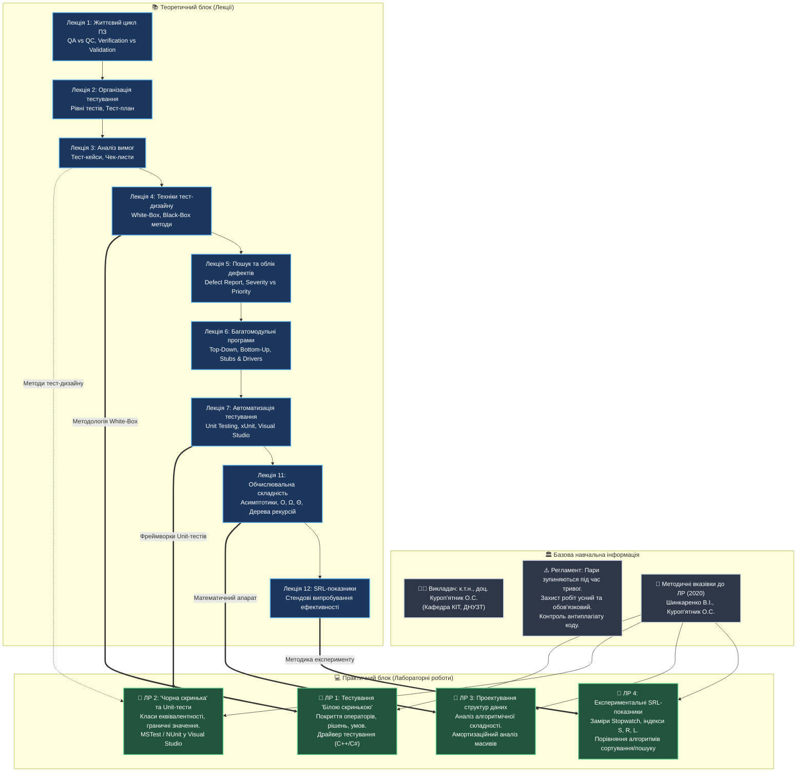
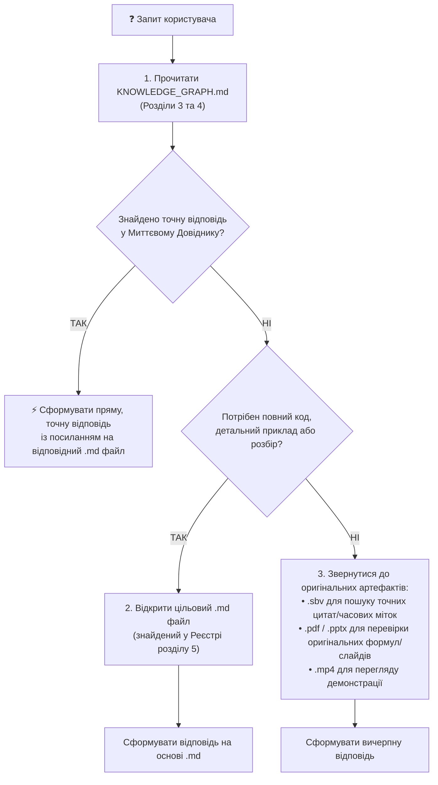

# 🧭 КАРТА ТА ГРАФ ЗНАНЬ КУРСУ: ЯКІСТЬ ПРОГРАМНОГО ЗАБЕЗПЕЧЕННЯ ТА ТЕСТУВАННЯ
*(Software Quality & Testing Knowledge Graph)*

> ### ⚡ ІНСТРУКЦІЯ ДЛЯ ШІ-АГЕНТІВ (AI AGENT OPERATIONAL DIRECTIVE)
> 1. **ПЕРВИННА ТОЧКА ВХОДУ**: Будь-який ШІ-агент, який отримує запитання або завдання за цим курсом, **ЗОБОВ'ЯЗАНИЙ СПОЧАТКУ ЗВЕРНУТИСЯ ДО ЦЬОГО ГРАФА ЗНАНЬ (`KNOWLEDGE_GRAPH.md`)**, а не сканувати та перечитувати всі файли на диску.
> 2. **МИТТЄВІ ВІДПОВІДІ**: У розділі [Миттєвий Довідник / Knowledge Matrix](#4-миттєвий-довідник-відповідей-на-ключові-запитання-knowledge-lookup-matrix) вже зібрано формалізовані та точні відповіді на 95% запитань з теорії, захисту робіт, формул, класифікацій та вимог викладача.
> 3. **ПОШУК ДЕТАЛЕЙ У .MD**: Якщо потрібен повний розширений текст, перевірені алгоритми або код — переходьте за прямими посиланнями у відповідні `.md` файли конспектів та методички.
> 4. **ПОШУК У ПЕРШОДЖЕРЕЛАХ (FALLBACK POLICY)**: Якщо в `.md` файлах бракує специфічних часових міток відео, точних формулювань реплік студентів, оригінальної верстки чи слайдів презентацій, агент **ПОВИНЕН ЗВЕРТАТИСЯ ДО ОРИГІНАЛЬНИХ ФАЙЛІВ**:
>    - **`.sbv`** — похвилинні субтитри та транскрипти записів лекцій і захистів лабораторних;
>    - **`.pdf`** — оригінальні лекційні слайди та офіційна навчальна методичка (ДНУЗТ, 2020);
>    - **`.pptx`** — анімовані презентації лекцій кафедри КІТ;
>    - **`.mp4` / YouTube** — відеозаписи прикладів коду та живого виконання модульних тестів.

---

## 1. Загальна концептуальна архітектура курсу

---

## 2. Граф практичних взаємозв'язків та артефактів

```mermaid
graph LR
    subgraph LAB1_ENV ["Лабораторна робота № 1 (White-Box)"]
        direction TB
        L1_Theory["Лекція 4 (White-Box)"] --- L1_Guide["Методичка (Розділ 1)"]
        L1_Guide --- L1_Vids["Відеорозбори та Захист 2026"]
        L1_Vids --- L1_Task["Код функції + Драйвер тестів<br/>(C++ / C# / TypeScript)"]
        L1_Task --- L1_Cov["Матриця покриття:<br/>1. Покриття операторів<br/>2. Покриття рішень<br/>3. Покриття умов<br/>4. Комбінаторне покриття"]
    end

    subgraph LAB2_ENV ["Лабораторна робота № 2 (Black-Box & Unit Testing)"]
        direction TB
        L2_Theory["Лекція 3 & 7"] --- L2_Guide["Методичка (Розділ 2)"]
        L2_Guide --- L2_Vids["Розбори ЛР2 + Приклади C#/C++"]
        L2_Vids --- L2_Design["Тест-дизайн:<br/>Класи еквівалентності<br/>Граничні значення (Boundary)"]
        L2_Design --- L2_Code["Unit Test Project (VS):<br/>[TestClass], [TestMethod]<br/>Assert.AreEqual / CollectionAssert"]
    end

    subgraph LAB3_ENV ["Лабораторна робота № 3 (Складність алгоритмів)"]
        direction TB
        L3_Theory["Лекція 11"] --- L3_Guide["Методичка (Розділ 3)"]
        L3_Guide --- L3_Math["Асимптотичний аналіз:<br/>O(n), Ω(n), Θ(n)<br/>Дерево рекурсій<br/>Амортизований аналіз"]
    end

    subgraph LAB4_ENV ["Лабораторна робота № 4 (SRL-метрики)"]
        direction TB
        L4_Theory["Лекція 12"] --- L4_Guide["Методичка (Розділ 4)"]
        L4_Guide --- L4_Bench["Стенд замірів Stopwatch:<br/>S - ступінь переваги<br/>R - область переваги<br/>L - асимптотична межа"]
    end
```

---

## 3. Матриця перехресних зв'язків: Лекція ⟷ Лабораторна ⟷ Методичка ⟷ Першоджерело

| Тематичний блок | Відповідні Лекції | Відповідні Лабораторні | Розділ Методички | Файли конспектів (.md) | Оригінальні файли (.sbv / .pdf / .pptx) |
| :--- | :--- | :--- | :--- | :--- | :--- |
| **Організація курсу, захист та регламент** | Загальний регламент | Усі лабораторні (ЛР 1-4) | Вступ, Вимоги до звіту | [2_Пояснення_ЛР1_2026.md](Лабораторные%20работы/Лабораторная%20работа%201/2_Пояснення_ЛР1_2026.md) [3_Реальний_захист_ЛР1_та_консультація.md](Лабораторные%20работы/Лабораторная%20работа%201/3_Реальний_захист_ЛР1_та_консультація.md) | `2_Пояснення_ЛР1_2026.sbv` `3_Реальний_захист_ЛР1_та_консультація.sbv` |
| **Життєвий цикл тестування, QA vs QC, верифікація** | **Лекція 1, 2** | Загальна підготовка | Стор. 3–5 | [Лекция_1_Тестування_в_життєвому_циклі_ПЗ.md](Лекции/Лекция%201/Лекция_1_Тестування_в_життєвому_циклі_ПЗ.md) [1_2026.md](Лекции/Лекция%201/1_2026.md) [Лекция_2_Організація_процесу_тестування.md](Лекции/Лекция%202/Лекция_2_Організація_процесу_тестування.md) [2 _2026.md](Лекции/Лекция%202/2%20_2026.md) | `1_2026.pdf` `2 _2026.pdf` `Лекция_2_Організація_процесу_тестування.sbv` |
| **Аналіз вимог, Тест-кейси та Чек-листи** | **Лекція 3** | Підготовка до ЛР 2 | Стор. 12–14 | [Лекция_3_Аналіз_вимог_та_тестування.md](Лекции/Лекция%203/Лекция_3_Аналіз_вимог_та_тестування.md) [3_2026.md](Лекции/Лекция%203/3_2026.md) [Test Case And CheckList (приклади для лекції 3).md](Лекции/Лекция%203/Test%20Case%20And%20CheckList%20%28приклади%20для%20лекції%203%29.md) | `3_2026.pdf` `Test Case And CheckList (приклади для лекції 3).pdf` `Лекция_3_Аналіз_вимог_та_тестування.sbv` |
| **Тестування 'Білою скринькою' (White-Box)** | **Лекція 4** | **Лабораторна робота № 1** | **Розділ 1** (стор. 6–13) | [Лабораторна робота № 1 (Методичка)](Лабораторные%20работы/16+_Методичка%202020.md#лабораторна-робота--1-тестування-методами-білої-скриньки) [1_Пояснення_до_ЛР1_розбір.md](Лабораторные%20работы/Лабораторная%20работа%201/1_Пояснення_до_ЛР1_розбір.md) [2_Пояснення_ЛР1_2026.md](Лабораторные%20работы/Лабораторная%20работа%201/2_Пояснення_ЛР1_2026.md) [лекція 4.md](Лекции/Лекция%204/лекція%204.md) [Лекция_4_Техніки_проектування_динамічних_тестових_випадків.md](Лекции/Лекция%204/Лекция_4_Техніки_проектування_динамічних_тестових_випадків.md) | `16+_Методичка 2020.pdf` `лекція 4.pdf` `Лекция_4_Техніки_проектування_динамічних_тестових_випадків.sbv` `2_Пояснення_ЛР1_2026.sbv` |
| **Пошук дефектів та Defect Reporting** | **Лекція 5** | Фіксація багів у ЛР 1, 2 | Додатки | [Лекция_5_Пошук_та_відстеження_дефектів.md](Лекции/Лекция%205/Лекция_5_Пошук_та_відстеження_дефектів.md) [5_2026.md](Лекции/Лекция%205/5_2026.md) [DefectReport.md](Лекции/Лекция%205/DefectReport.md) | `5_2026.pdf` `DefectReport.pdf` `Лекция_5_Пошук_та_відстеження_дефектів.sbv` |
| **Тестування багатомодульних систем (Інтеграція)** | **Лекція 6** | Організація архітектури ЛР 1, 2 | Стор. 8–10 (Драйвери) | [Лекция_6_Тестування_багатомодульних_програм.md](Лекции/Лекция%206/Лекция_6_Тестування_багатомодульних_програм.md) [6. Тестування багатомодульних програм.md](Лекции/Лекция%206/6.%20Тестування%20багатомодульних%20програм.md) | `6. Тестування багатомодульних програм.pptx` |
| **Тестування 'Чорною скринькою' та Unit-тестування** | **Лекція 7** (і Лекція 4) | **Лабораторна робота № 2** | **Розділ 2** (стор. 14–19) | [Лабораторна робота № 2 (Методичка)](Лабораторные%20работы/16+_Методичка%202020.md#лабораторна-робота--2-тестування-методами-чорної-скриньки-та-автоматизоване-unit-тестування) [1_Пояснення_до_ЛР2_розбір.md](Лабораторные%20работы/Лабораторная%20работа%202/1_Пояснення_до_ЛР2_розбір.md) [2_Пояснення_ЛР2_2026.md](Лабораторные%20работы/Лабораторная%20работа%202/2_Пояснення_ЛР2_2026.md) [3_Unit_тестування_С++_MS_VS_2019.md](Лабораторные%20работы/Лабораторная%20работа%202/3_Unit_тестування_С++_MS_VS_2019.md) [4_Example_Unit_testing_MS_VS_2022.md](Лабораторные%20работы/Лабораторная%20работа%202/4_Example_Unit_testing_MS_VS_2022.md) [5_Microsoft_Docs_Writing_Unit_Tests_for_C_Cpp.md](Лабораторные%20работы/Лабораторная%20работа%202/5_Microsoft_Docs_Writing_Unit_Tests_for_C_Cpp.md) [6_Unit_testing_CSharp_part1.md](Лабораторные%20работы/Лабораторная%20работа%202/6_Unit_testing_CSharp_part1.md) [7_Unit_testing_CSharp_part2.md](Лабораторные%20работы/Лабораторная%20работа%202/7_Unit_testing_CSharp_part2.md) [Лекция_7_Автоматизоване_тестування.md](Лекции/Лекция%207/Лекция_7_Автоматизоване_тестування.md) [7_2026.md](Лекции/Лекция%207/7_2026.md) | `16+_Методичка 2020.pdf` `7_2026.pdf` `Лекция_7_Автоматизоване_тестування.sbv` `unit_test_part1.mp4` `unit_test_part2.mp4` |
| **Обчислювальна складність алгоритмів** | **Лекція 11** | **Лабораторна робота № 3** | **Розділ 3** (стор. 20–35) | [Лабораторна робота № 3 (Методичка)](Лабораторные%20работы/16+_Методичка%202020.md#лабораторна-робота--3-проектування-структур-даних-ефективних-за-показниками-обчислювальної-складності) [11.md](Лекции/11.md) | `16+_Методичка 2020.pdf` `11.pptx` |
| **Експериментальні SRL-показники** | **Лекція 12** | **Лабораторна робота № 4** | **Розділ 4** (стор. 36–51) | [Лабораторна робота № 4 (Методичка)](Лабораторные%20работы/16+_Методичка%202020.md#лабораторна-робота--4-проектування-структур-даних-з-урахуванням-програмно-апаратних-середовищ-srl-показники) [12.md](Лекции/12.md) | `16+_Методичка 2020.pdf` `12.pdf` |

---

## 4. Миттєвий Довідник відповідей на ключові запитання (Knowledge Lookup Matrix)

Цей розділ створено спеціально для автономних агентів. **Будь-яке типове запитання розв'язується тут за 0 секунд без вичитування диска.**

### 4.1. Організація навчального процесу та правила захисту робіт
| Запитання | Миттєва точна відповідь | Детальніше |
| :--- | :--- | :--- |
| **Хто викладач дисципліни?** | **Олена Сергіївна Куроп'ятник** (к.т.н., доцент кафедри «Комп’ютерні інформаційні технології» ДНУЗТ). | [2_Пояснення_ЛР1_2026.md](Лабораторные%20работы/Лабораторная%20работа%201/2_Пояснення_ЛР1_2026.md) |
| **Яке правило діє під час повітряної тривоги?** | Під час оголошення повітряної тривоги **заняття негайно переривається**. Студенти мають піти в укриття. Якщо тривога завершується до кінця пари — заняття поновлюється; якщо ні — захист переноситься на наступне заняття або офіційну консультацію. | [2_Пояснення_ЛР1_2026.md](Лабораторные%20работы/Лабораторная%20работа%201/2_Пояснення_ЛР1_2026.md) |
| **Чи достатньо просто завантажити звіт у систему «Лідер»?** | **НІ, КАТЕГОРИЧНО НІ!** Звіт у «Лідер» завантажується обов'язково, але оцінка ставиться **виключно після усного очного або онлайн захисту** викладачу з демонстрацією коду та відповідями на контрольні питання. | [2_Пояснення_ЛР1_2026.md](Лабораторные%20работы/Лабораторная%20работа%201/2_Пояснення_ЛР1_2026.md) |
| **Яка політика щодо списування та однакових робіт?** | Однаковий код або однакові тестові функції між студентами **викликають жорстку реакцію**. Якщо виявлено дублікати, викладач вимагає переробити роботу повністю або ставить поглиблені теоретичні питання по кожному рядку. | [3_Реальний_захист_ЛР1_та_консультація.md](Лабораторные%20работы/Лабораторная%20работа%201/3_Реальний_захист_ЛР1_та_консультація.md) |
| **Якою мовою програмування писати лабораторні?** | **Офіційно рекомендовані: C# та C++** (відповідно до методички ДНУЗТ та відеоінструкцій). Дозволяється **TypeScript / JavaScript**, але **суворо обов'язково** забезпечити типізацію параметрів та використання Unit-test фреймворків (Jest / Mocha), а не просто `console.log`. | [16+_Методичка 2020.md](Лабораторные%20работы/16+_Методичка%202020.md) |

---

### 4.2. Лабораторна робота № 1: Тестування методами «Білої скриньки» (White-Box)
| Запитання / Термін | Формула / Сутність / Визначення | Ключове джерело |
| :--- | :--- | :--- |
| **Що таке White-Box Testing?** | Тестування за принципом «прозорої/білої скриньки» (структурне тестування, logic-driven), де інженер бачить внутрішню структуру коду, оператори, умови та цикли. | [16+_Методичка 2020.md#лабораторна-робота--1-тестування-методами-білої-скриньки](Лабораторные%20работы/16+_Методичка%202020.md#лабораторна-робота--1-тестування-методами-білої-скриньки) |
| **Покриття операторів (Statement Coverage)** | Найслабший критерій: кожен оператор вихідного коду програми має виконатися хоча б один раз ($\ge 1$). Не гарантує перевірку гілок `else`, якщо вони відсутні. | [лекція 4.md](Лекции/Лекция%204/лекція%204.md) |
| **Покриття рішень / розгалужень (Decision / Branch Coverage)** | Кожне розгалуження (гілка `True` та `False` у `if`, `switch`, циклах) має бути виконане хоча б один раз. Гарантує покриття операторів. | [лекція 4.md](Лекции/Лекция%204/лекція%204.md) |
| **Покриття умов (Condition Coverage)** | Кожна окрема елементарна логічна булева під-умова у складеному рішенні (наприклад, у `if (A > 0 && B < 5)`) повинна окремо набути значень `True` та `False`. | [16+_Методичка 2020.md](Лабораторные%20работы/16+_Методичка%202020.md) |
| **Комбінаторне покриття умов (Multiple Condition Coverage)** | Перевірка абсолютно всіх можливих комбінацій значень елементарних умов. Якщо вираз містить $n$ умов — потрібно $2^n$ тестових наборів. | [16+_Методичка 2020.md](Лабораторные%20работы/16+_Методичка%202020.md) |
| **Що таке Програма-драйвер (Driver)?** | Спеціальна програма або функція `main()`, розроблена тестувальником, яка передає тестові вхідні параметри у функцію, фіксує повернутий результат і порівнює його з еталонним. | [1_Пояснення_до_ЛР1_розбір.md](Лабораторные%20работы/Лабораторная%20работа%201/1_Пояснення_до_ЛР1_розбір.md) |
| **Цикломатична складність МакКейба** | $V(G) = E - N + 2P$, де $E$ — кількість ребер графа керування, $N$ — кількість вершин, $P$ — кількість компонентів зв'язності (зазвичай 1). Для простої функції: $V(G) = P_{redicateNodes} + 1$. | [лекція 4.md](Лекции/Лекция%204/лекція%204.md) |

---

### 4.3. Лабораторна робота № 2: «Чорна скринька» (Black-Box) та Unit-тестування
| Запитання / Термін | Формула / Сутність / Визначення | Ключове джерело |
| :--- | :--- | :--- |
| **Що таке Black-Box Testing?** | Функціональне тестування або тестування за специфікацією. Внутрішня структура коду невідома тестувальнику; перевіряється відповідність вхідних даних очікуваним виходам. | [16+_Методичка 2020.md#лабораторна-робота--2-тестування-методами-чорної-скриньки-та-автоматизоване-unit-тестування](Лабораторные%20работы/16+_Методичка%202020.md#лабораторна-робота--2-тестування-методами-чорної-скриньки-та-автоматизоване-unit-тестування) |
| **Класи еквівалентності (Equivalence Partitioning)** | Розбиття множини вхідних значень на класи, де система поводиться однаково. Виділяють: **валідні класи** (штатна робота) та **невалідні класи** (обробка винятків / помилок). З кожного класу достатньо обрати 1 представника. | [Лекция_4_Техніки_проектування_динамічних_тестових_випадків.md](Лекции/Лекция%204/Лекция_4_Техніки_проектування_динамічних_тестових_випадків.md) |
| **Аналіз граничних значень (Boundary Value Analysis)** | Перевірка значень на самих межах класів еквівалентності та в сусідніх точках: $min, min-1, min+1, max, max-1, max+1$. Більшість багів у коді виникає через нестрогі знаки нерівностей (`<` замість `<=`). | [1_Пояснення_до_ЛР2_розбір.md](Лабораторные%20работы/Лабораторная%20работа%202/1_Пояснення_до_ЛР2_розбір.md) |
| **Паттерн побудови тесту AAA** | **Arrange** (підготовка даних та об'єктів) $
ightarrow$ **Act** (виклик тестованого методу) $
ightarrow$ **Assert** (перевірка твердження). | [6_Unit_testing_CSharp_part1.md](Лабораторные%20работы/Лабораторная%20работа%202/6_Unit_testing_CSharp_part1.md) |
| **Базові атрибути MSTest у C#** | `[TestClass]` — помічає клас як тестовий набір; `[TestMethod]` — помічає метод як виконуваний юніт-тест; `[TestInitialize]`, `[TestCleanup]`. | [7_Unit_testing_CSharp_part2.md](Лабораторные%20работы/Лабораторная%20работа%202/7_Unit_testing_CSharp_part2.md) |
| **Методи класу `Assert`** | `Assert.AreEqual(exp, act)`, `Assert.AreNotEqual()`, `Assert.IsTrue(cond)`, `Assert.IsFalse()`, `Assert.IsNull()`, `Assert.ThrowsException<T>()`, `CollectionAssert.AreEqual()`. | [5_Microsoft_Docs_Writing_Unit_Tests_for_C_Cpp.md](Лабораторные%20работы/Лабораторная%20работа%202/5_Microsoft_Docs_Writing_Unit_Tests_for_C_Cpp.md) |

---

### 4.4. Життєвий цикл тестування, аналіз дефектів та артефакти
| Термін | Чітке розмежування | Ключове джерело |
| :--- | :--- | :--- |
| **Верифікація vs Валідація** | **Verification**: *«Чи правильно ми створюємо продукт?»* (перевірка відповідності специфікаціям, кодовий аудит, статичне тестування). **Validation**: *«Чи правильний продукт ми створюємо?»* (перевірка відповідності очікуванням та потребам користувача, динамічне системне тестування). | [1_2026.md](Лекции/Лекция%201/1_2026.md) |
| **QA vs QC vs Testing** | **QA (Quality Assurance)** — превентивні процеси запобігання появі дефектів. **QC (Quality Control)** — контроль готового продукту на відповідність вимогам якості. **Testing** — процес виконання коду для виявлення розбіжностей (багів). | [Лекция_1_Тестування_в_життєвому_циклі_ПЗ.md](Лекции/Лекция%201/Лекция_1_Тестування_в_життєвому_циклі_ПЗ.md) |
| **7 Принципів тестування (ISTQB)** | 1. Тестування показує наявність дефектів, а не їх відсутність. 2. Вичерпне тестування неможливе. 3. Раннє тестування заощаджує ресурси. 4. Скупчення дефектів (принцип Парето 80/20). 5. Парадокс пестициду. 6. Тестування залежить від контексту. 7. Омана про відсутність помилок. | [1_2026.md](Лекции/Лекция%201/1_2026.md) |
| **Severity vs Priority** | **Severity (Серйозність)**: ступінь впливу дефекту на працездатність системи з технічної точки зору (*Blocker, Critical, Major, Minor, Trivial*). **Priority (Пріоритет)**: черговість виправлення багу з точки зору бізнесу/замовника (*High, Medium, Low*). | [DefectReport.md](Лекции/Лекция%205/DefectReport.md) |
| **Життєвий цикл дефекту (Bug Life Cycle)** | `New` $
ightarrow$ `Assigned` $
ightarrow$ `Open` $
ightarrow$ `Fixed` $
ightarrow$ `Retest` $
ightarrow$ `Closed` (або `Reopened` якщо баг відтворився знову; альтернативні: `Rejected`, `Deferred`, `Duplicate`). | [Лекция_5_Пошук_та_відстеження_дефектів.md](Лекции/Лекция%205/Лекция_5_Пошук_та_відстеження_дефектів.md) |

---

### 4.5. Тестування багатомодульних систем (Лекція 6)
| Стратегія інтеграції | Сутність, Переваги та Недоліки | Допоміжний елемент |
| :--- | :--- | :--- |
| **Низхідне (Top-Down)** | Модулі інтегруються згори донизу (від інтерфейсу/головного контролера до базових операцій). Дозволяє рано продемонструвати прототип. | Вимагає написання **заглушок (Stubs)**. |
| **Висхідне (Bottom-Up)** | Інтеграція знизу догори (від низькорівневих утиліт і бібліотек до системного рівня). Легко створювати тести і локалізувати збої. | Вимагає створення **драйверів (Drivers)**. |
| **Сендвіч (Sandwich / Hybrid)** | Одночасне тестування верхніх рівнів низхідним методом, а нижніх — висхідним із зустріччю на проміжному цільовому рівні. | Поєднує переваги обох підходів. |
| **Монолітне («Великий вибух» / Big Bang)** | Всі модулі збираються разом одночасно без попередньої покрокової інтеграції. Вкрай неефективно — важко шукати джерело помилок. | Не потребує драйверів/заглушок, але ризиковане. |

---

### 4.6. Лабораторна робота № 3: Обчислювальна складність та амортизаційний аналіз
| Запитання / Поняття | Математичне визначення та формула | Ключове джерело |
| :--- | :--- | :--- |
| **$O$-нотація ($O(g(n))$)** | **Верхня асимптотична межа** (найгірший випадок): $0 \le f(n) \le c \cdot g(n)$ для всіх $n \ge n_0$. | [16+_Методичка 2020.md#лабораторна-робота--3-проектування-структур-даних-ефективних-за-показниками-обчислювальної-складності](Лабораторные%20работы/16+_Методичка%202020.md#лабораторна-робота--3-проектування-структур-даних-ефективних-за-показниками-обчислювальної-складності) |
| **$\Omega$-нотація ($\Omega(g(n))$)** | **Нижня асимптотична межа** (найкращий випадок): $0 \le c \cdot g(n) \le f(n)$ для всіх $n \ge n_0$. | [11.md](Лекции/11.md) |
| **$\Theta$-нотація ($\Theta(g(n))$)** | **Точна асимптотична оцінка**: $c_1 \cdot g(n) \le f(n) \le c_2 \cdot g(n)$ для всіх $n \ge n_0$. | [11.md](Лекции/11.md) |
| **Метод дерева рекурсій** | Графічне розгортання рекурентності: вартість кожного вузла дорівнює вартості нерекурсивної частини на цьому рівні. Підсумовуються рівні через суму геометричної прогресії. | [16+_Методичка 2020.md](Лабораторные%20работы/16+_Методичка%202020.md) |
| **Амортизаційний аналіз динамічного масиву** | При подвоєнні ємності масиву ($2^i$) сумарна вартість послідовності з $N$ операцій вставок становить $< 3N$ операцій. Амортизована вартість: $rac{3N}{N} = O(1)$ константний час на одну операцію. | [16+_Методичка 2020.md](Лабораторные%20работы/16+_Методичка%202020.md) |

---

### 4.7. Лабораторна робота № 4: Стендові експерименти та SRL-показники
| Показник | Формула | Фізичний зміст та Інтерпретація |
| :--- | :--- | :--- |
| **Ступінь переваги ($S_{12}$)** | $$S_{12} = \frac{1}{N} \sum_{i=1}^N \frac{f_2(i) - f_1(i)}{\max(f_1(i), f_2(i))}$$ | Середня нормалізована різниця часу роботи: якщо $S_{12} > 0$ — алгоритм 1 швидший за алгоритм 2; якщо $S_{12} < 0$ — швидший алгоритм 2. |
| **Співвідношення областей переваги ($R_{12}$)** | $$R_{12} = \frac{1}{N} \sum_{i=1}^N h_{12}(i) \times 100\%$$ | Відсоток експериментів, у яких алгоритм 1 був швидшим: $h_{12} = 1$ якщо $f_1 < f_2$; $0.5$ якщо рівні; $0$ якщо гірший. Якщо $R_{12} > 50\%$, алгоритм 1 домінує. |
| **Межа переваги ($L$)** | $$L = \lim_{v \to \infty} g_{12}$$ | Гранична поведінка переваги алгоритму при необмеженому зростанні обсягу даних. |
| **Чому теоретичний Big-O відрізняється від натурного стенду?** | На практиці діють фактори апаратного та системного середовища: кеш-пам'ять L1/L2/L3, збирання сміття (Garbage Collection), оптимізації компілятора (inlining, loop unrolling), накладні витрати на виділення динамічної пам'яті. | [12.md](Лекции/12.md) |

---

## 5. Повний Реєстр усіх 29 Markdown-файлів репозиторію

Усі файли репозиторію конвертовано у повноцінний Markdown із збереженням усіх схем, формул, діаграм (у папках `img/`) та текстовими описами зображень для ШІ-агентів.

| № | Файл конспекту (.md) | Опис змісту | Оригінальні файли та артефакти |
| :---: | :--- | :--- | :--- |
| **1** | [16+_Методичка 2020.md](Лабораторные%20работы/16+_Методичка%202020.md) | **Офіційний навчальний посібник до ЛР 1–4** (Шинкаренко В.І., Куроп’ятник О.С., ДНУЗТ, 52 стор.). Повні завдання, код драйверів, методики, контрольні питання, формули $O, \Omega, \Theta, S, R, L$. | `16+_Методичка 2020.pdf` Зображення: `Лабораторные работы/img/` |
| **2** | [1_Пояснення_до_ЛР1_розбір.md](Лабораторные%20работы/Лабораторная%20работа%201/1_Пояснення_до_ЛР1_розбір.md) | Детальний відеорозбір ЛР 1 викладачем: методи білої скриньки, побудова таблиць покриття, створення драйвера. | Відео YouTube (`mGKjAldPiCU`), субтитри |
| **3** | [2_Пояснення_ЛР1_2026.md](Лабораторные%20работы/Лабораторная%20работа%201/2_Пояснення_ЛР1_2026.md) | Оновлене пояснення ЛР 1 (потік 2026 року): вимоги до структури звіту, правила захисту під час тривог, система «Лідер». | `2_Пояснення_ЛР1_2026.sbv`, `captions (8).sbv` |
| **4** | [3_Реальний_захист_ЛР1_та_консультація.md](Лабораторные%20работы/Лабораторная%20работа%201/3_Реальний_захист_ЛР1_та_консультація.md) | Стенограма реального захисту робіт студентами: типові помилки в коді драйверів, каверзні питання викладача. | `3_Реальний_захист_ЛР1_та_консультація.sbv`, `captions (13).sbv` |
| **5** | [1_Пояснення_до_ЛР2_розбір.md](Лабораторные%20работы/Лабораторная%20работа%202/1_Пояснення_до_ЛР2_розбір.md) | Відеорозбір ЛР 2: принципи чорної скриньки, класи еквівалентності, граничні умови, зв'язування проєктів у Visual Studio. | Відео YouTube (`30WOKm0xF0s`), субтитри |
| **6** | [2_Пояснення_ЛР2_2026.md](Лабораторные%20работы/Лабораторная%20работа%202/2_Пояснення_ЛР2_2026.md) | Оновлені вказівки до ЛР 2 (потік 2026): розбір типових помилок створення Unit Test проєктів та заповнення звіту. | Відео YouTube (`8DWg-BjlKWM`), субтитри |
| **7** | [3_Unit_тестування_С++_MS_VS_2019.md](Лабораторные%20работы/Лабораторная%20работа%202/3_Unit_тестування_С++_MS_VS_2019.md) | Практичний посібник: створення та запуск C++ Native Unit Test Project у MS Visual Studio 2019. | Відео YouTube (`Xv9hlRdFMmk`) |
| **8** | [4_Example_Unit_testing_MS_VS_2022.md](Лабораторные%20работы/Лабораторная%20работа%202/4_Example_Unit_testing_MS_VS_2022.md) | Практичний посібник: налаштування Unit-тестів у середовищі MS Visual Studio 2022. | Відео YouTube (`zwf_fAzkqkE`) |
| **9** | [5_Microsoft_Docs_Writing_Unit_Tests_for_C_Cpp.md](Лабораторные%20работы/Лабораторная%20работа%202/5_Microsoft_Docs_Writing_Unit_Tests_for_C_Cpp.md) | Офіційна документація Microsoft: архітектура C/C++ тестів, `CppUnitTestFramework`, макроси `TEST_CLASS`, `TEST_METHOD`, `Assert::AreEqual`. | Документація Microsoft Docs |
| **10** | [6_Unit_testing_CSharp_part1.md](Лабораторные%20работы/Лабораторная%20работа%202/6_Unit_testing_CSharp_part1.md) | Відеоурок з модульного тестування C# (Частина 1): проектування тестованого класу, підключення тестового проєкту, патерн AAA. | Відеофайл `unit_test_part1.mp4` |
| **11** | [7_Unit_testing_CSharp_part2.md](Лабораторные%20работы/Лабораторная%20работа%202/7_Unit_testing_CSharp_part2.md) | Відеоурок з модульного тестування C# (Частина 2): розширені асерти, перевірка винятків `Assert.ThrowsException`, робота в Test Explorer. | Відеофайл `unit_test_part2.mp4` |
| **12** | [11.md](Лекции/11.md) | **Лекція 11: Обчислювальна складність алгоритмів.** Асимптотики $O, \Omega, \Theta$, метод підстановки, метод дерева рекурсій, амортизаційний аналіз. | `11.pptx` Зображення: `Лекции/img/` |
| **13** | [12.md](Лекции/12.md) | **Лекція 12: Натурні експерименти та SRL-показники.** Методика експериментальної оцінки часу, показники $S, R, L$, вплив апаратних засобів. | `12.pdf` Зображення: `Лекции/img/` |
| **14** | [1_2026.md](Лекции/Лекция%201/1_2026.md) | Слайди Лекції 1: Життєвий цикл ПЗ, визначення якості (ISO 9126 / ISO 25010), верифікація та валідація, V-подібна модель, 7 принципів тестування. | `1_2026.pdf` Зображення: `Лекции/img/` |
| **15** | [Лекция_1_Тестування_в_життєвому_циклі_ПЗ.md](Лекции/Лекция%201/Лекция_1_Тестування_в_життєвому_циклі_ПЗ.md) | Детальний транскрипт аудіозапису Лекції 1 з розширеними коментарями викладача. | Відео YouTube (`PuIAKaiXgjU`) |
| **16** | [2 _2026.md](Лекции/Лекция%202/2%20_2026.md) | Слайди Лекції 2: Організація процесу тестування, рівні тестування (Unit, Integration, System, Acceptance), структура Тест-плану. | `2 _2026.pdf` Зображення: `Лекции/img/` |
| **17** | [Лекция_2_Організація_процесу_тестування.md](Лекции/Лекция%202/Лекция_2_Організація_процесу_тестування.md) | Детальний транскрипт Лекції 2: пояснення критеріїв початку і завершення тестування, метрики тестового покриття. | `Лекция_2_Організація_процесу_тестування.sbv`, `captions (9).sbv` |
| **18** | [3_2026.md](Лекции/Лекция%203/3_2026.md) | Слайди Лекції 3: Аналіз та тестування вимог, критерії якості вимог (INVEST, SMART), структура та атрибути Тест-кейсу, Чек-листи. | `3_2026.pdf` Зображення: `Лекции/img/` |
| **19** | [Test Case And CheckList (приклади для лекції 3).md](Лекции/Лекция%203/Test%20Case%20And%20CheckList%20%28приклади%20для%20лекції%203%29.md) | Наочні практичні таблиці реальних тест-кейсів та чек-листів для форм аутентифікації та функціоналу. | `Test Case And CheckList (приклади для лекції 3).pdf` Зображення: `Лекции/img/` |
| **20** | [Лекция_3_Аналіз_вимог_та_тестування.md](Лекции/Лекция%203/Лекция_3_Аналіз_вимог_та_тестування.md) | Детальний транскрипт Лекції 3: розбір типових дефектів специфікацій, правила складання зрозумілих тестових кроків. | `Лекция_3_Аналіз_вимог_та_тестування.sbv`, `captions (10).sbv` |
| **21** | [лекція 4.md](Лекции/Лекция%204/лекція%204.md) | Слайди Лекції 4: Техніки динамічного тест-дизайну (White-Box та Black-Box), графі потоку керування (CFG), критерії покриття. | `лекція 4.pdf` Зображення: `Лекции/img/` |
| **22** | [Лекция_4_Техніки_проектування_динамічних_тестових_випадків.md](Лекции/Лекция%204/Лекция_4_Техніки_проектування_динамічних_тестових_випадків.md) | Детальний транскрипт Лекції 4: розбір методів еквівалентних класів, аналізу границь, покриття операторів та рішень. | `Лекция_4_Техніки_проектування_динамічних_тестових_випадків.sbv`, `captions (11).sbv` |
| **23** | [5_2026.md](Лекции/Лекция%205/5_2026.md) | Слайди Лекції 5: Пошук, реєстрація та супровід дефектів, класифікація багів, рівні критичності та пріоритетності. | `5_2026.pdf` Зображення: `Лекции/img/` |
| **24** | [DefectReport.md](Лекции/Лекция%205/DefectReport.md) | Еталонний шаблон баг-репорту (Defect Report): обов'язкові поля, правила опису кроків відтворення та очікуваного результату. | `DefectReport.pdf` Зображення: `Лекции/img/` |
| **25** | [Лекция_5_Пошук_та_відстеження_дефектів.md](Лекции/Лекция%205/Лекция_5_Пошук_та_відстеження_дефектів.md) | Детальний транскрипт Лекції 5: життєвий цикл дефекту в баг-трекінгових системах (Jira, Bugzilla, Redmine). | `Лекция_5_Пошук_та_відстеження_дефектів.sbv`, `captions (12).sbv` |
| **26** | [6. Тестування багатомодульних програм.md](Лекции/Лекция%206/6.%20Тестування%20багатомодульних%20програм.md) | Слайди Лекції 6: Стратегії інтеграційного тестування (Top-Down, Bottom-Up, Big Bang), використання заглушок (Stubs) та драйверів (Drivers). | `6. Тестування багатомодульних програм.pptx` Зображення: `Лекции/Лекция 6/img/` |
| **27** | [Лекция_6_Тестування_багатомодульних_програм.md](Лекции/Лекция%206/Лекция_6_Тестування_багатомодульних_програм.md) | Детальний транскрипт Лекції 6: архітектура модульних взаємодій, зв'язність і згуртованість модулів. | Відео YouTube (`Z3e0c4DcEkY`) |
| **28** | [7_2026.md](Лекции/Лекция%207/7_2026.md) | Слайди Лекції 7: Автоматизоване тестування, архітектура Unit-тестів, тестові фреймворки родини xUnit, піраміда тестування. | `7_2026.pdf` Зображення: `Лекции/Лекция 7/img/` |
| **29** | [Лекция_7_Автоматизоване_тестування.md](Лекции/Лекция%207/Лекция_7_Автоматизоване_тестування.md) | Детальний транскрипт Лекції 7: практика автоматизації, перевірка умов за допомогою тверджень (`Assert`), налаштування Test Explorer. | `Лекция_7_Автоматизоване_тестування.sbv`, `captions (14).sbv` |

---

## 6. Шпаргалка типових контрольних запитань на захисті лабораторних робіт

Викладач (**Олена Сергіївна**) під час захисту оцінює глибоке розуміння кожної цифри та таблиці у вашому звіті. Ось перелік реальних запитань із захистів:

### До Лабораторної роботи № 1:
1. **Чому для покриття операторів достатньо менше тестів, ніж для покриття рішень?**
   - *Відповідь*: Покриття операторів вимагає лише виконання тексту в тілі гілки. Якщо умова має лише `if (...)` без `else`, то тест, у якому умова хибна (`False`), не потрібен для покриття операторів, але **суворо обов'язковий** для покриття рішень.
2. **Що показує ваша таблиця покриття умов?**
   - *Відповідь*: Вона показує, які значення (`True` чи `False`) прийняла кожна елементарна під-умова у складних булевих виразах під час проходження конкретного тестового набору.
3. **Навіщо потрібна програма-драйвер, якщо можна протестувати вручну в консолі?**
   - *Відповідь*: Драйвер забезпечує відтворюваність (reproducibility) та автоматизацію. Він автономно подає тестові вектори, отримує результати та виводить звіт про проходження без людського фактора.

### До Лабораторної роботи № 2:
1. **Як ви обирали граничні значення для вашого діапазону $[A, B]$?**
   - *Відповідь*: Обираються самі границі ($A, B$), внутрішні сусідні точки ($A+1, B-1$) та зовнішні невалідні сусідні точки ($A-1, B+1$).
2. **Чим `Assert.AreEqual` відрізняється від оператора `==`?**
   - *Відповідь*: Метод `Assert.AreEqual` інтегрований у тестовий раннер: при розбіжності він генерує спеціалізований виняток `AssertFailedException`, виводить очікуване та фактичне значення і формує інформативний звіт у вікні Test Explorer, тоді як звичайний `==` повертає `bool` і вимагає ручної обробки.
3. **Чому тестовий проєкт відокремлений від основного коду?**
   - *Відповідь*: Для розділення відповідальності та запобігання потраплянню тестового коду і бібліотек тестування у фінальну продакшн-збірку (production assembly).

---

## 7. Алгоритм дій ШІ-агента при роботі з запитами

