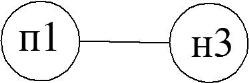
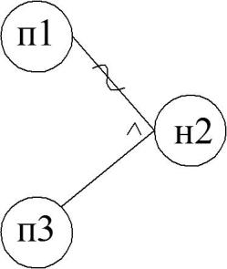
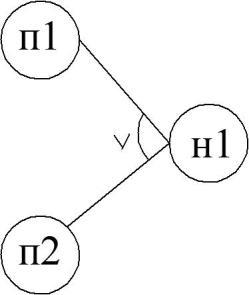
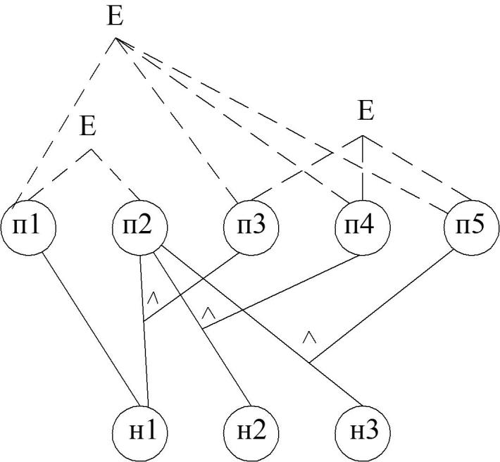
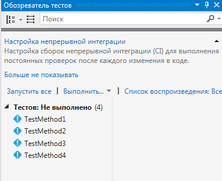
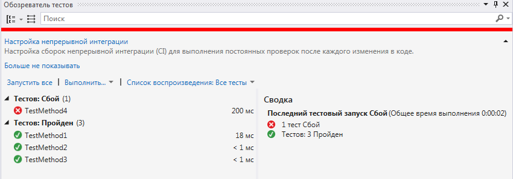
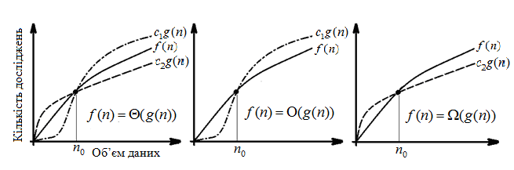

# Якість програмного забезпечення та тестування: Методичні вказівки до виконання лабораторних робіт

**Міністерство освіти і науки України**  
**Дніпропетровський національний університет залізничного транспорту імені академіка В. Лазаряна (ДНУЗТ)**  
**Кафедра «Комп’ютерні інформаційні технології»**  


> **Детальний опис зображення для ШІ-агентів:**  
> Офіційний герб / емблема Дніпропетровського національного університету залізничного транспорту імені академіка В. Лазаряна (ДНУЗТ), що містить академічні та залізничні символи, герб України та назву університету.

---

### Вихідні дані видання:
- **УДК:** 004.05
- **Укладачі:**
  - д.т.н., проф. Шинкаренко Віктор Іванович
  - к.т.н., доц. (на момент видання ас.) Куроп’ятник Олена Сергіївна
  - ас. Забула Геннадій Володимирович
  - ас. Пєтін Дмитро Олегович
  - асп. Лукін Єлисей Віталійович
- **Рецензенти:**
  - к.т.н., доц. Андрющенко В. О. (ДНУЗТ)
  - к.ф.-м.н., доц. Зайцев В. Г. (ДНУ імені Олеся Гончара)
- **Рік видання:** 2020

---

# НАВЧАЛЬНИЙ ЗМІСТ ЛАБОРАТОРНОГО ПРАКТИКУМУ

- [Лабораторна робота № 1. Тестування методами білої скриньки](#лабораторна-робота--1-тестування-методами-білої-скриньки)
- [Лабораторна робота № 2. Тестування методами чорної скриньки та автоматизоване Unit-тестування](#лабораторна-робота--2-тестування-методами-чорної-скриньки-та-автоматизоване-unit-тестування)
- [Лабораторна робота № 3. Проектування структур даних, ефективних за показниками обчислювальної складності](#лабораторна-робота--3-проектування-структур-даних-ефективних-за-показниками-обчислювальної-складності)
- [Лабораторна робота № 4. Проектування структур даних з урахуванням програмно-апаратних середовищ (SRL-показники)](#лабораторна-робота--4-проектування-структур-даних-з-урахуванням-програмно-апаратних-середовищ-srl-показники)
- [Список використаної літератури](#список-використаної-літератури)

---

# ЛАБОРАТОРНА РОБОТА № 1. Тестування методами білої скриньки

## 1. Мета та завдання роботи
**Мета роботи:** Отримати практичні навички проектування та виконання тестів методами «білої скриньки» (White-Box Testing).

**Зміст роботи:**
1. Ознайомитися з теоретичними засадами методів тестування програмного забезпечення.
2. Виявити переваги та недоліки методів тестування білою скринькою.
3. Підготувати тестований фрагмент програми або функцію відповідно до індивідуального завдання.
4. Розробити набори тестів за методами:
   - покриття операторів (Statement Coverage);
   - покриття рішень (Decision / Branch Coverage);
   - покриття умов (Condition Coverage);
   - комбінаторне покриття умов (Multiple Condition Coverage).
5. Створити програму-драйвер для запуску тестів та фіксації результатів.
6. Провести аналіз повноти тестування, сформулювати висновки та оформити звіт.

**Вимоги до змісту звіту:**
1. Титульна сторінка, назва дисципліни, номер роботи, ПІБ студента, група, варіант.
2. Постановка індивідуального завдання та текст тестованої функції мовою C/C++ або C#.
3. Таблиці тестів для кожного з методів покриття (оператори, рішення, умови, комбінації).
4. Текст розробленої програми-драйвера.
5. Протокол виконання тестів (скриншоти консолі / вікна виводу).
6. Аналіз повноти тестування та відповіді на контрольні запитання.

---

## 2. Теоретичні відомості

Тестування білою скринькою базується на знанні внутрішньої логіки та вихідного тексту програми. Його також називають тестуванням, що керується логікою програми (Logic-Driven Testing).

### Основні критерії покриття:
1. **Критерій покриття операторів (Statement Coverage):**  
   Кожен оператор програми повинен виконатися хоча б один раз.
2. **Критерій покриття рішень (Decision / Branch Coverage):**  
   Кожне розгалуження в керуючих структурах (`if`, `switch`, цикли) повинно прийняти значення `True` і `False` хоча б один раз.
3. **Критерій покриття умов (Condition Coverage):**  
   Кожна елементарна логічна під-умова у складеному рішенні повинна набути значення `True` і `False`.
4. **Комбінаторне покриття умов (Multiple Condition Coverage):**  
   Перевіряються абсолютно всі можливі комбінації істинності під-умов ($2^n$ наборів).

### Драйвери та заглушки:
- **Драйвер (Driver):** допоміжний програмний модуль верхнього рівня, який викликає тестовану функцію, передає їй тестові вхідні параметри та друкує отриманий результат.
- **Заглушка (Stub):** допоміжний модуль, що імітує поведінку викликаного підлеглого модуля.

---

## 3. Приклад проектування тестів та програми-драйвера

### Тестована функція визначення максимального числа:
```cpp
int NumberMax(int a, int b) {
    if (a > b)         // Оператор 1
        return 1;      // Оператор 2
    else 
        if (b > a)     // Оператор 3
            return 2;  // Оператор 4
    return 0;          // Оператор 5
}
```

### Тести та матриця покриття операторів:
- **Т1:** $a = 0, b = 0 
ightarrow$ результат $0$ (виконуються оп. 1, 3, 5).
- **Т2:** $a = 1, b = 0 
ightarrow$ результат $1$ (виконуються оп. 1, 2).
- **Т3:** $a = 1, b = 5 
ightarrow$ результат $2$ (виконуються оп. 1, 3, 4).

| № тесту | Вхідні дані ($a, b$) | Очікуваний результат | Оператор 1 | Оператор 2 | Оператор 3 | Оператор 4 | Оператор 5 |
| :---: | :---: | :---: | :---: | :---: | :---: | :---: | :---: |
| **Т1** | $a=0, b=0$ | $0$ | * | | * | | * |
| **Т2** | $a=1, b=0$ | $1$ | * | * | | | |
| **Т3** | $a=1, b=5$ | $2$ | * | | * | * | |

---

## 4. Контрольні запитання до ЛР № 1:
1. Що таке тестування за методом «білої скриньки»? Які його сильні та слабкі сторони?
2. У чому полягає відмінність між критерієм покриття операторів та покриттям рішень?
3. Чому 100% покриття операторів не гарантує відсутності логічних помилок у програмі?
4. Що таке комбінаторне покриття умов і чому його важко досягти для складних логічних виразів?
5. Яке призначення має тестовий драйвер і яку структуру він повинен мати?

---

# ЛАБОРАТОРНА РОБОТА № 2. Тестування методами чорної скриньки та автоматизоване Unit-тестування

## 1. Мета та завдання роботи
**Мета роботи:** Отримати практичні навички проектування тестів методами «чорної скриньки» (Black-Box Testing) та опанувати засоби автоматизованого модульного тестування (Unit Testing) у середовищі Microsoft Visual Studio.

**Зміст роботи:**
1. Ознайомитися з методами тестування чорною скринькою:
   - Розбиття на класи еквівалентності (Equivalence Partitioning);
   - Аналіз граничних значень (Boundary Value Analysis);
   - Метод функціональних діаграм (причинно-наслідковий аналіз);
   - Тестування переходів за станами (State Transition Testing).
2. За індивідуальним завданням розробити бібліотеку класів/функцій мовою C# або C++.
3. Спроектувати тестові набори за методом класів еквівалентності та аналізу границь.
4. Створити у MS Visual Studio проект Unit-тестування (MSTest або NUnit).
5. Реалізувати тестові методи з використанням класу `Assert`.
6. Виконати тести через вікно **Test Explorer**, зафіксувати результати проходження та проаналізувати помилки.

---

## 2. Теоретичні відомості та методика роботи

Тестування чорною скринькою не використовує знання структури коду, а перевіряє поведінку системи на відповідність специфікації вхідних і вихідних даних.

### Методи тест-дизайну чорної скриньки:
- **Класи еквівалентності:** розбиття простору входів на підмножини, де поведінка вважається однорідною.
- **Граничні значення:** перевірка значень на самих межах класів еквівалентності ($min, max$) та на відстані $\pm 1$ від границі.
- **Причинно-наслідковий граф:** формалізація комбінацій вхідних умов (причин) та реакцій системи (наслідків) за допомогою булевих зв'язків.

---

## 3. Автоматизація Unit-тестування у MS Visual Studio


> **Детальний опис зображення для ШІ-агентів:**  
> Рис. 2.1. Діалогове вікно вибору шаблону проекту в Visual Studio: показано вибір пункту «Unit Test Project» (.NET Core / .NET Framework) у майстрі створення проектів.


> **Детальний опис зображення для ШІ-агентів:**  
> Рис. 2.2. Вікно «Solution Explorer» у Visual Studio: показано структуру Solution із двома проектами — основним проектом із кодом бібліотеки (ClassLibrary) та тестовим проектом (UnitTestProject), пов'язаними через Project Reference.


> **Детальний опис зображення для ШІ-агентів:**  
> Рис. 2.3. Вікно Reference Manager: увімкнено галочку навпроти основного проекту, що додає бінарну залежність у проект тестів.

### Структура модульного тесту мовою C#:
```csharp
using Microsoft.VisualStudio.TestTools.UnitTesting;
using MyMathLib;

namespace MyMathLib.Tests {
    [TestClass]
    public class OperationTests {
        [TestMethod]
        public void Add_ValidNumbers_ReturnsCorrectSum() {
            // Arrange (Підготовка)
            int a = 5;
            int b = 10;
            int expected = 15;

            // Act (Дія)
            int actual = Calculator.Add(a, b);

            // Assert (Перевірка)
            Assert.AreEqual(expected, actual);
        }
    }
}
```


> **Детальний опис зображення для ШІ-агентів:**  
> Рис. 2.4. Вікно Test Explorer (Провідник тестів) у Visual Studio: відображено повний перелік тестових методів зі статусом проходження (зелені кружечки з галочками — успішно пройдені тести Passed, червоні хрестики — невдалі тести Failed), час виконання у мілісекундах та стек помилки.


> **Детальний опис зображення для ШІ-агентів:**  
> Рис. 2.5. Граф передачі керування (Control Flow Graph) алгоритму обробки черги/списку, де вузли відповідають операторам перевірки умов, а орієнтовані ребра — переходам виконання.

---

## 4. Контрольні запитання до ЛР № 2:
1. Що таке тестування за методом «чорної скриньки»? Чим воно відрізняється від «білої скриньки»?
2. Як формуються класи еквівалентності та скільки тестів вибирається з одного класу?
3. Чому більшість помилок виникає саме на границях діапазонів значень?
4. Які базові атрибути використовуються у тестових фреймворках MSTest та NUnit?
5. Для чого призначений клас `Assert` і які його основні методи порівняння результатів?

---

# ЛАБОРАТОРНА РОБОТА № 3. Проектування структур даних, ефективних за показниками обчислювальної складності

## 1. Мета та завдання роботи
**Мета роботи:** Вивчити комбінаторно-ймовірнісні методи визначення показників обчислювальної складності алгоритмів та набути практичних навичок проектування ефективних структур даних.

**Зміст роботи:**
1. Ознайомитися з класичними метриками складності алгоритмів (кількість операцій, обсяг за Холстедом, цикломатичне число МакКейба).
2. Засвоїти поняття асимптотичної обчислювальної складності ($O, \Omega, \Theta$).
3. Для визначеної структури даних (динамічний масив, зв'язний список, стек, черга, бінарне дерево пошуку) розрахувати кількість обчислювальних операцій для основних методів обробки (додавання, пошук, видалення).
4. Застосувати аналітичні методи розв'язання рекурентних співвідношень:
   - Метод підстановки (метод математичної індукції);
   - Метод дерева рекурсій;
   - Метод амортизаційного аналізу (метод групування, метод бухгалтерського обліку, метод потенціалів).
5. Зробити порівняльний аналіз складності та оформити підсумковий звіт.

---

## 2. Теоретичні положення

### Асимптотичні оцінки складності:
- **$O(g(n))$ (Верхня межа складності):** визначає поведінку алгоритму в найгіршому випадку. Існують константи $c > 0$ та $n_0$, такі що $0 \le f(n) \le c \cdot g(n)$ для всіх $n \ge n_0$.
- **$\Omega(g(n))$ (Нижня межа складності):** найкращий випадок.
- **$\Theta(g(n))$ (Точна асимптотична межа):** $c_1 \cdot g(n) \le f(n) \le c_2 \cdot g(n)$.


> **Детальний опис зображення для ШІ-агентів:**  
> Рис. 3.1. Графічна ілюстрація трьох фундаментальних асимптотичних меж:  
> - Лівий графік: $\Theta(g(n))$ — крива $f(n)$ обмежена зверху кривою $c_2 \cdot g(n)$ та знизу $c_1 \cdot g(n)$ починаючи з точки $n_0$.  
> - Середній графік: $O(g(n))$ — крива $f(n)$ обмежена зверху кривою $c \cdot g(n)$.  
> - Правий графік: $\Omega(g(n))$ — крива $f(n)$ обмежена знизу кривою $c \cdot g(n)$.


> **Детальний опис зображення для ШІ-агентів:**  
> Рис. 3.2. Графічне дерево рекурсій для розв'язання рекурентного співвідношення $T(n) = 3T(n/4) + c \cdot n^2$:  
> - Корінь: вартість $c \cdot n^2$.  
> - Рівень 1: 3 вузли розмірністю $n/4$ із сумарною вартістю $3 \cdot c(n/4)^2 = rac{3}{16} c n^2$.  
> - Рівень 2: 9 вузлів розмірністю $n/16$ із вартістю $rac{9}{256} c n^2$.  
> - Листки: $3^{\log_4 n} = n^{\log_4 3}$ листків із вартістю $\Theta(1)$ кожен.  
> - Сума геометричної прогресії доводить, що домінуючою є вартість кореня, отже загальна складність $T(n) = O(n^2)$.

---

## 3. Амортизаційний аналіз операцій динамічного масиву
Розглядається операція розширення масиву вдвічі при переповненні:
- Копіювання $k$ елементів коштує $k$ операцій запису.
- Проте розширення відбувається лише при $k = 1, 2, 4, 8, \dots, 2^i$.
- Сумарна вартість послідовності з $N$ вставок:
  $$\sum_{i=0}^{\log_2 N} 2^i + N < 2N + N = 3N$$
- **Амортизована вартість однієї вставки:** $rac{3N}{N} = O(1)$ константний час!

---

## 4. Контрольні запитання до ЛР № 3:
1. Що таке асимптотична складність алгоритму і чим вона відрізняється від фактичного часу роботи?
2. Дайте визначення позначенням $O$, $\Omega$, $\Theta$.
3. У чому полягає сутність методу підстановки та методу дерева рекурсій?
4. Для чого застосовується амортизаційний аналіз і які його 3 основні методи?
5. Чому середня амортизована складність додавання елемента в кінець динамічного масиву є $O(1)$, хоча окрема операція може коштувати $O(n)$?

---

# ЛАБОРАТОРНА РОБОТА № 4. Проектування структур даних з урахуванням програмно-апаратних середовищ (SRL-показники)

## 1. Мета та завдання роботи
**Мета роботи:** Вивчити статистичні методи визначення показників часової ефективності алгоритмів та набути практичних навичок їх експериментального дослідження в реальних програмно-апаратних середовищах.

**Зміст роботи:**
1. Ознайомитися з системою SRL-показників (ступінь переваги $S$, співвідношення областей переваги $R$, асимптотичні межі $L$).
2. Обрати конкуруючі структури даних або алгоритми (наприклад, сортування вставками vs швидке сортування, або масив vs зв'язний список).
3. Розробити програму для проведення натурних стендових випробувань з високоточним таймером (`Stopwatch` / `QueryPerformanceCounter`).
4. Провести серію експериментів для різних обсягів даних $N$, різних типів даних та різних рівнів упорядкованості.
5. Розрахувати значення показників $S$ та $R$ за формулами.
6. Побудувати графіки залежності часу від обсягу даних та графічно визначити області переваги.
7. Сформулювати висновки про практичну доцільність використання обраних рішень.

---

## 2. Теоретичні положення: Система SRL-показників

Часова ефективність $E = f(v, t, x, \psi, r)$ залежить від обсягу даних ($v$), їх типу ($t$), значень ($x$), середовища компіляції ($\psi$) та апаратної платформи ($r$).

### Формули для розрахунку:
1. **Ступінь переваги одного алгоритму над іншим ($S$):**
   $$S_{12} = rac{1}{N} \sum_{i=1}^N g_{12}(i)$$
   де локальна перевага:
   $$g_{12} = rac{f_2 - f_1}{\max(f_1, f_2)}$$
   *(додатне значення $S$ свідчить про перевагу першого алгоритму, від'ємне — про перевагу другого)*.

2. **Співвідношення областей переваги ($R$):**
   $$R_{12} = rac{1}{N} \sum_{i=1}^N h_{12}(i) 	imes 100\%$$
   де:
   $$h_{12} = egin{cases} 1, & f_1 < f_2 \ 0.5, & f_1 = f_2 \ 0, & f_1 > f_2 \end{cases}$$

3. **Межа переваги ($L$):**
   $$L = \lim_{v 	o \infty} g_{12}$$

---

## 3. Методика проведення експерименту на C#

```csharp
using System;
using System.Diagnostics;

class Benchmark {
    static void Main() {
        int[] sizes = { 100, 500, 1000, 5000, 10000, 50000 };
        Stopwatch sw = new Stopwatch();

        foreach (int size in sizes) {
            int[] data1 = GenerateRandomArray(size);
            int[] data2 = (int[])data1.Clone();

            // Тест алгоритму 1
            sw.Restart();
            Algorithm1(data1);
            sw.Stop();
            long time1 = sw.ElapsedTicks;

            // Тест алгоритму 2
            sw.Restart();
            Algorithm2(data2);
            sw.Stop();
            long time2 = sw.ElapsedTicks;

            double g = (double)(time2 - time1) / Math.Max(time1, time2);
            Console.WriteLine($"N={size}: Time1={time1} ticks, Time2={time2} ticks, g={g:F4}");
        }
    }
}
```

---

## 4. Контрольні запитання до ЛР № 4:
1. Чому теоретична асимптотична складність не завжди відображає реальний час виконання програми?
2. Які фактори апаратного та програмного середовища впливають на часову ефективність?
3. Що характеризує показник $S$ і в яких межах він змінюється?
4. Що показує показник $R$ і як інтерпретувати значення $R > 50\%$?
5. Як геометрично визначаються $S$- та $R$-показники на графіках часу?

---

# СПИСОК ВИКОРИСТАНОЇ ЛІТЕРАТУРИ

1. Кормен Т., Лейзерсон Ч., Ривест Р., Штайн К. Алгоритмы: построение и анализ, 3-е изд. : Пер. с англ. — М. : И.Д. Вильямс, 2013. — 1328 с.
2. Кнут Д. Э. Искусство программирования, том 1. Основные алгоритмы, 3-е изд. : Пер. с англ. — М. : И.Д. Вильямс, 2000. — 720 с.
3. Майерс Г., Баджетт Т., Сандлер К. Искусство тестирования программного обеспечения, 3-е изд. : Пер. с англ. — М. : ООО "И.Д. Вильямс", 2012. — 272 с.
4. Бейзер Б. Тестирование черного ящика. Технологии функционального тестирования программного обеспечения и систем. — СПб. : Питер, 2004. — 320 с.
5. Шинкаренко В. І., Куроп’ятник О. С. Оцінювання ефективності алгоритмів виявлення запозичень у програмному коді // Системні технології. — 2017. — Вип. 4 (111). — С. 132–142.
6. Шинкаренко В. І., Забула Г. В. Адаптація структур даних у задачах моделювання складних систем // Вісник Дніпропетровського університету. Серія: Моделювання. — 2016. — Вип. 8. — С. 54–66.
