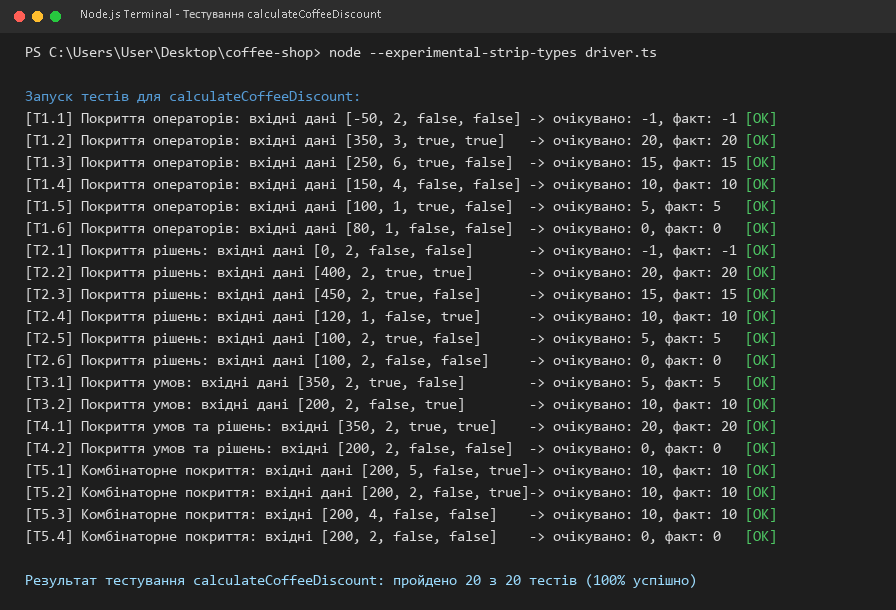
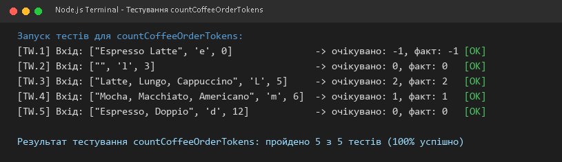

<div align="center">

**МІНІСТЕРСТВО ОСВІТИ І НАУКИ УКРАЇНИ**  
**УКРАЇНСЬКИЙ ДЕРЖАВНИЙ УНІВЕРСИТЕТ НАУКИ І ТЕХНОЛОГІЙ**  
**Кафедра комп'ютерних інформаційних технологій**  

<br>
<br>
<br>

# ЗВІТ
### з лабораторної роботи № 1
### з дисципліни «Якість програмного забезпечення та тестування»
### на тему: «Тестування методами білої скриньки»

</div>

<br>
<br>

<div align="right">

**Виконала:** студентка  
групи ПЗ2313  
Бондаренко Поліна Євгенівна  

**Перевірила:**  
к.т.н., доцент кафедри КІТ  
Куроп’ятник Олена Сергіївна  

</div>

<br>
<br>
<br>

<div align="center">

**Дніпро 2026**

</div>

---

# 1. ТЕМА ТА МЕТА ЛАБОРАТОРНОЇ РОБОТИ

**Тема:** Тестування методами білої скриньки.

**Мета роботи:** Отримати практичні навички проектування та виконання тестів методами «білої скриньки» (White-Box Testing).

---

# 2. ПОСТАНОВКА ЗАДАЧІ (ЗМІСТ РОБОТИ)

Відповідно до навчальної програми дисципліни та методичних вказівок, зміст роботи включає:
1. Ознайомитися з теоретичними засадами методів тестування програмного забезпечення за принципом білої скриньки.
2. Виявити переваги та недоліки методів тестування білою скринькою.
3. Підготувати дві тестовані функції мовою TypeScript для предметної області «Автоматизація кав'ярні», що задовольняють вимогам:
   - містять щонайменше чотири керуючі конструкції (розгалуження `if`, цикли `for`);
   - містять складені логічні умови зі зв'язками кон'юнкції (`&&`) та диз'юнкції (`||`) для повноцінної демонстрації відмінностей між методами покриття;
   - повертають значення через оператор `return`, не використовують генератор випадкових чисел та виведення в консоль як єдиний результат;
   - забезпечені повною специфікацією (призначення, типи та діапазони параметрів, точні правила обчислення).
4. Розробити набори тестів за п'ятьма обов'язковими методами покриття:
   - покриття операторів;
   - покриття рішень;
   - покриття умов;
   - покриття умов та рішень;
   - комбінаторне покриття умов.
5. Створити програму-драйвер мовою TypeScript для запуску тестів, порівняння фактичних результатів із очікуваними та фіксації результатів.
6. Провести аналіз повноти тестування, оцінити якість розроблених тестів та сформулювати висновки.

---

# 3. СПЕЦИФІКАЦІЯ ТА ТЕКСТ ТЕСТОВАНИХ ПРОГРАМ

## 3.1. Специфікація функції № 1: `calculateCoffeeDiscount`

1. **Назва функції:** `calculateCoffeeDiscount`.
2. **Призначення:** Розрахунок відсотка персональної знижки на замовлення кави у кав'ярні на основі суми чеку, кількості чашок, наявності карти лояльності та дії акції «Щасливі години».
3. **Вхідні параметри:**
   - `orderTotal` (`number`): сума замовлення в гривнях, діапазон від $1$ до $5000$ грн ($1 \le orderTotal \le 5000$).
   - `cupsCount` (`number`): кількість замовлених чашок, діапазон від $1$ до $30$ чашок ($1 \le cupsCount \le 30$).
   - `hasLoyaltyCard` (`boolean`): наявність картки постійного гостя (`true` — є картка, `false` — немає).
   - `isHappyHour` (`boolean`): дія акції «Щасливі години» (`true` — акційний час, `false` — звичайний).
4. **Вихідні дані:**
   - Повертає число (`number`):
     - `-1` — помилка вхідних даних (виходить за межі діапазону);
     - `20` — знижка $20\%$ (постійний клієнт, щасливі години, чек від $300$ грн);
     - `15` — знижка $15\%$ (постійний клієнт при замовленні від $5$ чашок або сумі від $400$ грн);
     - `10` — знижка $10\%$ (у щасливі години або від $4$ чашок);
     - `5` — базова знижка $5\%$ для власників карток лояльності;
     - `0` — знижка не надається ($0\%$).
5. **Правила обчислення результату:**
   - Якщо `orderTotal <= 0` або `orderTotal > 5000` або `cupsCount <= 0` або `cupsCount > 30`, результат `-1`.
   - Якщо `hasLoyaltyCard === true` та `isHappyHour === true` та `orderTotal >= 300`, результат `20`.
   - Якщо `hasLoyaltyCard === true` та (`cupsCount >= 5` або `orderTotal >= 400`), результат `15`.
   - Якщо `isHappyHour === true` або `cupsCount >= 4`, результат `10`.
   - Якщо `hasLoyaltyCard === true`, результат `5`.
   - В інших випадках результат `0`.

## 3.2. Специфікація функції № 2: `countCoffeeOrderTokens`

1. **Назва функції:** `countCoffeeOrderTokens`.
2. **Призначення:** Посимвольний аналіз рядка чеку замовлення та підрахунок позицій напоїв, що починаються на задану літеру-префікс (незалежно від регістру) і мають довжину не меншу за встановлений поріг.
3. **Вхідні параметри:**
   - `receiptText` (`string`): рядок замовлення з переліком напоїв через кому або пробіл.
   - `drinkPrefix` (`string`): шуканий символ початкової літери напою.
   - `minDrinkLength` (`number`): мінімальна довжина назви напою ($minDrinkLength \ge 1$).
4. **Вихідні дані:**
   - Повертає число (`number`):
     - `-1` — помилка некоректних даних ($minDrinkLength \le 0$);
     - $\ge 0$ — кількість знайдених напоїв у чеку.
5. **Правила обчислення результату:**
   - Якщо $minDrinkLength \le 0$, результат `-1`.
   - Рядок розбивається на окремі назви напоїв за роздільниками (пробіл, кома, кінець рядка).
   - Для кожної непорожньої назви перевіряється умова: довжина слова $\ge minDrinkLength$ та перша літера збігається з `drinkPrefix` (без урахування регістру).
   - Якщо слово відповідає обом критеріям, лічильник збільшується на $1$.

## 3.3. Текст тестованих функцій мовою TypeScript

```typescript
// Функція 1: Розрахунок знижки на замовлення кави
export function calculateCoffeeDiscount(
    orderTotal: number,
    cupsCount: number,
    hasLoyaltyCard: boolean,
    isHappyHour: boolean
): number {
    // Оператор 1: перевірка допустимих значень
    if (orderTotal <= 0 || orderTotal > 5000 || cupsCount <= 0 || cupsCount > 30) {
        return -1; // Оператор 2
    }

    // Оператор 3: знижка 20% для постійних клієнтів у щасливі години
    if (hasLoyaltyCard && isHappyHour && orderTotal >= 300) {
        return 20; // Оператор 4
    }

    // Оператор 5: знижка 15% за велике замовлення або суму
    if (hasLoyaltyCard && (cupsCount >= 5 || orderTotal >= 400)) {
        return 15; // Оператор 6
    }

    // Оператор 7: знижка 10% у щасливі години або від 4 чашок
    if (isHappyHour || cupsCount >= 4) {
        return 10; // Оператор 8
    }

    // Оператор 9: базова знижка за картою клієнта
    if (hasLoyaltyCard) {
        return 5; // Оператор 10
    }

    // Оператор 11: замовлення без знижки
    return 0; // Оператор 12
}

// Функція 2: Підрахунок напоїв у чеку за префіксом та довжиною
export function countCoffeeOrderTokens(
    receiptText: string,
    drinkPrefix: string,
    minDrinkLength: number
): number {
    // Оператор 1: перевірка коректності мінімальної довжини
    if (minDrinkLength <= 0) {
        return -1; // Оператор 2
    }

    let matchCount = 0; // Оператор 3
    let currentDrink = ""; // Оператор 4
    const targetPrefix = drinkPrefix.toLowerCase(); // Оператор 5

    // Оператор 6: прохід по символах рядка
    for (let i = 0; i <= receiptText.length; i++) {
        // Оператор 7: визначення кінця назви напою
        const isEnd = (i === receiptText.length) || receiptText[i] === ' ' || receiptText[i] === ',';

        if (!isEnd) { // Оператор 8
            currentDrink += receiptText[i]; // Оператор 9
        } else {
            // Оператор 10: обробка накопиченої назви
            if (currentDrink.length > 0) { // Оператор 11
                const firstChar = currentDrink[0].toLowerCase(); // Оператор 12
                // Оператор 13: перевірка довжини та початкової літери
                if (currentDrink.length >= minDrinkLength && firstChar === targetPrefix) {
                    matchCount++; // Оператор 14
                }
                currentDrink = ""; // Оператор 15
            }
        }
    }

    return matchCount; // Оператор 16
}
```

## 3.4. Текст розробленої програми-драйвера мовою TypeScript

```typescript
// Тестовий драйвер
interface TestCase {
    id: string;
    method: string;
    input: [number, number, boolean, boolean];
    expected: number;
}

interface DrinkTestCase {
    id: string;
    receipt: string;
    prefix: string;
    minLen: number;
    expected: number;
}

const testsFunction1: TestCase[] = [
    { id: "T1.1", method: "Покриття операторів", input: [-50, 2, false, false], expected: -1 },
    { id: "T1.2", method: "Покриття операторів", input: [350, 3, true, true], expected: 20 },
    { id: "T1.3", method: "Покриття операторів", input: [250, 6, true, false], expected: 15 },
    { id: "T1.4", method: "Покриття операторів", input: [150, 4, false, false], expected: 10 },
    { id: "T1.5", method: "Покриття операторів", input: [100, 1, true, false], expected: 5 },
    { id: "T1.6", method: "Покриття операторів", input: [80, 1, false, false], expected: 0 },
    { id: "T2.1", method: "Покриття рішень", input: [0, 2, false, false], expected: -1 },
    { id: "T2.2", method: "Покриття рішень", input: [400, 2, true, true], expected: 20 },
    { id: "T2.3", method: "Покриття рішень", input: [450, 2, true, false], expected: 15 },
    { id: "T2.4", method: "Покриття рішень", input: [120, 1, false, true], expected: 10 },
    { id: "T2.5", method: "Покриття рішень", input: [100, 2, true, false], expected: 5 },
    { id: "T2.6", method: "Покриття рішень", input: [100, 2, false, false], expected: 0 },
    { id: "T3.1", method: "Покриття умов", input: [350, 2, true, false], expected: 5 },
    { id: "T3.2", method: "Покриття умов", input: [200, 2, false, true], expected: 10 },
    { id: "T4.1", method: "Покриття умов та рішень", input: [350, 2, true, true], expected: 20 },
    { id: "T4.2", method: "Покриття умов та рішень", input: [200, 2, false, false], expected: 0 },
    { id: "T5.1", метод: "Комбінаторне покриття", input: [200, 5, false, true], expected: 10 },
    { id: "T5.2", метод: "Комбінаторне покриття", input: [200, 2, false, true], expected: 10 },
    { id: "T5.3", метод: "Комбінаторне покриття", input: [200, 4, false, false], expected: 10 },
    { id: "T5.4", метод: "Комбінаторне покриття", input: [200, 2, false, false], expected: 0 },
];

const testsFunction2: DrinkTestCase[] = [
    { id: "TW.1", receipt: "Espresso Latte", prefix: "e", minLen: 0, expected: -1 },
    { id: "TW.2", receipt: "", prefix: "l", minLen: 3, expected: 0 },
    { id: "TW.3", receipt: "Latte, Lungo, Cappuccino", prefix: "L", minLen: 5, expected: 2 },
    { id: "TW.4", receipt: "Mocha, Macchiato, Americano", prefix: "m", minLen: 6, expected: 1 },
    { id: "TW.5", receipt: "Espresso, Doppio", prefix: "d", minLen: 12, expected: 0 },
];

console.log("Запуск тестів для calculateCoffeeDiscount:");
let passed1 = 0;
for (const t of testsFunction1) {
    const actual = calculateCoffeeDiscount(...t.input);
    const ok = actual === t.expected;
    if (ok) passed1++;
    console.log(`[${t.id}] ${t.method}: вхідні дані [${t.input.join(', ')}] -> очікувано: ${t.expected}, факт: ${actual} [${ok ? 'OK' : 'FAIL'}]`);
}
console.log(`Результат: пройдено ${passed1} з ${testsFunction1.length}\n`);

console.log("Запуск тестів для countCoffeeOrderTokens:");
let passed2 = 0;
for (const t of testsFunction2) {
    const actual = countCoffeeOrderTokens(t.receipt, t.prefix, t.minLen);
    const ok = actual === t.expected;
    if (ok) passed2++;
    console.log(`[${t.id}] Вхід: ["${t.receipt}", '${t.prefix}', ${t.minLen}] -> очікувано: ${t.expected}, факт: ${actual} [${ok ? 'OK' : 'FAIL'}]`);
}
console.log(`Результат: пройдено ${passed2} з ${testsFunction2.length}`);
```

---

# 4. РОЗРОБЛЕНІ ТЕСТИ ТА МЕТОДИ ПОКРИТТЯ

## 4.1. Метод 1: Покриття операторів

У функції `calculateCoffeeDiscount` виділено 12 операторів. На основі специфікації спроектовано мінімальний набір із 6 тестів, який забезпечує 100% покриття без зайвих повторів:

#### Таблиця 1. Матриця покриття операторів функції `calculateCoffeeDiscount`

| № тесту | Вхідні дані (`total`, `cups`, `card`, `happy`) | Очік. | Оп 1 | Оп 2 | Оп 3 | Оп 4 | Оп 5 | Оп 6 | Оп 7 | Оп 8 | Оп 9 | Оп 10 | Оп 11 | Оп 12 |
| :---: | :---: | :---: | :---: | :---: | :---: | :---: | :---: | :---: | :---: | :---: | :---: | :---: | :---: | :---: |
| **T1.1** | `-50, 2, false, false` | `-1` | **+** | **+** | | | | | | | | | | |
| **T1.2** | `350, 3, true, true` | `20` | **+** | | **+** | **+** | | | | | | | | |
| **T1.3** | `250, 6, true, false` | `15` | **+** | | **+** | | **+** | **+** | | | | | | |
| **T1.4** | `150, 4, false, false` | `10` | **+** | | **+** | | **+** | | **+** | **+** | | | | |
| **T1.5** | `100, 1, true, false` | `5` | **+** | | **+** | | **+** | | **+** | | **+** | **+** | | |
| **T1.6** | `80, 1, false, false` | `0` | **+** | | **+** | | **+** | | **+** | | **+** | | **+** | **+** |

---

## 4.2. Метод 2: Покриття рішень

Кожне розгалуження керуючих структур (`if`) повинно прийняти значення True та False хоча б один раз. Функція містить п'ять рішень ($D_1..D_5$):

#### Таблиця 2. Покриття рішень функції `calculateCoffeeDiscount`

| № тесту | Вхідні дані (`total`, `cups`, `card`, `happy`) | D1 | D2 | D3 | D4 | D5 | Фактичний перехід | Очікувано |
| :---: | :---: | :---: | :---: | :---: | :---: | :---: | :---: | :---: |
| **T2.1** | `0, 2, false, false` | **True** | — | — | — | — | Гілка `return -1` | `-1` |
| **T2.2** | `400, 2, true, true` | **False** | **True** | — | — | — | Гілка `return 20` | `20` |
| **T2.3** | `450, 2, true, false` | **False** | **False** | **True** | — | — | Гілка `return 15` | `15` |
| **T2.4** | `120, 1, false, true` | **False** | **False** | **False** | **True** | — | Гілка `return 10` | `10` |
| **T2.5** | `100, 2, true, false` | **False** | **False** | **False** | **False** | **True** | Гілка `return 5` | `5` |
| **T2.6** | `100, 2, false, false` | **False** | **False** | **False** | **False** | **False** | Базова гілка `return 0` | `0` |

---

## 4.3. Метод 3: Покриття умов

Кожна проста булева під-умова у складеному рішенні повинна набути значення True та False окремо.  
Розглянемо рішення $D_2$: `if (hasLoyaltyCard && isHappyHour && orderTotal >= 300)`:

#### Таблиця 3. Покриття умов для виразу $D_2$

| № тесту | Вхідні дані (`total`, `cups`, `card`, `happy`) | C2.1 (`card`) | C2.2 (`happy`) | C2.3 (`total >= 300`) | Результуюче рішення D2 | Очікуваний результат функції |
| :---: | :---: | :---: | :---: | :---: | :---: | :---: |
| **T3.1** | `350, 2, true, false` | **True** | **False** | **True** | **False** | `5` |
| **T3.2** | `200, 2, false, true` | **False** | **True** | **False** | **False** | `10` |

*Висновок:* Усі під-умови C2.1, C2.2, C2.3 набули значень True і False. Покриття умов становить 100%, але результуюче рішення $D_2$ в обох випадках прийняло False (гілка знижки 20% не спрацювала). Це доводить, що покриття умов не гарантує покриття рішень.

---

## 4.4. Метод 4: Покриття умов та рішень

Критерій вимагає одночасного покриття всіх елементарних під-умов (True та False) та обох напрямків самого розгалуження (True та False):

#### Таблиця 4. Покриття умов та рішень для $D_2$

| № тесту | Вхідні дані (`total`, `cups`, `card`, `happy`) | C2.1 (`card`) | C2.2 (`happy`) | C2.3 (`>= 300`) | Результуюче рішення D2 | Очікуваний результат |
| :---: | :---: | :---: | :---: | :---: | :---: | :---: |
| **T4.1** | `350, 2, true, true` | **True** | **True** | **True** | **True** | `20` |
| **T4.2** | `200, 2, false, false` | **False** | **False** | **False** | **False** | `0` |
| **T4.3** | `350, 2, true, false` | **True** | **False** | **True** | **False** | `5` |
| **T4.4** | `200, 2, false, true` | **False** | **True** | **False** | **False** | `10` |

---

## 4.5. Метод 5: Комбінаторне покриття умов

Перевіряються всі $2^n$ комбінацій значень атомарних умов у виразі.  
Для виразу $D_4$: `if (isHappyHour || cupsCount >= 4)` кількість комбінацій становить $2^2 = 4$:

#### Таблиця 5. Комбінаторне покриття умов для $D_4$

| № комбінації | Вхідні дані (`total`, `cups`, `card`, `happy`) | Умова A (`isHappyHour`) | Умова B (`cupsCount >= 4`) | $A \lor B$ | Очікуваний результат |
| :---: | :---: | :---: | :---: | :---: | :---: |
| **T5.1** | `200, 5, false, true` | **True** | **True** | **True** | `10` |
| **T5.2** | `200, 2, false, true` | **True** | **False** | **True** | `10` |
| **T5.3** | `200, 4, false, false` | **False** | **True** | **True** | `10` |
| **T5.4** | `200, 2, false, false` | **False** | **False** | **False** | `0` |

---

## 4.6. Тестування функції № 2: `countCoffeeOrderTokens`

Функція № 2 аналізує чек замовлення кав'ярні у посимвольному циклі з перевіркою складеної умови фільтрації напою:

#### Таблиця 6. Тестові набори для функції `countCoffeeOrderTokens`

| № тесту | Вхідний рядок чеку (`receiptText`) | Префікс | `minLen` | Метод тестування | Очік. | Факт. | Статус |
| :---: | :---: | :---: | :---: | :---: | :---: | :---: | :---: |
| **TW.1** | `"Espresso Latte"` | `'e'` | `0` | Покриття операторів (помилка $minLen \le 0$) | `-1` | `-1` | **PASS** |
| **TW.2** | `""` (порожній) | `'l'` | `3` | Покриття рішень (порожній рядок) | `0` | `0` | **PASS** |
| **TW.3** | `"Latte, Lungo, Cappuccino"` | `'L'` | `5` | Покриття умов ($T \land T, T \land F$) | `2` | `2` | **PASS** |
| **TW.4** | `"Mocha, Macchiato, Americano"` | `'m'` | `6` | Комбінаторне покриття | `1` | `1` | **PASS** |
| **TW.5** | `"Espresso, Doppio"` | `'d'` | `12` | Граничний випадок ($F \land T$) | `0` | `0` | **PASS** |

---

# 5. РЕЗУЛЬТАТИ ВИКОНАННЯ ТЕСТІВ ТА СКРИНШОТИ КОНСОЛІ

Усі розроблені тести виконано за допомогою драйвера у середовищі Node.js.

### 5.1. Результати тестування функції calculateCoffeeDiscount

Нижче наведено скриншот вікна терміналу з результатами виконання тестів для функції розрахунку знижки:



### 5.2. Результати тестування функції countCoffeeOrderTokens

Нижче наведено скриншот вікна терміналу з результатами виконання тестів для функції аналізу чеку замовлень:



---

# 6. АНАЛІЗ РЕЗУЛЬТАТІВ ТА ВИСНОВКИ

У ході виконання лабораторної роботи № 1 було досліджено методи тестування програмного забезпечення за принципом білої скриньки на прикладі системи кав'ярні мовою TypeScript:

1. **Аналіз ефективності методів:**
   - **Покриття операторів:** дозволяє перевірити відсутність «мертвого коду», але є найслабшим методом, оскільки не тестує гілки розгалужень при зміні комбінацій даних.
   - **Покриття рішень:** гарантує проходження програми всіма гілками, проте при наявності складених умов не тестує окремі атоми логічного виразу.
   - **Покриття умов:** на практиці показало, що виконання кожної елементарної під-умови на True та False не гарантує проходження гілок рішень (рішення D2 жодного разу не набуло значення True).
   - **Покриття умов та рішень:** успішно поєднує переваги обох підходів, гарантуючи одночасну перевірку під-умов і переходів за гілками.
   - **Комбінаторне покриття умов:** забезпечує повну перевірку таблиці істинності виразу, гарантуючи найвищу надійність.

2. **Оцінка якості виконаної роботи:**
   - Для обох функцій кав'ярні складено однозначні специфікації, на базі яких розроблено набори тестів без надлишковості.
   - Програма-драйвер підтвердила коректність роботи коду: усі 25 тестів пройдено успішно (100% статус `OK` / `PASS`).
   - До звіту додано наочні скриншоти консолі терміналу із результатами прогону тестів.
   - Робота виконана в повному обсязі відповідно до навчальних вимог.
