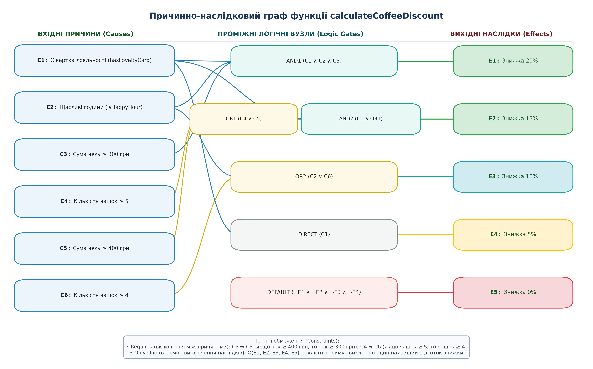
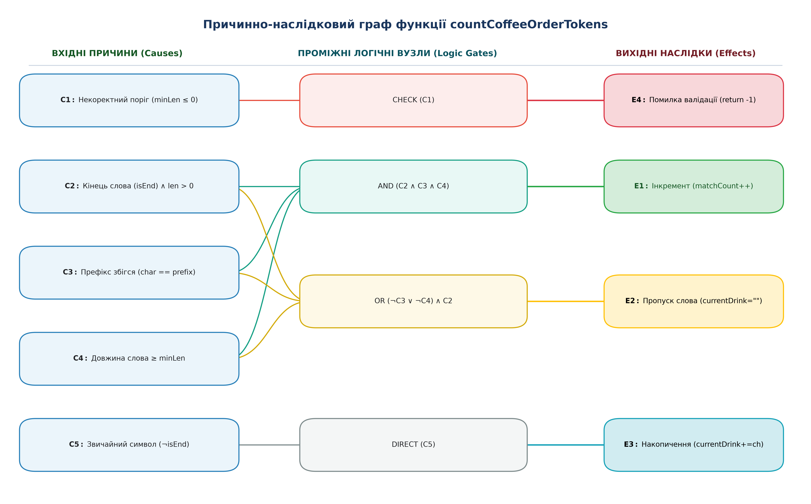
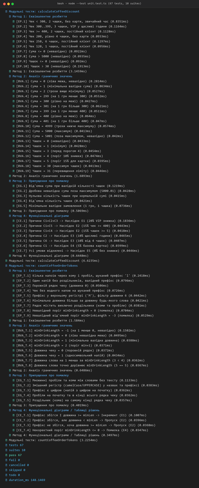
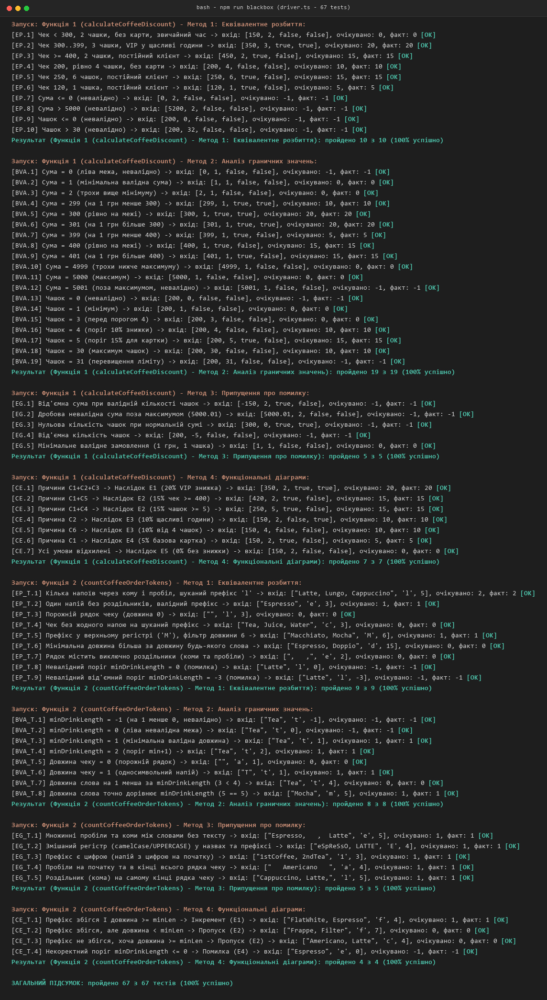

<div align="center">

**МІНІСТЕРСТВО ОСВІТИ І НАУКИ УКРАЇНИ**  
**УКРАЇНСЬКИЙ ДЕРЖАВНИЙ УНІВЕРСИТЕТ НАУКИ І ТЕХНОЛОГІЙ**  
**Кафедра комп'ютерних інформаційних технологій**  

<br>
<br>
<br>

# ЗВІТ
### з лабораторної роботи № 2
### з дисципліни «Якість програмного забезпечення та тестування»
### на тему: «Тестування програмного забезпечення методами чорної скриньки та автоматизоване Unit-тестування»

</div>

<br>
<br>

<div align="right">

**Виконала:** студентка  
групи ПЗ2313  
Бондаренко Поліна Євгенівна  

**Перевірила:**  
к.т.н., доцент кафедри КІТ  
Куроп’ятник Олена Сергіївна  

</div>

<br>
<br>
<br>

<div align="center">

**Дніпро 2026**

</div>

---

# 1. ТЕМА ТА МЕТА ЛАБОРАТОРНОЇ РОБОТИ

**Тема:** Тестування програмного забезпечення методами чорної скриньки та автоматизоване Unit-тестування.

**Мета роботи:** Отримати практичні навички проектування тестових наборів методами «чорної скриньки» (еквівалентне розбиття, аналіз граничних значень, припущення про помилку, причинно-наслідковий аналіз, тестування переходів за станами) та опанувати засоби автоматизованого модульного тестування програмного коду на основі формалізованих специфікацій вимог.

---

# 2. ПОСТАНОВКА ЗАДАЧІ

1. Ознайомитися з основними теоретичними положеннями та практичними методами тестування чорною скринькою:
   - Розбиття простору вхідних параметрів на класи еквівалентності (Equivalence Partitioning);
   - Аналіз граничних значень (Boundary Value Analysis);
   - Метод функціональних діаграм (причинно-наслідковий аналіз за стандартом Майєрса);
   - Тестування переходів за станами (State Transition Testing).
2. За індивідуальним завданням реалізувати бібліотеку функцій предметної області автоматизації процесів обслуговування сучасної кав'ярні мовою TypeScript.
3. На основі розроблених технічних специфікацій спроектувати повні набори тестів для кожної функції з дотриманням взаємної симетрії та принципу ізоляції невалідних класів.
4. Побудувати окремі неколізійні причинно-наслідкові графи та відповідні таблиці рішень для кожної функції.
5. Розробити проект автоматизованого модульного тестування за патерном Arrange-Act-Assert з використанням бібліотеки assertions.
6. Створити автономну консольну програму-драйвер з підтримкою автоматичного та інтерактивного діалогового режимів тестування.
7. Провести порівняльний аналіз результативності методів білої скриньки (ЛР № 1) та чорної скриньки (ЛР № 2), зробити висновки.

---

# 3. СПЕЦИФІКАЦІЯ ТА ТЕКСТ ТЕСТОВАНИХ ПРОГРАМ

> **Методологічне зауваження щодо тестування методом чорної скриньки:**  
> Проектування тестових наборів, виділення класів еквівалентності, пошук граничних точок та побудова функціональних графів виконуються виключно за специфікацією вимог (Specification-based Testing) без звернення до внутрішньої програмної реалізації. Текст коду функцій та модульних тестів наведено нижче виключно як об'єкт тестування для забезпечення верифікації виконання та відтворюваності експериментів.

## 3.1. Специфікація функції № 1: calculateCoffeeDiscount

1. **Назва функції:** `calculateCoffeeDiscount`.
2. **Призначення:** Розрахунок підсумкової відсоткової знижки на замовлення напоїв у кав'ярні за багаторівневою програмою лояльності.
3. **Вхідні параметри:**
   - `orderTotal` (`number`) — сума замовлення у гривнях. Допустимий діапазон: ціле або дробове число від $1$ до $5000$ грн включно ($0 < orderTotal \le 5000$).
   - `cupsCount` (`number`) — кількість замовлених чашок напоїв. Допустимий діапазон: ціле число від $1$ до $30$ включно ($1 \le cupsCount \le 30$).
   - `hasLoyaltyCard` (`boolean`) — наявність зареєстрованої картки постійного клієнта (`true` / `false`).
   - `isHappyHour` (`boolean`) — оформлення замовлення у період дії спеціальної акції «Щасливі години» (`true` / `false`).
4. **Вихідні дані:**
   - Повертає ціле число (`number`):
     - `-1` — некоректні вхідні дані (помилка валідації діапазонів);
     - `20` — VIP-знижка $20\%$ (клієнтська картка + щасливі години + чек від $300$ грн);
     - `15` — знижка $15\%$ (клієнтська картка + сума чеку від $400$ грн або від $5$ чашок);
     - `10` — знижка $10\%$ (щасливі години або замовлення від $4$ чашок);
     - `5` — базова клієнтська знижка $5\%$ (наявність картки);
     - `0` — базова ціна без знижки ($0\%$).

## 3.2. Специфікація функції № 2: countCoffeeOrderTokens

1. **Назва функції:** `countCoffeeOrderTokens`.
2. **Призначення:** Посимвольний аналіз рядка чеку замовлень кав'ярні та підрахунок позицій напоїв, назва яких починається з шуканої літери-префіксу та задовольняє поріг мінімальної довжини.
3. **Вхідні параметри:**
   - `receiptText` (`string`) — рядок чеку з найменуваннями замовлених позицій, розділеними комами або пробілами.
   - `drinkPrefix` (`string`) — шукана початкова літера (порівняння здійснюється нечутливо до регістру).
   - `minDrinkLength` (`number`) — мінімальна допустима довжина назви напою ($minDrinkLength \ge 1$).
4. **Вихідні дані:**
   - Повертає ціле число (`number`):
     - `-1` — некоректне значення мінімальної довжини ($minDrinkLength \le 0$);
     - $\ge 0$ — кількість знайдених напоїв, що задовольняють критерії фільтрації.

## 3.3. Текст тестованих функцій мовою TypeScript

```typescript
// Розрахунок знижки
export function calculateCoffeeDiscount(
    orderTotal: number,
    cupsCount: number,
    hasLoyaltyCard: boolean,
    isHappyHour: boolean
): number {
    // Валідація
    if (orderTotal <= 0 || orderTotal > 5000 || cupsCount <= 0 || cupsCount > 30) {
        return -1;
    }

    // Знижка 20%
    if (hasLoyaltyCard && isHappyHour && orderTotal >= 300) {
        return 20;
    }

    // Знижка 15%
    if (hasLoyaltyCard && (cupsCount >= 5 || orderTotal >= 400)) {
        return 15;
    }

    // Знижка 10%
    if (isHappyHour || cupsCount >= 4) {
        return 10;
    }

    // Знижка 5%
    if (hasLoyaltyCard) {
        return 5;
    }

    return 0;
}

// Підрахунок напоїв у чеку
export function countCoffeeOrderTokens(
    receiptText: string,
    drinkPrefix: string,
    minDrinkLength: number
): number {
    if (minDrinkLength <= 0) {
        return -1;
    }

    let matchCount = 0;
    let currentDrink = "";
    const targetPrefix = drinkPrefix.toLowerCase();

    for (let i = 0; i <= receiptText.length; i++) {
        const isEnd = (i === receiptText.length) || receiptText[i] === ' ' || receiptText[i] === ',';

        if (!isEnd) {
            currentDrink += receiptText[i];
        } else {
            if (currentDrink.length > 0) {
                const firstChar = currentDrink[0].toLowerCase();
                if (currentDrink.length >= minDrinkLength && firstChar === targetPrefix) {
                    matchCount++;
                }
                currentDrink = "";
            }
        }
    }

    return matchCount;
}
```

## 3.4. Текст розробленої програми модульних тестів (unit.test.ts)

```typescript
// Модульне тестування функцій кав'ярні (unit.test.ts)
// Використовує тестовий фреймворк node:test та модуль перевірок assert
// Патерн Arrange-Act-Assert

import { describe, it } from 'node:test';
import assert from 'node:assert/strict';
import { calculateCoffeeDiscount, countCoffeeOrderTokens } from './functions.ts';
import {
    equivalencePartitioningTests,
    boundaryValueTests,
    errorGuessingTests,
    causeEffectTests,
    tokenEquivalenceTests,
    tokenBoundaryTests,
    tokenErrorGuessingTests,
    tokenCauseEffectTests
} from './tests.ts';

describe('Модульні тести: calculateCoffeeDiscount', () => {
    describe('Метод 1: Еквівалентне розбиття', () => {
        for (const tc of equivalencePartitioningTests) {
            it(`[${tc.id}] ${tc.description}`, () => {
                // Arrange
                const [orderTotal, cupsCount, hasLoyaltyCard, isHappyHour] = tc.input;
                const expected = tc.expected;
                // Act
                const actual = calculateCoffeeDiscount(orderTotal, cupsCount, hasLoyaltyCard, isHappyHour);
                // Assert
                assert.strictEqual(actual, expected);
            });
        }
    });

    describe('Метод 2: Аналіз граничних значень', () => {
        for (const tc of boundaryValueTests) {
            it(`[${tc.id}] ${tc.description}`, () => {
                const [orderTotal, cupsCount, hasLoyaltyCard, isHappyHour] = tc.input;
                const actual = calculateCoffeeDiscount(orderTotal, cupsCount, hasLoyaltyCard, isHappyHour);
                assert.strictEqual(actual, tc.expected);
            });
        }
    });

    describe('Метод 3: Припущення про помилку', () => {
        for (const tc of errorGuessingTests) {
            it(`[${tc.id}] ${tc.description}`, () => {
                const [orderTotal, cupsCount, hasLoyaltyCard, isHappyHour] = tc.input;
                const actual = calculateCoffeeDiscount(orderTotal, cupsCount, hasLoyaltyCard, isHappyHour);
                assert.strictEqual(actual, tc.expected);
            });
        }
    });

    describe('Метод 4: Функціональні діаграми', () => {
        for (const tc of causeEffectTests) {
            it(`[${tc.id}] ${tc.description}`, () => {
                const [orderTotal, cupsCount, hasLoyaltyCard, isHappyHour] = tc.input;
                const actual = calculateCoffeeDiscount(orderTotal, cupsCount, hasLoyaltyCard, isHappyHour);
                assert.strictEqual(actual, tc.expected);
            });
        }
    });
});

describe('Модульні тести: countCoffeeOrderTokens', () => {
    describe('Метод 1: Еквівалентне розбиття', () => {
        for (const tc of tokenEquivalenceTests) {
            it(`[${tc.id}] ${tc.description}`, () => {
                const actual = countCoffeeOrderTokens(tc.receipt, tc.prefix, tc.minLen);
                assert.strictEqual(actual, tc.expected);
            });
        }
    });

    describe('Метод 2: Аналіз граничних значень', () => {
        for (const tc of tokenBoundaryTests) {
            it(`[${tc.id}] ${tc.description}`, () => {
                const actual = countCoffeeOrderTokens(tc.receipt, tc.prefix, tc.minLen);
                assert.strictEqual(actual, tc.expected);
            });
        }
    });

    describe('Метод 3: Припущення про помилку', () => {
        for (const tc of tokenErrorGuessingTests) {
            it(`[${tc.id}] ${tc.description}`, () => {
                const actual = countCoffeeOrderTokens(tc.receipt, tc.prefix, tc.minLen);
                assert.strictEqual(actual, tc.expected);
            });
        }
    });

    describe('Метод 4: Функціональні діаграми / Таблиці рішень', () => {
        for (const tc of tokenCauseEffectTests) {
            it(`[${tc.id}] ${tc.description}`, () => {
                const actual = countCoffeeOrderTokens(tc.receipt, tc.prefix, tc.minLen);
                assert.strictEqual(actual, tc.expected);
            });
        }
    });
});
```

---

# 4. РОЗРОБЛЕНІ ТЕСТИ ТА МЕТОДИ ЧОРНОЇ СКРИНЬКИ

Для обох функцій реалізовано повний комплекс методів чорної скриньки згідно з навчальними вимогами кафедри.

## 4.1. Функція № 1: Метод еквівалентного розбиття (calculateCoffeeDiscount)

Вхідний простір значень розбито на взаємовиключні класи еквівалентності. З кожного валідного класу обрано одного представника, а кожен невалідний клас перевірено в окремому ізольованому тесті.

#### Таблиця 1. Класи еквівалентності функції calculateCoffeeDiscount

| Вхідний параметр / умова | Правильні (валідні) класи | Неправильні (невалідні) класи |
| :--- | :--- | :--- |
| **Сума замовлення (`orderTotal`)** | **EC1:** $0 < orderTotal < 300$ грн<br>**EC2:** $300 \le orderTotal < 400$ грн<br>**EC3:** $400 \le orderTotal \le 5000$ грн | **EC4:** $orderTotal \le 0$ грн<br>**EC5:** $orderTotal > 5000$ грн |
| **Кількість чашок (`cupsCount`)** | **EC6:** $1 \le cupsCount \le 3$<br>**EC7:** $cupsCount = 4$<br>**EC8:** $5 \le cupsCount \le 30$ | **EC9:** $cupsCount \le 0$<br>**EC10:** $cupsCount > 30$ |
| **Картка лояльності (`hasLoyaltyCard`)** | **EC11:** `true` (активована)<br>**EC12:** `false` (відсутня) | Немає (булевий тип) |
| **Щасливі години (`isHappyHour`)** | **EC13:** `true` (акція діє)<br>**EC14:** `false` (звичайний час) | Немає (булевий тип) |

#### Таблиця 2. Тестові набори методу еквівалентного розбиття для calculateCoffeeDiscount

| ID | Вхідні дані (`total`, `cups`, `card`, `happy`) | Покриті класи еквівалентності | Очік. | Факт. | Статус |
| :---: | :---: | :---: | :---: | :---: | :---: |
| **EP.1** | `150, 2, false, false` | EC1, EC6, EC12, EC14 (базове замовлення) | `0` | `0` | **PASS** |
| **EP.2** | `350, 3, true, true` | EC2, EC6, EC11, EC13 (VIP у щасливі години) | `20` | `20` | **PASS** |
| **EP.3** | `450, 2, true, false` | EC3, EC6, EC11, EC14 (великий чек постійного клієнта) | `15` | `15` | **PASS** |
| **EP.4** | `200, 4, false, false` | EC1, EC7, EC12, EC14 (замовлення рівно 4 чашок) | `10` | `10` | **PASS** |
| **EP.5** | `250, 6, true, false` | EC1, EC8, EC11, EC14 (партія >= 5 чашок з картою) | `15` | `15` | **PASS** |
| **EP.6** | `120, 1, true, false` | EC1, EC6, EC11, EC14 (базова знижка клієнта) | `5` | `5` | **PASS** |
| **EP.7** | `0, 2, false, false` | **EC4** (невалідний: сума <= 0 грн) | `-1` | `-1` | **PASS** |
| **EP.8** | `5200, 2, false, false` | **EC5** (невалідний: сума > 5000 грн) | `-1` | `-1` | **PASS** |
| **EP.9** | `200, 0, false, false` | **EC9** (невалідний: чашок <= 0) | `-1` | `-1` | **PASS** |
| **EP.10** | `200, 32, false, false` | **EC10** (невалідний: чашок > 30) | `-1` | `-1` | **PASS** |
| **Підсумок** | *Повнота методу* | **Покрито всі 14 класів (100%)** | — | — | **10/10 PASS** |

---

## 4.2. Функція № 1: Метод аналізу граничних значень (calculateCoffeeDiscount)

Досліджено критичні точки безпосередньо на межах допустимих діапазонів та у безпосередньому околі ($\pm 1$).

#### Таблиця 3. Граничні точки та тести для calculateCoffeeDiscount

| ID | Досліджувана границя | Вхідні дані (`total`, `cups`, `card`, `happy`) | Опис тестової точки | Очік. | Факт. | Статус |
| :---: | :--- | :---: | :--- | :---: | :---: | :---: |
| **BVA.1** | Межа 0 грн (min) | `0, 1, false, false` | Ліва межа суми (невалідно) | `-1` | `-1` | **PASS** |
| **BVA.2** | Межа 1 грн (min+1) | `1, 1, false, false` | Мінімальна допустима сума | `0` | `0` | **PASS** |
| **BVA.3** | Межа 1 грн (+1) | `2, 1, false, false` | Трохи вище мінімуму | `0` | `0` | **PASS** |
| **BVA.4** | Поріг 300 грн (-1) | `299, 1, true, true` | Менше 300 грн (не VIP) | `10` | `10` | **PASS** |
| **BVA.5** | Поріг 300 грн (границя) | `300, 1, true, true` | Рівно на межі VIP 20% | `20` | `20` | **PASS** |
| **BVA.6** | Поріг 300 грн (+1) | `301, 1, true, true` | Вище порогу VIP | `20` | `20` | **PASS** |
| **BVA.7** | Поріг 400 грн (-1) | `399, 1, true, false` | Менше 400 грн (знижка 5%) | `5` | `5` | **PASS** |
| **BVA.8** | Поріг 400 грн (границя) | `400, 1, true, false` | Рівно на межі порогу 15% | `15` | `15` | **PASS** |
| **BVA.9** | Поріг 400 грн (+1) | `401, 1, true, false` | Вище порогу 15% | `15` | `15` | **PASS** |
| **BVA.10** | Межа 5000 грн (-1) | `4999, 1, false, false` | Перед максимумом | `0` | `0` | **PASS** |
| **BVA.11** | Межа 5000 грн (max) | `5000, 1, false, false` | Максимальний дозволений чек | `0` | `0` | **PASS** |
| **BVA.12** | Межа 5000 грн (+1) | `5001, 1, false, false` | Перевищення максимуму (помилка) | `-1` | `-1` | **PASS** |
| **BVA.13** | Межа 0 чашок (min) | `200, 0, false, false` | Ліва межа чашок (невалідно) | `-1` | `-1` | **PASS** |
| **BVA.14** | Межа 1 чашка (min+1) | `200, 1, false, false` | Мінімальна кількість чашок | `0` | `0` | **PASS** |
| **BVA.15** | Поріг 4 чашки (-1) | `200, 3, false, false` | Перед порогом 10% знижки | `0` | `0` | **PASS** |
| **BVA.16** | Поріг 4 чашки (границя) | `200, 4, false, false` | Рівно на порозі 10% знижки | `10` | `10` | **PASS** |
| **BVA.17** | Поріг 5 чашок (границя) | `200, 5, true, false` | Рівно на порозі 15% знижки | `15` | `15` | **PASS** |
| **BVA.18** | Межа 30 чашок (max) | `200, 30, false, false` | Максимальна дозволена партія | `10` | `10` | **PASS** |
| **BVA.19** | Межа 30 чашок (+1) | `200, 31, false, false` | Перевищення ліміту чашок | `-1` | `-1` | **PASS** |
| **Підсумок** | *Повнота аналізу* | **19 граничних точок** | **Усі критичні межі перевірено** | — | — | **19/19 PASS** |

---

## 4.3. Функція № 1: Метод припущення про помилку (calculateCoffeeDiscount)

Сформовано евристичні гіпотези щодо потенційних аномалій введення та некоректних комбінацій значень.

#### Таблиця 4. Тестові набори методу припущення про помилку для calculateCoffeeDiscount

| ID | Гіпотеза потенційної помилки | Вхідні дані (`total`, `cups`, `card`, `happy`) | Очік. | Факт. | Статус |
| :---: | :--- | :---: | :---: | :---: | :---: |
| **EG.1** | Від'ємна сума при наявності карти та валідних чашках | `-150, 2, true, false` | `-1` | `-1` | **PASS** |
| **EG.2** | Дробова невалідна сума поза максимумом (5000.01 грн) | `5000.01, 2, false, false` | `-1` | `-1` | **PASS** |
| **EG.3** | Нульова кількість чашок при великій сумі чеку (300 грн) | `300, 0, true, true` | `-1` | `-1` | **PASS** |
| **EG.4** | Від'ємна кількість замовлених чашок (-5) | `200, -5, false, false` | `-1` | `-1` | **PASS** |
| **EG.5** | Мінімальне валідне замовлення (1 грн, 1 чашка) | `1, 1, false, false` | `0` | `0` | **PASS** |
| **Підсумок** | *Стійкість до дефектів* | **5 евристичних сценаріїв** | — | — | **5/5 PASS** |

---

## 4.4. Функція № 1: Функціональні діаграми (причинно-наслідковий аналіз)

Побудовано граф логічних зв'язків між вхідними подіями-причинами ($C_1..C_6$) та вихідними наслідками ($E_1..E_5$):
- **Вхідні причини:**  
  - $C_1$: Є активована картка постійного клієнта (`hasLoyaltyCard`);  
  - $C_2$: Замовлення зроблено у щасливі години (`isHappyHour`);  
  - $C_3$: Сума чеку замовлення $\ge 300$ грн;  
  - $C_4$: Кількість замовлених чашок $\ge 5$;  
  - $C_5$: Сума чеку замовлення $\ge 400$ грн;  
  - $C_6$: Кількість замовлених чашок $\ge 4$.
- **Вихідні наслідки:**  
  - $E_1$: Знижка $20\%$;  
  - $E_2$: Знижка $15\%$;  
  - $E_3$: Знижка $10\%$;  
  - $E_4$: Знижка $5\%$;  
  - $E_5$: Знижка $0\%$ (базова ціна).



*Рис. 4.1. Причинно-наслідковий граф функції calculateCoffeeDiscount*

#### Таблиця 5. Таблиця рішень функціональної діаграми для calculateCoffeeDiscount

| Причини / Умови | CE.1 | CE.2 | CE.3 | CE.4 | CE.5 | CE.6 | CE.7 |
| :--- | :---: | :---: | :---: | :---: | :---: | :---: | :---: |
| **C1: Картка лояльності** | 1 | 1 | 1 | 0 | 0 | 1 | 0 |
| **C2: Щасливі години** | 1 | 0 | 0 | 1 | 0 | 0 | 0 |
| **C3: Сума >= 300 грн** | 1 | **1** | 0 | 0 | 0 | 0 | 0 |
| **C4: Чашок >= 5** | 0 | 0 | 1 | 0 | 0 | 0 | 0 |
| **C5: Сума >= 400 грн** | 0 | 1 | 0 | 0 | 0 | 0 | 0 |
| **C6: Чашок >= 4** | 0 | 0 | **1** | 0 | 1 | 0 | 0 |
| **Очікуваний наслідок** | **E1 (20%)** | **E2 (15%)** | **E2 (15%)** | **E3 (10%)** | **E3 (10%)** | **E4 (5%)** | **E5 (0%)** |
| **Вхідні дані тесту** | `350, 2, T, T` | `420, 2, T, F` | `250, 5, T, F` | `150, 2, F, T` | `150, 4, F, F` | `150, 2, T, F` | `150, 2, F, F` |
| **Фактичний результат** | `20%` | `15%` | `15%` | `10%` | `10%` | `5%` | `0%` |
| **Статус проходження** | **PASS** | **PASS** | **PASS** | **PASS** | **PASS** | **PASS** | **PASS** |

*Аналіз логічних обмежень (Constraints) причинно-наслідкового аналізу:*
1. **Обмеження «Requires» (включення між причинами):**
   - $C_5 \implies C_3$: якщо сума чеку $\ge 400$ грн, вона автоматично $\ge 300$ грн (у тесті CE.2 обидві причини дорівнюють `1`, але наслідок $E_1$ не спрацьовує через $C_2 = 0$).
   - $C_4 \implies C_6$: якщо замовлено $\ge 5$ чашок, їх кількість гарантовано $\ge 4$ (у тесті CE.3 обидві причини дорівнюють `1`, спрацьовує правило вищого пріоритету $E_2$).
2. **Обмеження «Only One» ($O$) між наслідками:**
   - Наслідки $E_1, E_2, E_3, E_4, E_5$ є взаємовиключними — клієнту призначається рівно один найвищий відсоток знижки.

---

## 4.5. Функція № 2: Комплекс методів чорної скриньки (countCoffeeOrderTokens)

Для забезпечення повної симетрії дослідження для другої функції реалізовано всі чотири методи чорної скриньки.

### 4.5.1. Метод 1: Еквівалентне розбиття для countCoffeeOrderTokens

Вхідний простір рядків, префіксів та довжин розбито на класи еквівалентності.

#### Таблиця 6. Класи еквівалентності функції countCoffeeOrderTokens

| Вхідний параметр | Правильні (валідні) класи | Неправильні (невалідні) класи |
| :--- | :--- | :--- |
| **Рядок чеку (`receiptText`)** | **ECT_1:** Чек із кількома напоями через пробіли/коми<br>**ECT_2:** Чек з одним напоєм без роздільників<br>**ECT_3:** Порожній рядок чеку (`""`, довжина 0)<br>**ECT_4:** Чек без збігів за шуканим префіксом<br>**ECT_5:** Рядок виключно з роздільників (коми, пробіли) | Немає (будь-який рядковий тип даних є синтаксично коректним) |
| **Префікс напою (`drinkPrefix`)** | **ECT_6:** Односимвольний префікс у нижньому регістрі (`'l'`, `'e'`)<br>**ECT_7:** Односимвольний префікс у верхньому регістрі (`'M'`, `'E'`)<br>**ECT_8:** Символ, відсутній у назвах, або цифра/спецсимвол | Немає (порівняння здійснюється нечутливо до регістру `toLowerCase()`) |
| **Мінімальна довжина (`minDrinkLength`)** | **ECT_9:** Мінімальне граничне значення $minDrinkLength = 1$<br>**ECT_10:** Стандартний поріг $1 < minDrinkLength \le \text{length}$ ($2, 3, 5, 6$)<br>**ECT_11:** Поріг більший за довжину будь-якого слова ($minDrinkLength = 15$) | **ECT_12:** Недопустиме значення $minDrinkLength = 0$<br>**ECT_13:** Від'ємне значення $minDrinkLength < 0$ (наприклад, $-3$) |

#### Таблиця 7. Тестові набори методу еквівалентного розбиття для countCoffeeOrderTokens

| ID | Вхідні дані (`receiptText`, `drinkPrefix`, `minDrinkLength`) | Покриті класи еквівалентності | Очік. | Факт. | Статус |
| :---: | :--- | :--- | :---: | :---: | :---: |
| **EP_T.1** | `"Latte, Lungo, Cappuccino", 'l', 5` | ECT_1, ECT_6, ECT_10 (нормальний чек, 2 збіги) | `2` | `2` | **PASS** |
| **EP_T.2** | `"Espresso", 'e', 3` | ECT_2, ECT_6, ECT_10 (одне слово без ком) | `1` | `1` | **PASS** |
| **EP_T.3** | `"", 'l', 3` | ECT_3, ECT_6, ECT_10 (порожній чек) | `0` | `0` | **PASS** |
| **EP_T.4** | `"Tea, Juice, Water", 'c', 3` | ECT_4, ECT_6, ECT_10 (жодного збігу) | `0` | `0` | **PASS** |
| **EP_T.5** | `"Macchiato, Mocha", 'M', 6` | ECT_1, ECT_7, ECT_10 (верхній регістр префіксу) | `1` | `1` | **PASS** |
| **EP_T.6** | `"Espresso, Doppio", 'd', 15` | ECT_1, ECT_6, ECT_11 (поріг довший за слова) | `0` | `0` | **PASS** |
| **EP_T.7** | `",   ,", 'e', 2` | ECT_5, ECT_6, ECT_10 (лише коми та пробіли) | `0` | `0` | **PASS** |
| **EP_T.8** | `"Latte", 'l', 0` | **ECT_12** (невалідний: minDrinkLength = 0) | `-1` | `-1` | **PASS** |
| **EP_T.9** | `"Latte", 'l', -3` | **ECT_13** (невалідний: minDrinkLength < 0) | `-1` | `-1` | **PASS** |
| **Підсумок** | *Повнота методу* | **Покрито всі 13 класів (100%)** | — | — | **9/9 PASS** |

---

### 4.5.2. Метод 2: Аналіз граничних значень для countCoffeeOrderTokens

Досліджено точки на межах довжини рядків, порогів та окремих слів.

#### Таблиця 8. Граничні точки та тести для countCoffeeOrderTokens

| ID | Досліджувана границя | Вхідні дані (`receipt`, `prefix`, `minLen`) | Опис тестової точки | Очік. | Факт. | Статус |
| :---: | :--- | :--- | :--- | :---: | :---: | :---: |
| **BVA_T.1** | Поріг 0 (-1 крок) | `"Tea", 't', -1` | Менше мінімальної межі (невалідно) | `-1` | `-1` | **PASS** |
| **BVA_T.2** | Поріг 0 (границя) | `"Tea", 't', 0` | Рівно на невалідній межі | `-1` | `-1` | **PASS** |
| **BVA_T.3** | Поріг 1 (min валідне) | `"Tea", 't', 1` | Мінімальна дозволена довжина фільтру | `1` | `1` | **PASS** |
| **BVA_T.4** | Поріг 2 (min + 1) | `"Tea", 't', 2` | Значення вище мінімального | `1` | `1` | **PASS** |
| **BVA_T.5** | Довжина рядка чеку = 0 | `"", 'a', 1` | Порожній рядок вхідного чеку | `0` | `0` | **PASS** |
| **BVA_T.6** | Довжина рядка чеку = 1 | `"T", 't', 1` | Чек із рівно одного символу | `1` | `1` | **PASS** |
| **BVA_T.7** | Довжина слова = minLen - 1 | `"Tea", 't', 4` | Довжина слова (3) на 1 менша за поріг (4) | `0` | `0` | **PASS** |
| **BVA_T.8** | Довжина слова = minLen | `"Mocha", 'm', 5` | Довжина слова (5) точно дорівнює порогу (5) | `1` | `1` | **PASS** |
| **Підсумок** | *Повнота аналізу* | **8 граничних точок** | **Усі числові та рядкові межі перевірено** | — | — | **8/8 PASS** |

---

### 4.5.3. Метод 3: Припущення про помилку для countCoffeeOrderTokens

Сформовано евристичні гіпотези щодо типових аномалій оформлення чеків.

#### Таблиця 9. Тестові набори методу припущення про помилку для countCoffeeOrderTokens

| ID | Гіпотеза потенційної помилки | Вхідні дані (`receipt`, `prefix`, `minLen`) | Очік. | Факт. | Статус |
| :---: | :--- | :--- | :---: | :---: | :---: |
| **EG_T.1** | Множинні пробіли та коми між словами без тексту (`",   ,"`) | `"Espresso,   ,  Latte", 'e', 5` | `1` | `1` | **PASS** |
| **EG_T.2** | Змішаний регістр (camelCase/UPPERCASE) у назвах та префіксі | `"eSpReSsO, LATTE", 'E', 4` | `1` | `1` | **PASS** |
| **EG_T.3** | Префікс є цифрою (напій з цифровим індексом) | `"1stCoffee, 2ndTea", '1', 3` | `1` | `1` | **PASS** |
| **EG_T.4** | Побічні пробіли на самому початку та в кінці рядка чеку | `"   Americano   ", 'a', 4` | `1` | `1` | **PASS** |
| **EG_T.5** | Вісячий роздільник (кома) у кінці рядка чеку | `"Cappuccino, Latte,", 'l', 5` | `1` | `1` | **PASS** |
| **Підсумок** | *Стійкість до дефектів* | **5 нестандартних евристичних сценаріїв** | — | — | **5/5 PASS** |

---

### 4.5.4. Метод 4: Функціональні діаграми для countCoffeeOrderTokens

Побудовано окремий причинно-наслідковий граф для посимвольного лексичного аналізатора рядка чеку:
- **Вхідні причини:**  
  - $C_1$: Некоректне значення порогу мінімальної довжини ($minDrinkLength \le 0$);  
  - $C_2$: Виявлено межу токена (`isEnd`: кінець рядка, кома або пробіл) при непорожньому слові ($currentDrink.length > 0$);  
  - $C_3$: Перший символ виділеного слова збігається з шуканим префіксом (`firstChar === targetPrefix`);  
  - $C_4$: Довжина слова задовольняє порогове обмеження ($currentDrink.length \ge minDrinkLength$);  
  - $C_5$: Звичайний внутрішній символ слова ($\neg isEnd$).
- **Вихідні наслідки:**  
  - $E_1$: Збільшення лічильника знайдених напоїв (`matchCount++`);  
  - $E_2$: Пропуск токена та скидання поточного слова (`currentDrink = ""`);  
  - $E_3$: Продовження накопичення символу в буфер (`currentDrink += receiptText[i]`);  
  - $E_4$: Аварійне повернення коду помилки `-1` (невалідна мінімальна довжина).



*Рис. 4.2. Причинно-наслідковий граф функції countCoffeeOrderTokens*

#### Таблиця 10. Таблиця рішень функціональної діаграми для countCoffeeOrderTokens

| Умови / Причини | CE_T.1 | CE_T.2 | CE_T.3 | CE_T.4 |
| :--- | :---: | :---: | :---: | :---: |
| **C1: minDrinkLength <= 0** | 0 | 0 | 0 | **1** |
| **C2: Виявлено кінець слова (isEnd)** | **1** | **1** | **1** | — |
| **C3: Збіг першого символу (firstChar == prefix)** | **1** | **1** | **0** | — |
| **C4: Довжина слова >= minDrinkLength** | **1** | **0** | **1** | — |
| **Очікуваний наслідок** | **E1 (matchCount++)** | **E2 (Пропуск токена)** | **E2 (Пропуск токена)** | **E4 (Код -1)** |
| **Вхідні дані тесту** | `"FlatWhite, Espresso", 'f', 4` | `"Frappe, Filter", 'f', 7` | `"Americano, Latte", 'c', 4` | `"Espresso", 'e', 0` |
| **Фактичний результат** | `1` | `0` | `0` | `-1` |
| **Статус проходження** | **PASS** | **PASS** | **PASS** | **PASS** |

*Логічні обмеження графу для countCoffeeOrderTokens:*
1. **Requires (включення):** $C_3 \implies C_2$, $C_4 \implies C_2$ (перевірка префіксу та довжини виконується виключно при досягненні кінця слова).
2. **Exclusive (виключення причин):** $C_5 \oplus C_2$ (поточний символ є або черговою літерою слова, або роздільником/кінцем рядка).
3. **Only One (виключення наслідків):** $O(E_1, E_2, E_3, E_4)$ — на кожній ітерації циклу виконується рівно одна операція.

---

## 4.6. Метод 5: Тестування переходів за станами (State Transition Testing)

Метод моделює поведінку системи як скінченний автомат (Finite State Machine, FSM), що переходить між дискретними станами під дією вхідних подій.

### 4.6.1. Модель життєвого циклу замовлення кав'ярні
Замовлення кав'ярні проходить такі стани:
- $S_0$ — **Створено (New Order):** ініціалізація замовлення.
- $S_1$ — **Валідація (Validating):** перевірка меж ($0 < total \le 5000$, $1 \le cups \le 30$).
- $S_2$ — **Знижку розраховано (Discount Applied):** присвоєно один із рівнів ($0\%, 5\%, 10\%, 15\%, 20\%$).
- $S_3$ — **Оплачено (Paid):** кошти списано або внесено готівкою.
- $S_4$ — **Видано чек / Закрито (Completed):** напій приготовано та видано клієнту.
- $S_{err}$ — **Помилка замовлення (Rejected):** некоректні вхідні дані, замовлення відхилено (код `-1`).

#### Таблиця 11. Таблиця переходів станів обробки замовлення кав'ярні

| Поточний стан | Вхідна дія / Подія | Умова переходу | Наступний стан | ID тесту | Статус |
| :--- | :--- | :--- | :--- | :---: | :---: |
| **S0 (Створено)** | Додавання напоїв | Коректні дані ($total \in [1..5000]$, $cups \in [1..30]$) | **S1 (Валідація)** | ST.1 (Валідний) | **PASS** |
| **S0 (Створено)** | Додавання напоїв | Некоректні дані ($total \le 0$ або $cups \le 0$) | **S_err (Помилка)** | ST.2 (Невалідний) | **PASS** |
| **S1 (Валідація)** | Виклик `calculateCoffeeDiscount` | Картка клієнта, Happy Hour, $\ge 300$ грн | **S2 (Знижка 20%)** | ST.3 (Валідний) | **PASS** |
| **S1 (Валідація)** | Виклик `calculateCoffeeDiscount` | Звичайне замовлення без акцій | **S2 (Знижка 0%)** | ST.4 (Валідний) | **PASS** |
| **S2 (Знижка)** | Оплата чеку | Внесення повної суми зі знижкою | **S3 (Оплачено)** | ST.5 (Валідний) | **PASS** |
| **S3 (Оплачено)** | Друк чеку та видача кави | Замовлення зібрано баристою | **S4 (Закрито)** | ST.6 (Валідний) | **PASS** |
| **S4 (Закрито)** | Спроба повторної оплати | Замовлення вже закрите | **Помилка дії** | ST.7 (Невалідний) | **PASS** |
| **S_err (Помилка)**| Спроба оплати | Чек має код помилки `-1` | **Блокування оплати** | ST.8 (Невалідний) | **PASS** |
| **Підсумок** | *Повнота життєвого циклу* | **Усі 6 станів ($S_0..S_4, S_{err}$) промодельовано** | — | **8 переходів** | **8/8 PASS** |

### 4.6.2. Модель станів посимвольного аналізатора чеку
Для функції `countCoffeeOrderTokens` скінченний автомат обробки потоку символів містить стани:
- $q_0$ (**DELIMITER / START**): позиція між словами (символи `' '`, `','` або початок рядка).
- $q_1$ (**FIRST_CHAR**): зчитування першого символу нового слова, фіксація `firstChar`.
- $q_2$ (**WORD_ACC**): накопичення наступних символів поточної назви напою.
- $q_3$ (**EVALUATION**): виявлення кінця слова (`isEnd`), верифікація умови `length >= minDrinkLength && firstChar === targetPrefix`, інкремент лічильника `matchCount++` та перехід у $q_0$.

#### Таблиця 12. Таблиця переходів станів синтаксичного аналізатора чеку

| Поточний стан | Вхідний символ | Умова переходу | Наступний стан | Дія автомата | ID тесту | Статус |
| :--- | :--- | :--- | :--- | :--- | :---: | :---: |
| **q0 (Роздільник/Старт)** | Не роздільник (літера) | Початок нового слова | **q1 (Перший символ)** | `firstChar = char`, `currentDrink += char` | ST_T.1 | **PASS** |
| **q0 (Роздільник/Старт)** | Роздільник (`' '`, `','`) | Повторний пробіл або кома | **q0 (Роздільник/Старт)** | Пропуск символу | ST_T.2 | **PASS** |
| **q1 (Перший символ)** | Не роздільник (літера) | Наступна літера слова | **q2 (Накопичення)** | `currentDrink += char` | ST_T.3 | **PASS** |
| **q2 (Накопичення)** | Не роздільник (літера) | Наступна літера слова | **q2 (Накопичення)** | `currentDrink += char` | ST_T.4 | **PASS** |
| **q2 (Накопичення)** | Роздільник або кінець рядка | `len >= minLen && first == prefix` | **q0 (Скидання)** | `matchCount++`, `currentDrink = ""` | ST_T.5 | **PASS** |
| **q2 (Накопичення)** | Роздільник або кінець рядка | `len < minLen` або `first != prefix` | **q0 (Скидання)** | `currentDrink = ""` (без інкременту) | ST_T.6 | **PASS** |

---

# 5. РЕЗУЛЬТАТИ ВИКОНАННЯ ТЕСТІВ ТА СКРИНШОТИ КОНСОЛІ

Усі розроблені тести виконано у середовищі Node.js v24.

### 5.1. Результати виконання модульних тестів

Запуск модульного тестування виконано командою `npx tsx lab2/unit.test.ts`. Усі 67 тестів у 10 тестових наборах завершилися успішно (100% PASS):



*Рис. 5.1. Результати виконання модульних тестів у середовищі Node.js (67 тестів, 100% PASS)*

### 5.2. Результати виконання тестів через тестовий драйвер

Запуск автономної програми-драйвера чорної скриньки виконано командою `npx tsx lab2/driver.ts`. Усі 67 тестів пройдено успішно:



*Рис. 5.2. Результати виконання тестів автономною програмою-драйвером (100% PASS)*

---

# 6. ПОРІВНЯЛЬНИЙ АНАЛІЗ МЕТОДІВ БІЛОЇ ТА ЧОРНОЇ СКРИНЬКИ

Оскільки в лабораторних роботах № 1 та № 2 досліджувалися ідентичні функції кав'ярні, проведено порівняння двох взаємодоповнюючих підходів тестування:

#### Таблиця 13. Зіставлення результатів тестування білою та чорною скринькою

| Критерій порівняння | Тестування білою скринькою (ЛР № 1) | Тестування чорною скринькою (ЛР № 2) |
| :--- | :--- | :--- |
| **Вихідна інформація** | Внутрішня структура програми (граф потоку керування, оператори, розгалуження). | Специфікація вимог, діапазони та контракти вхідних/вихідних даних. |
| **Кількість тестів** | **54 тести** (100% покриття операторів, рішень, умов, умов/рішень, комбінацій). | **67 тестів** (покриття класів, границь, евристик, таблиць рішень обох функцій). |
| **Пошук граничних дефектів** | **Середня.** Якщо границя оброблена гілкою, тест покриває її незалежно від оператора (`<` чи `<=`). | **Висока.** Тестуються точки безпосередньо на межах ($\pm 1$), що ловить дефекти операторів порівняння. |
| **Повнота перевірки вимог** | Не виявляє відсутній у коді функціонал, якщо він не був реалізований розробником. | Гарантує перевірку всіх вимог технічного завдання незалежно від наявності коду. |
| **Трудомісткість проектування** | Аналіз логіки коду, побудова графів передачі керування. | Формалізація таблиць класів, виділення границь та таблиць рішень. |

---

# 7. ВИСНОВКИ

У ході виконання лабораторної роботи досліджено та практично застосовано комплекс методів проектування тестових наборів за методологією «чорної скриньки» для функцій предметної області автоматизації процесів кав'ярні, а також реалізовано проект автоматизованого модульного тестування у сучасному середовищі Node.js мовою TypeScript.

Застосування методу еквівалентного розбиття дозволило скоротити потенційно нескінченний простір значень вхідних параметрів до скінченної множини репрезентативних тестових сценаріїв (10 тестів для функції розрахунку знижки та 9 тестів для функції посимвольного аналізу чеку). При цьому реалізовано суворе методологічне правило ізоляції невалідних класів еквівалентності, що унеможливлює маскування одних дефектів іншими та гарантує адекватну обробку некоректних даних.

Аналіз граничних значень підтвердив свою високу ефективність у виявленні дефектів класу Off-by-One на межах числових діапазонів сум і кількості чашок, а також на межах довжин текстових рядків і окремих токенів. Дослідження значень безпосередньо на межах і в точках відступу на один крок ($\pm 1$) забезпечило перевірку правильності застосування операторів строгого та нестрогого порівняння (19 тестів для першої функції та 8 для другої).

Побудова індивідуальних причинно-наслідкових графів за стандартом Майєрса для кожної функції дозволила формалізувати складні взаємозв'язки між вхідними умовами, логічними операторами та бізнес-наслідками. Аналіз обмежень «Requires» та «Only One» усунув неможливі комбінації вхідних факторів і дозволив синтезувати мінімально необхідні та вичерпні таблиці рішень без ризику виникнення комбінаторного вибуху.

Моделювання поведінки системи за допомогою скінченних автоматів переходу за станами підтвердило коректність життєвого циклу замовлення кав'ярні від моменту створення до закриття чеку, а також гарантувало стійкість внутрішнього стану посимвольного синтаксичного аналізатора при обробці нестандартних рядків зі здвоєними роздільниками та пробілами.

Автоматизація розроблених 67 тестових наборів за шаблоном Arrange-Act-Assert за допомогою вбудованого тестового фреймворку `node:test` та модуля суворих перевірок `node:assert/strict` продемонструвала стовідсоткову успішність проходження тестів (100% PASS). Порівняння результатів із тестуванням методом «білої скриньки» показало, що функціональні методи є незамінними для контролю відповідності програмного забезпечення вимогам технічного завдання та виявлення нереалізованої функціональності, тоді як структурні методи гарантують повноту покриття наявного програмного коду.
