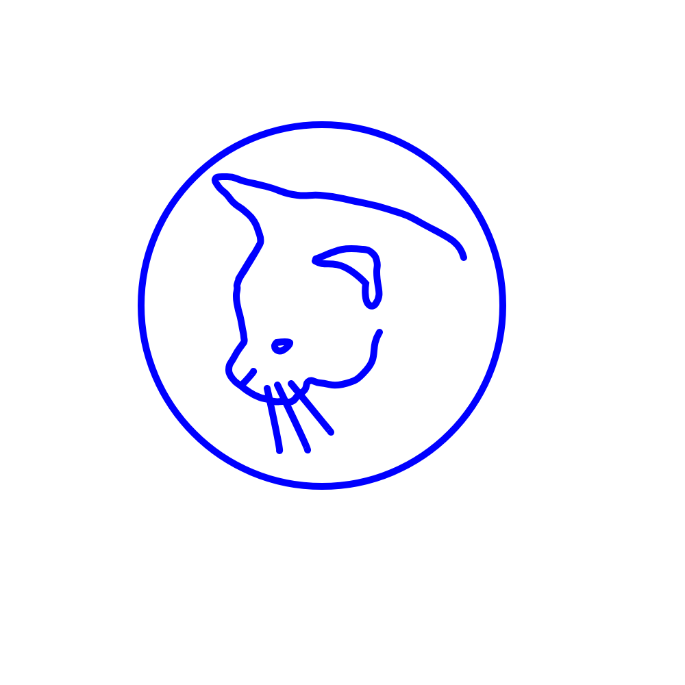
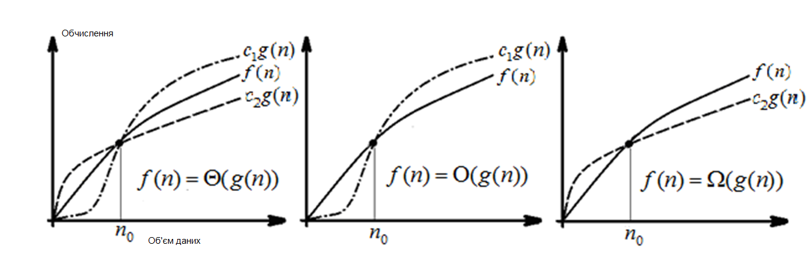

# Лекція 11. Обчислювальна складність алгоритмів

**Дисципліна:** Якість програмного забезпечення та тестування  
**Викладач:** к.т.н., доцент Олена Сергіївна Куроп’ятник  

---

## Слайд 1: Титульний слайд

# Обчислювальна складність алгоритмів
**Лекція 11** з дисципліни «Якість ПЗ та тестування»  
**Викладач:** Олена Сергіївна Куроп’ятник

> **Детальний опис зображення для ШІ-агентів:**  
> Графічний логотип / титульна ілюстрація навчального курсу: зображено розкритий ноутбук, на екрані якого відображаються блок-схеми та діагностичні графіки, поруч лежать кубики з літерами «Q» та «A» (Quality Assurance), стилізована лупа, що фокусується на помилці/багу (символ тестування ПЗ), та елементи системних шестерень, що символізують злагоджену роботу програмного коду.

---

## Слайд 2: Критерії вибору алгоритму

Критерії вибору алгоритму поділяються на дві основні групи:

1. **Відображають представлення алгоритму (статичні критерії / структурні метрики):**
   - Кількість операцій та операндів.
   - Кількість унікальних операцій та операндів (словник програми за Холстедом).
   - Обсяг програми (довжина та об'єм за Холстедом).
   - Цикломатичне число МакКейба (складність графа керування).

2. **Проявляються під час виконання алгоритму (динамічні критерії):**
   - **Часова ефективність** (швидкодія, час відгуку, процесорний час).
   - **Функціональна ефективність** (точність, ресурсомісткість, використання оперативної пам'яті).

---

## Слайд 3: Обчислювальна складність алгоритму

Обчислювальна складність залежить від кількості вхідних даних.

Якщо алгоритм реалізує функцію:
$$y = f(x), \quad x \in X, \quad y \in Y$$

де:
- $X$ – множина вхідних даних, для кожного елемента якої алгоритм за скінченний час повинен знайти результат,
- $Y$ – множина вихідних результатів,

тоді існує функція кількості операцій:
$$k = g(f(x))$$

де $k$ – загальна кількість обчислювальних операцій, що виконуються алгоритмом для досягнення результату.

---

## Слайд 4: Складність алгоритму

- **Обчислювальна складність (Computational complexity)** – фундаментальна властивість алгоритму, безпосередньо пов’язана з кількістю елементарних обчислювальних операцій.
- Дозволяє спрогнозувати часові показники роботи програми на різних обсягах даних.
- Застосовується як головний аналітичний критерій вибору алгоритму з-поміж функціонально еквівалентних альтернатив.

**Ключові поняття:**
- *Computational complexity* (обчислювальна складність)
- *Time complexity* (часова складність)
- *Complexity* (загальна складність алгоритмічних рішень)

---

## Слайд 5: Обчислювальна складність та часова ефективність алгоритму

> Обчислення точного фізичного часу виконання алгоритму на конкретному пристрої за відомою кількістю застосовуваних операцій є неможливим з об'єктивних причин апаратної реалізації:
> - Наявність апаратних засобів розпаралелювання обчислень (конвеєризація команд, наявність кількох конвеєрів, багатоядерність, гіперпотоковість).
> - Непередбачуваність часу виконання допоміжних системних операцій (кеш-промахи, звернення до RAM, віртуальна пам'ять, підкачка сторінок, операції введення/виведення I/O).

---

## Слайд 6: Необхідність знання часової ефективності

Знання та оцінка часової ефективності є критично важливими для:
1. **Вибору найбільш ефективного алгоритму** з-поміж альтернативних при проектуванні та розробці програмного забезпечення.
2. **Розробки принципово нових алгоритмів** та визначення їхньої ефективності для підтвердження придатності до практичного промислового застосування.

---

## Слайд 7: Випадки використання алгоритму

Оцінка складності алгоритму розглядається для трьох сценаріїв поведінки:

| Випадок | Характеристика | Приклад: додавання в масив | Приклад: пошук у несортованому масиві |
| :--- | :--- | :--- | :--- |
| **Гірший (Worst case)** | Максимально можливі витрати ресурсів | Додавання в динамічний масив із необхідністю його розширення (перевиділення пам'яті та копіювання) | Шуканий елемент знаходиться на останній позиції або взагалі відсутній (повний перебір $N$ елементів) |
| **Середній (Average case)** | Математичне сподівання часу виконання | Додавання в масив за індексом у випадкову позицію | Шуканий елемент знаходиться всередині масиву (в середньому перевіряється $N/2$ елементів) |
| **Кращий (Best case)** | Мінімально можливі витрати ресурсів | Додавання в масив за індексом без розширення | Шуканий елемент є найпершим у масиві (знайдено за 1 порівняння) |

---

## Слайд 8: Аналіз алгоритму по Кнуту (Дональд Кнут)

Методика математичного аналізу алгоритмів за Д. Кнутом базується на таких положеннях:
1. Робляться певні припущення щодо характеристик вхідних даних алгоритму.
2. Для кожного кроку (команди) алгоритму аналітично обчислюється кількість його виконання.
3. Для деяких команд кількість повторів є фіксованою для будь-якого виконання. Для інших команд визначається кортеж із чотирьох параметрів:
   $$\langle\text{мінімальна}, \text{середня}, \text{максимальна кількість разів виконання}, \text{дисперсія}\rangle$$
   залежно від розмірності вхідних даних $N$.
4. Знаючи кількість повторень і час виконання кожної елементарної інструкції, приймаємо час виконання команд віртуальної машини **MIX** за умовну одиницю $t$, що дозволяє обчислити аналітичний час виконання алгоритму в гіршому, середньому та найкращому випадках.

---

## Слайд 9: Оцінка ефективності алгоритму (реалізації алгоритму)

Обчислення оцінки ефективності алгоритму проводиться через сумарний час роботи всіх його операцій з урахуванням частоти їх виклику. При цьому оцінюється не лише абстрактна математична схема, а й конкретна машинна реалізація алгоритму на цільовій системі.

---

## Слайд 10: Недоліки методу обчислення оцінки алгоритму

- Побудова точних аналітичних оцінок – досить складне, математично обтяжливе та трудомістке завдання.
- Загальноприйнятої універсальної інженерної методики точного часового аналізу не існує.
- За суттю, аналітична ефективність оцінюється лише для трьох (іноді $1M$) точок простору вхідних даних (кращий, середній, гірший).
- При зміні області визначення або типу вхідних даних увесь аналіз необхідно повторювати заново.
- Оцінка суттєво залежить від мікроархітектури цільового комп’ютера.
- Часова складність суттєво залежить від специфічних особливостей розташування вхідних даних.
- Для конкретних наборів даних час реалізації алгоритмів однакової теоретичної складності може відрізнятися на порядок і більше.

---

## Слайд 11: Асимптотична обчислювальна складність алгоритму

> **Детальний опис зображення для ШІ-агентів:**  
> Графік асимптотичної складності Big-O (Big-O Complexity Chart).  
> **Осі графіка:**  
> - Вісь X (горизонтальна): розмір вхідних даних $N$ (Elements).  
> - Вісь Y (вертикальна): кількість операцій / час виконання (Operations).  
>  
> **Криві складності на графіку:**  
> 1. $O(1)$ — Константна складність (зелена горизонтальна лінія внизу) — відмінна ефективність (Excellent). Час виконання не залежить від $N$.  
> 2. $O(\log n)$ — Логарифмічна складність (зелена плавна крива) — відмінна ефективність (Good). Зі зростанням $N$ кількість операцій зростає вкрай повільно.  
> 3. $O(n)$ — Лінійна складність (жовто-зелена похила пряма лінія) — прийнятна ефективність (Fair). Кількість операцій пропорційна кількості елементів.  
> 4. $O(n \log n)$ — Лінійно-логарифмічна складність (жовта крива) — допустима для сортування (Fair).  
> 5. $O(n^2)$ — Квадратична складність (помаранчева парабола) — погана ефективність (Bad). Швидке зростання кількості операцій.  
> 6. $O(2^n)$ — Експоненціальна складність (червона крута крива) — жахлива ефективність (Horrible).  
> 7. $O(n!)$ — Факторіальна складність (темно-червона майже вертикальна крива) — критично неприйнятна (Horrible).  
>  
> **Зонування кольоровими смугами:**  
> - Зелена зона (внизу): Excellent / Good ($O(1)$, $O(\log n)$).  
> - Жовта зона: Fair ($O(n)$).  
> - Помаранчева зона: Bad ($O(n \log n)$, $O(n^2)$).  
> - Червона зона (вгорі зліва): Horrible ($O(2^n)$, $O(n!)$).

---

## Слайд 12: Класи алгоритмів за асимптотичною складністю

Клас вказує на порядок зростання кількості операцій при зростанні обсягу даних та на максимальні ресурсні витрати:

- **Константний:** $O(1)$
- **Логарифмічний:** $O(\log n)$
- **Лінійний:** $O(n)$
- **Лінійно-логарифмічний:** $O(n \log n)$
- **Квадратичний:** $O(n^2)$
- **Поліноміальний:** $O(n^k)$
- **Експоненціальний:** $O(2^n)$
- **Класи P та NP:** задачі, розв'язні за поліноміальний час (P), та задачі, розв'язок яких можна перевірити за поліноміальний час (NP), з обмеженою або необмеженою поліноміальною асимптотикою.

---

## Слайд 13: Складність: обчислювальна $\neq$ часова

- **Обчислювальна складність** визначається виключно логікою алгоритму та кількістю кроків над абстрактними структурами даних.
- **Часова ефективність** суттєво залежить від обчислювальної складності, проте **не є тотожною їй**. На практиці алгоритм із меншою асимптотичною складністю може програвати простішому алгоритму на малих $N$ через високу постійну складову (константу накладних витрат) або через особливості кешування процесора.

---

## Слайд 14: Залежність обчислювальної складності від даних

### Приклад 1. Сортування
Вважається, що елементи є випадковими та різними (відповідає більшості практичних випадків).  
Але припустимо, що елементи є цілими числами $a_i \in [0, m]$, де:
$$m \ll M$$
(де $M$ – кількість елементів масиву).

Зменшення діапазону значень $m$ приводить до значного зменшення складності алгоритмів, а при $m = 0$ (усі елементи однакові), наприклад, для сортування бульбашкою буде потрібно лише $N$ порівнянь і нуль перестановок — тобто обчислювальна складність практично знижується до лінійної.

> *«Кожен метод має свої переваги та недоліки, тому він виявляється ефективнішим за інших при деяких конфігураціях даних та апаратури»*  
> — **Дональд Кнут**

---

## Слайд 15: Приклади залежності складності алгоритму від даних

### Приклад 2. Обробка текстів
Нехай є текст, який треба перевірити на наявність запозичень. Проводимо попередню обробку, прибираючи повторювані пробіли (2+ поспіль). Якщо рядок представлено масивом символів, то за відсутності повторних пробілів зсуву елементів не відбуватиметься, що знижує час обробки.

### Приклад 3. Пошук у масиві
Нехай є масив, у якому треба знайти всі входження деякого елемента за умови, що він присутній. Якщо масив відсортований, достатньо бінарним пошуком знайти перше входження — подальша кількість операцій залежатиме від кількості входжень дублікатів, а не від повного розміру масиву $N$.

---

## Слайд 16: Обчислювальна складність алгоритмів наближених обчислень

### Пошук кореня рівняння методом поділу відрізка навпіл (бісекції):
Кількість виконань ітераційного циклу:
$$N = \log_2\left(\frac{b - a}{\varepsilon}\right) - 1$$

Кількість обчислень у алгоритмі:
$$N(A) = c \cdot \log_2\left(\frac{b - a}{\varepsilon}\right) \cdot 1.5 N(f)$$

де:
- $c$ – коефіцієнт, пов'язаний зі службовими блоками алгоритму,
- $N(f)$ – обчислювальна складність обчислення самої функції $f(x)$, яка може рахуватися за формулою або нескінченними рядами (і тоді складність обчислення функції залежить від допустимої похибки),
- $(b - a)$ – початковий інтервал локалізації кореня,
- $\varepsilon$ – необхідна точність наближення.

> **Важливий висновок:** Складність визначається параметрами точності та межами вхідного інтервалу $(a, b, \varepsilon)$, а не обсягами масивів чи кількістю елементів.

---

## Слайд 17: Зв'язок між складністю та часовою ефективністю

- **Класичний підхід (Д. Кнут):** однаковий час виконання кожної елементарної машинної команди.
- **Модифікований підхід:** час виконання команд різний, але заздалегідь детермінований і відомий із специфікації архітектури процесора.
- **Сучасна реальність:** через складні внутрішні оптимізації процесора час виконання команд **не є постійним** і може розглядатися лише як **ймовірнісна або нечітка величина**.

---

## Слайд 18: Система оптимізації програми та апаратні фактори

Фактори, що безпосередньо впливають на часову ефективність реалізації алгоритму:
1. **Вплив представлення даних:** розміщення у пам'яті (вирівнювання за адресами), розрядність змінних (32-біт vs 64-біт).
2. **Конструктивні особливості архітектури процесорів та пам'яті:**
   - конвеєрна обробка команд та апаратне передбачення розгалужень (branch prediction);
   - багаторівнева організація пам'яті (L1, L2, L3 Cache);
   - загальна складність технічних засобів та процесорних інструкцій (SIMD/AVX).
3. **Обсяг та порядок використання пам'яті:**
   - розподіл між регістровою пам'яттю процесора, кеш-пам'яттю, оперативною пам'яттю (RAM) та віртуальною пам'яттю (файли підкачки на SSD/HDD).

---

## Слайд 19: Резюме

- **Обчислювальна складність** – фундаментальна властивість алгоритму, безпосередньо пов’язана з кількістю виконуваних обчислювальних операцій.
- **Часова ефективність** залежить від обчислювальної складності, проте **не тотожна їй** через апаратні та системні фактори.
- Обчислювальна складність залежить від типу, структури вхідних даних та їхнього обсягу.
- Складність методів наближених обчислень залежить від заданої **точності розрахунків** (похибки $\varepsilon$), а не від фізичної кількості даних.
- Через особливості сучасної апаратної архітектури та оптимізації компіляторів час виконання команд є непостійним і розглядається як імовірнісна чи нечітка характеристика.

---

## Слайд 20: Завершення лекції

# Дякую за увагу!
