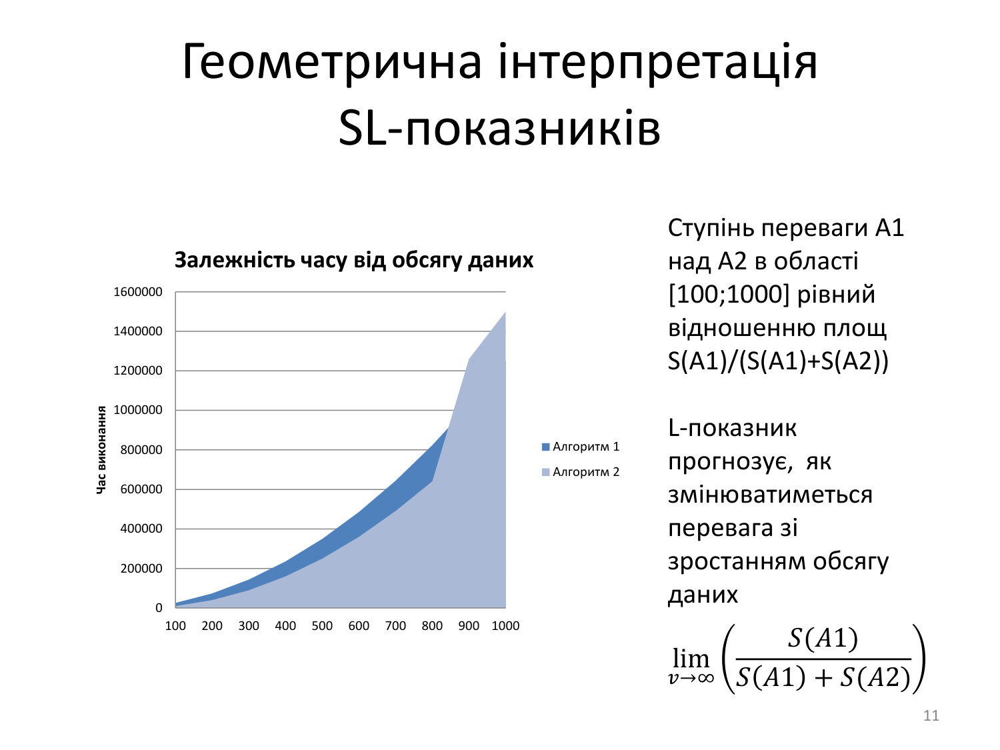
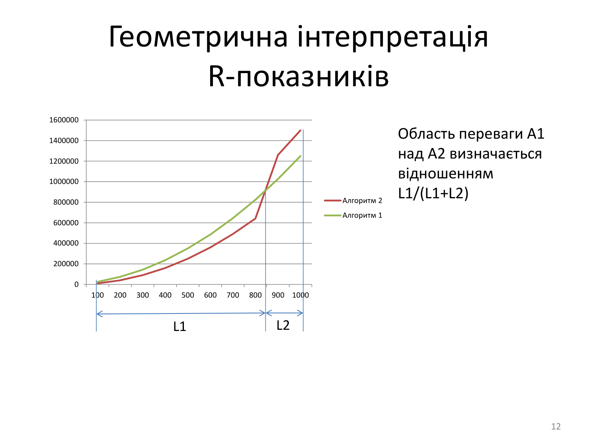

# Лекція 12. Часова ефективність обчислювальних алгоритмів

**Дисципліна:** Якість програмного забезпечення та тестування  
**Тема:** Часова ефективність обчислювальних алгоритмів (SRL-показники)  
**Викладач:** к.т.н., доцент Олена Сергіївна Куроп’ятник  

---

## Слайд 1: Титульний слайд

# Часова ефективність обчислювальних алгоритмів
**Лекція 12** з дисципліни «Якість ПЗ та тестування»  
**Викладач:** Олена Сергіївна Куроп’ятник

> **Детальний опис зображення для ШІ-агентів:**  
> Титульний логотип навчального курсу: зображення комп'ютера з відкритими графіками вимірювання швидкодії алгоритмів, кубики «QA», збільшувальне скло інженера з якості та шестерні системної оптимізації програмного коду.

---

## Слайд 2: Випадки при оцінюванні алгоритму

1. **Якщо існує лише один безальтернативний алгоритм:**
   - Обчислювальна складність алгоритму дає первинну теоретичну оцінку часової ефективності.
   - Застосовується **ймовірнісна оцінка** алгоритму на основі математичних моделей.
2. **Якщо існують альтернативні алгоритми (кілька конкурентних рішень):**
   - Застосовується **статистична оцінка** алгоритму.
   - Часову ефективність необхідно оцінювати за фактичними машинними реалізаціями алгоритмів у реальному програмно-апаратному середовищі.

---

## Слайд 3: Показники часової ефективності

Часова ефективність будь-якого алгоритму є багатовимірною функцією:
$$E = f(v, t, x, \psi, r)$$

де:
- $v$ – обсяг вхідних даних (Volume / розмір вибірки $N$);
- $t$ – тип даних (Type: цілі, дійсні, рядки, складені структури);
- $x$ – конкретні значення вхідних даних (Values: упорядковані, випадкові, обернені);
- $\psi$ – програмне середовище функціонування та створення виконуваного `.exe` файлу (компілятор, версія runtime/JVM/.NET, рівень оптимізації коду, системні бібліотеки);
- $r$ – архітектура комп’ютера (Hardware: процесор, розрядність, частота шини, ієрархія кеш-пам'яті L1–L3, обсяг RAM).

---

## Слайд 4: Порівняння ефективності алгоритмів

За наявності кількох функціонально еквівалентних алгоритмів необхідно провести порівняльний аналіз їхніх багатовимірних функцій ефективності:
$$E_1 = f_1(v, t, x, \psi, r)$$
$$E_2 = f_2(v, t, x, \psi, r)$$
$$\dots$$
$$E_n = f_n(v, t, x, \psi, r)$$

---

## Слайд 5: Задача визначення функції ефективності

Для коректного та об'єктивного порівняння часової ефективності двох конкуруючих алгоритмів необхідно визначити:
1. **$S$ (Ступінь переваги):** наскільки у середньому один з алгоритмів перевершує інший за часом виконання у досліджуваній області.
2. **$R$ (Співвідношення областей переваги):** чи у всій досліджуваній області спостерігається перевага одного алгоритму, а якщо ні – то як співвідносяться розміри областей переваги кожного з алгоритмів.
3. **$L$ (Межі переваги):** якою буде гранична перевага одного з алгоритмів при нескінченному зростанні обсягу даних ($v \to \infty$).

---

## Слайд 6: Система SRL-показників

### Вхідні множини (області визначення):
- $V^*$ – множина можливих значень обсягу даних;
- $T^*$ – множина можливих типів даних;
- $X^*$ – множина можливих значень даних;
- $\Psi^*$ – множина можливих програмних середовищ;
- $\Re^*$ – множина апаратних архітектур комп’ютерів, на яких можлива реалізація алгоритмів.

### Показники для порівняння:
- **$S$** – ступінь переваги $i$-го алгоритму над $j$-м на обмежених підмножинах ($V \subseteq V^*, T \subseteq T^*, X \subseteq X^*, \Psi \subseteq \Psi^*, \Re \subseteq \Re^*$).
- **$R$** – співвідношення розмірів областей переваги (у відсотках).
- **$L$** – асимптотичні межі переваги.

---

## Слайд 7: Розрахунок S-показника (Ступінь переваги)

$$S_{ij} = \frac{1}{N} \sum_{v \in V} \sum_{t \in T} \sum_{x \in X} \sum_{\psi \in \Psi} \sum_{r \in \Re} g_{ij}(v, t, x, \psi, r)$$

де:
- $N$ – загальна кількість експериментальних тестових точок;
- $g_{ij}$ – локальний ступінь переваги $i$-го алгоритму над $j$-м у конкретній точці простору:
  $$g_{ij} = \frac{f_j - f_i}{\max(f_i, f_j)}$$
- $f_i$ та $f_j$ – час виконання $i$-го та $j$-го алгоритмів відповідно.

---

## Слайд 8: Розрахунок R-показника (Співвідношення областей переваги)

$$R_{ij} = \frac{1}{N} \sum h_{ij}$$

де $h_{ij}$ – індикаторна ознака переваги $i$-го алгоритму над $j$-м у контрольній точці:
$$h_{ij} = \begin{cases} 1, & \text{якщо } f_i < f_j \text{ (перевага } i\text{-го алгоритму)} \\ 0.5, & \text{якщо } f_i = f_j \text{ (час однаковий)} \\ 0, & \text{якщо } f_i > f_j \text{ (перевага } j\text{-го алгоритму)} \end{cases}$$

---

## Слайд 9: Розрахунок L-показника (Межі переваги)

$$L_{ij} = \lim_{v \to \infty} g_{ij}$$

$L$-показник визначає асимптотичну межу переваги $i$-го алгоритму при необмеженому збільшенні обсягу оброблюваних даних ($v \to \infty$).

---

## Слайд 10: Спрощення розрахунку SRL-показників

Для реальних інженерних випробувань замість нескінченного сумування використовують методи математичної статистики:
- $\theta$ – оцінка математичного сподівання випадкової величини $\xi$ в області визначення;
- вибірковий розрахунок для репрезентативних точок вибірки з контролем статистичної похибки та довірчих інтервалів.

---

## Слайд 11: Геометрична інтерпретація SL-показників

> **Детальний опис зображення для ШІ-агентів:**  
> Графік геометричної інтерпретації $S$- та $L$-показників:  
> - **Вісь X:** Обсяг даних (від 100 до 1000 елементів).  
> - **Вісь Y:** Час виконання у мікросекундах (від 0 до 1 600 000).  
> - На графіку побудовано дві експериментальні криві:  
>   - **Алгоритм 1 ($A_1$):** синя лінія (нижча траєкторія зростання часу);  
>   - **Алгоритм 2 ($A_2$):** помаранчева крива (стрімкіше квадратичне зростання).  
> - **Геометричний зміст $S$:** ступінь переваги $A_1$ над $A_2$ на проміжку $[100; 1000]$ обчислюється як відношення інтегральних площ під кривими:  
>   $$\frac{S(A_1)}{S(A_1) + S(A_2)}$$  
> - **Геометричний зміст $L$:** границя відношення площ при $v \to \infty$: $\lim_{v \to \infty} \frac{S(A_1)}{S(A_1) + S(A_2)}$.

---

## Слайд 12: Геометрична інтерпретація R-показників

> **Детальний опис зображення для ШІ-агентів:**  
> Графік геометричної інтерпретації $R$-показника:  
> - Показано точку перетину двох часових кривих $A_1$ та $A_2$.  
> - Вісь обсягу розбивається точкою перетину на два інтервали довжиною $L_1$ та $L_2$:  
>   - На інтервалі $L_1$ (малі обсяги даних) швидшим є Алгоритм 2;  
>   - На інтервалі $L_2$ (великі обсяги даних) швидшим стає Алгоритм 1.  
> - Частка області переваги Алгоритму 1 визначається відношенням довжин інтервалів:  
>   $$R = \frac{L_2}{L_1 + L_2} \times 100\%$$

---

## Слайд 13: Аналіз значень SR-показників

- **Якщо отримана оцінка $S > 0$ (додатна):** це свідчить про загальну перевагу першого алгоритму над другим.
- **Якщо $S < 0$ (від'ємна):** це перевага другого алгоритму.
- **Оцінка $R$ демонструє співвідношення простору переваг:**
  - $R > 50\%$ – відсоток випробувань закінчився на користь першого алгоритму;
  - $R = 50\%$ – області переваг алгоритмів строго рівнозначні;
  - $R < 50\%$ – перевагу в більшості випадків має другий алгоритм.

---

## Слайд 14: Оцінка ефективності адаптованої структури даних за SR-показниками

*(Наукове дослідження: автор Забула Г.В., наук. керівник Шинкаренко В.І.)*

- **Суть адаптації:** автоматичне формування інтерфейсів структур даних (СД) із довільної програми користувача за допомогою рефлексії та програмних шаблонів.
- **Результати експерименту:** адаптована структура даних за часовою ефективністю перевершила всі контрольні реалізації у всій досліджуваній області ($R = 100\%$). Ступінь переваги досяг **$S \approx 90\%$**, що еквівалентно прискоренню виконання сценарію приблизно в **10 разів**.

---

## Слайди 15–17: Адаптація SRL-показників для виявлення запозичень та стиснення графів

*(Наукові дослідження: автор Куроп’ятник О.С., наук. керівник Шинкаренко В.І.)*

### 1. Дослідження чутливості алгоритмів виявлення запозичень (плагіату):
- Визначено ступінь чутливості ($S_{\text{disguise}}$), область змін ($R$) та абсолютний показник змін ($A$).
- Доведено, що для низки алгоритмів стійкість до маскування тексту залишається на рівні менше 1% втрати точності.

### 2. Дослідження ефективності стиснення графового представлення тексту:
- Текст моделюється орієнтованими графами з навантаженими вершинами та дугами.
- **Отримані статистичні результати стиснення:**
  - $S$ кількості вершин $\approx 96\%$ (зменшення на $\approx 5$ тис. шт.);
  - $S$ кількості дуг $\approx 90\%$ (зменшення на $\approx 5.2$ тис. шт.);
  - $S$ необхідного об’єму пам’яті $\approx 94.5\%$;
  - Область переваги стисненого графа над оригінальним: **$R = 100\%$**.

---

## Слайд 18: Необхідність використання показників часової ефективності

SRL-показники є обов'язковими для:
- розробки принципово нових алгоритмів;
- обґрунтованого вибору алгоритму в процесі проектування архітектури ПЗ;
- адаптації алгоритмів до специфічного апаратного середовища функціонування;
- оптимізації розроблених та діючих програмних засобів.

---

## Слайд 19: Матриця підходів до оцінки часової ефективності

| Призначення | Альтернативні алгоритми | Методологічний підхід | Рекомендована оцінка |
| :--- | :---: | :--- | :--- |
| **Оцінка нового алгоритму** | Немає | Ймовірнісний | Обчислювальна складність |
| **Оцінка нового алгоритму** | Є | Ймовірнісний + статистичний | Обчислювальна складність, $SRL$ |
| **Вибір алгоритму для розробки ПЗ** | Немає | Ймовірнісний + статистичний | Обчислювальна складність, $SR$ |
| **Вибір алгоритму для розробки ПЗ** | Є | Статистичний | $SR$ |
| **Оптимізація алгоритму без розпаралелення** | Є / Немає | Ймовірнісний + статистичний | Обчислювальна складність, $S$ |
| **Адаптація алгоритму до умов експлуатації** | Є / Немає | Статистичний | $SR$ |

---

## Слайд 20: Додаткові вимоги до правильного вибору алгоритму

1. Вибір можливий лише за умови внесення до специфікації програми всіх наявних відомостей про діапазони та типи вхідних даних.
2. При виборі раціонального алгоритму найбільш ефективними є $S$-$R$ показники, розраховані строго в області робочої специфікації.
3. Необхідно обов'язково враховувати схильність алгоритмів до апаратного розпаралелювання (векторизація SIMD, мультипотоковість).
4. Обов'язкове проведення натурних стендових випробувань на цільовій апаратній платформі.

---

## Слайд 21: Резюме

- Класична асимптотична обчислювальна складність $O(n)$ не завжди є достатньою для точного вибору алгоритму в промисловому ПЗ.
- **SRL-показники** надають строгу математичну та статистичну оцінку реальної часової поведінки алгоритмів.
- Вибір конкретної комбінації показників ($S$, $R$ чи $L$) залежить від мети дослідження (оптимізація, порівняння, стиснення чи довготривалий прогноз).

---

## Слайд 22: Завершення лекції

# Дякую за увагу!
