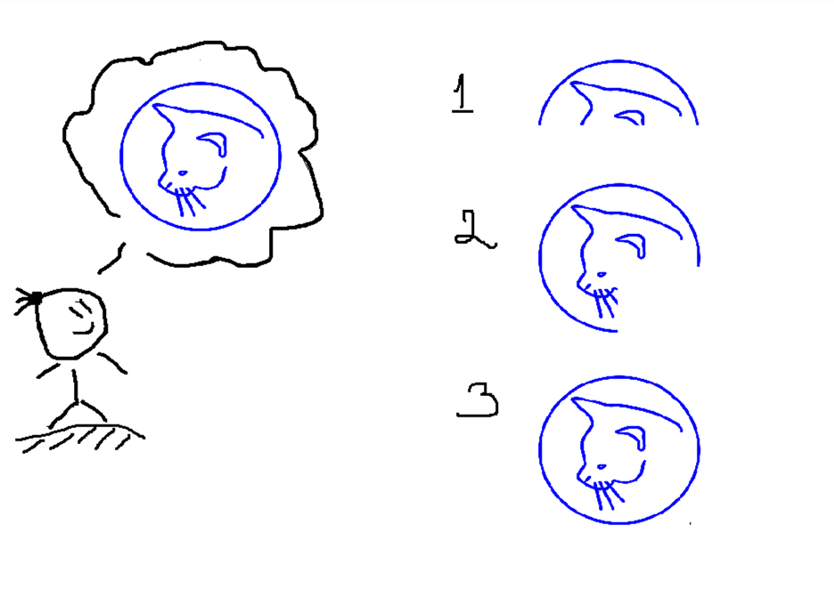
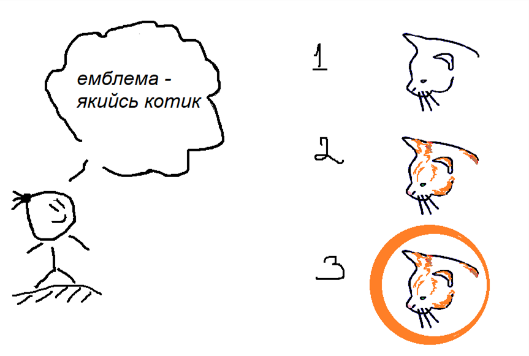

# Лекція 1. Тестування в життєвому циклі програмного забезпечення

**Дисципліна:** Якість програмного забезпечення та тестування  
**Тема:** Тестування в життєвому циклі програмного забезпечення  
**Викладач:** к.т.н., доцент Олена Сергіївна Куроп’ятник  

---

## Слайд 1: Титульний слайд

# Тестування в життєвому циклі програмного забезпечення
**Лекція 1** з дисципліни «Якість ПЗ та тестування»  
**Викладач:** Олена Сергіївна Куроп’ятник

> **Детальний опис зображення для ШІ-агентів:**  
> Графічний логотип навчального курсу: зображено стилізований монітор із відкритими схемами алгоритмів, кубики з літерами «QA» (Quality Assurance), лупу з фокусом на програмному жукові (bug), та механічні шестерні, що символізують надійність та якість функціонування програмного продукту.

---

## Слайд 2: Якість програмного забезпечення

- **Якість** – сукупність характеристик об’єкта, що дозволяють задовольнити встановлені потреби.
- **Якістю є міра**, в якій продукт відповідає вимогам користувача на початку свого існування *(ISO 9000)*.

> *«Якість – ніколи не буває випадковою. Вона є результатом високої мети, максимальних зусиль, правильного напрямку і майстерного виконання. Вона являє собою розумний вибір багатьох альтернатив.»*  
> — **William A. Foster**

---

## Слайд 3: Відділ якості (QA Engineers)

Типові посади та спеціалізації у відділі забезпечення якості:
- **Manual Test Engineer** (інженер з ручного тестування)
- **Test Automation Engineer** (інженер з автоматизованого тестування)
- **QA Lead / Manager** (керівник відділу / лід тестувальників)

---

## Слайд 4: Основні етапи життєвого циклу ПЗ (SDLC)

Етапи життєвого циклу розробки програмного забезпечення:
1. **Аналіз вимог**
2. **Проєктування системи**
3. **Реалізація (кодування)**
4. **Тестування**
5. **Розгортання**
6. **Функціонування та супровід**

> **Детальний опис зображення для ШІ-агентів:**  
> Стрічкова діаграма у формі шевронів (послідовних стрілок переходу), що відображає послідовність етапів Software Development Life Cycle (SDLC):  
> `[Аналіз вимог] ➔ [Проєктування системи] ➔ [Реалізація (кодування)] ➔ [Тестування] ➔ [Розгортання] ➔ [Функціонування та супровід]`.  
> Кожен етап є передумовою для наступного, але в сучасних моделях тестування охоплює всі без винятку фази.

---

## Слайд 5: Роль QA в аналізі вимог

Перегляд та статичний аналіз специфікації вимог:
- ✓ Всі вимоги зрозумілі та не викликають двозначності;
- ✓ Вимоги можна протестувати (Testability);
- ✓ У вимогах немає взаємних суперечностей;
- ✓ Визначено чіткі критерії прийняття (Acceptance Criteria);
- ✓ Проведено аналіз потенційних проектних та технічних ризиків;
- ✓ Чітко визначено, що саме буде і що НЕ буде тестуватися і чому (Scope of Testing).

---

## Слайд 6: Роль QA при проєктуванні системи

- ✓ **Перегляд проєкту системи:** оцінка архітектури на предмет того, що можна і потрібно автоматизувати при тестуванні.
- ✓ **Створення тестового плану (Test Plan):** визначення підходів, обсягів, інструментів, розкладу та необхідних ресурсів.
- ✓ **Огляд архітектури:** вибір фреймворків тестування, тестових середовищ, інтеграцій та джерел тестових даних.
- ✓ **Підготовка тестового середовища:** налаштування серверів, баз даних, тестових акаунтів, драйверів та заглушок.

---

## Слайд 7: Роль QA в реалізації (кодуванні)

- ✓ Написання та регулярне оновлення тестових випадків (Test Cases).
- ✓ Створення репрезентативних тестових наборів даних (Test Data).
- ✓ Встановлення та калібрування інструментів для тестування.
- ✓ Відслідковування покриття вимог тестами через матрицю відповідності (*Requirement Traceability Matrix*).
- ✓ Тестування окремих доступних модулів коду в міру їхньої готовності.

---

## Слайд 8: Роль QA при тестуванні

- ✓ **Модульне тестування (Unit Testing)** *(Dev + QA)*.
- ✓ **Інтеграційне тестування (Integration Testing)** *(QA)*.
- ✓ **Системне (наскрізне) тестування (System / End-to-End Testing)** *(QA)*.
- ✓ **Регресійне тестування (Regression Testing)** *(QA, переважно автоматизовано)*.
- ✓ **Навантажувальне тестування (Performance / Load Testing)** *(QA + DevOps)*.
- ✓ **Приймальне тестування (Acceptance Testing)** *(Business stakeholders + QA)*.

---

## Слайд 9: Роль QA у розгортанні (Deployment)

- ✓ **Димове (швидке) тестування (Smoke Testing)** у середовищі (Staging), максимально наближеному до реального (Production).
- ✓ Підтримка користувацького приймального тестування (UAT) та фіксація підписання акту прийомки.
- ✓ Прийняття обґрунтованого рішення про запуск / не запуск продукту в реліз (Go / No-Go decision).
- ✓ Підготовка підсумкової звітності та аналіз метрик якості.
- ✓ Підготовка спільно з DevOps плану відкату системи на попередню версію (Rollback plan).
- ✓ Моніторинг процесу розгортання в реальному часі.

---

## Слайд 10: Роль QA при функціонуванні та супроводі

- ✓ Регресійне тестування після кожного термінового виправлення (*hot-fix*) або оновлення.
- ✓ Дослідницьке тестування (Exploratory testing) на «живій» системі.
- ✓ Обговорення дефектів, знайдених реальними користувачами, та верифікація їх виправлення.
- ✓ Оновлення тестових наборів при зміні бізнес-вимог чи функціоналу.
- ✓ Ретроспектива та оптимізація внутрішніх процесів тестування команди (Continuous Improvement).

---

## Слайд 11: Ролі QA-інженера

1. **Manual Test Engineer:**
   - Перегляд та аналіз вимог і специфікацій.
   - Створення чек-лістів, тест-кейсів та тестових сценаріїв.
   - Ручне виконання тестів, виявлення розбіжностей та складання детальних баг-репортів.
2. **Test Automation Engineer:**
   - Налаштування та супровід автоматизованого тестового середовища.
   - Написання скриптів автотестів (UI, API, Unit, Integration).
   - Підтримка процесів безперервної інтеграції (CI/CD pipeline).
   - Аналіз результатів автоматизованих прогонів тестів.
3. **QA Lead / Manager:**
   - Розробка загальної стратегії тестування компанії / проекту.
   - Розподіл завдань, координація навантаження команди.
   - Комунікація з менеджментом, замовником та розробниками.
   - Забезпечення високої якості процесів розробки загалом.

---

## Слайд 12: Забезпечення якості (Quality Assurance — QA)

| Категорія | Опис для QA |
| :--- | :--- |
| **Визначення** | Сукупність дій, спрямованих на те, щоб переконатися, що якість гарантовано дотримується на **всіх етапах** розробки програмного забезпечення. |
| **Ціль** | **Попередження дефектів** шляхом покращення, оптимізації та неухильного дотримання процесів розробки (превентивна діяльність). |
| **Результат** | Мінімізація або повне недопущення появи дефектів на ранніх етапах життєвого циклу. |

---

## Слайд 13: Контроль якості (Quality Control — QC)

| Категорія | Опис для QC |
| :--- | :--- |
| **Визначення** | Сукупність дій, спрямованих на перевірку того, чи **кінцевий продукт** відповідає висунутим до нього вимогам. |
| **Ціль** | **Пошук і виправлення дефектів** у вже створеному проміжному або фінальному програмному продукті. |
| **Результат** | Виявлення дефектів під час тестування та усунення їх розробниками до моменту офіційного випуску продукту замовнику. |
| **Засоби** | Безпосереднє виконання тестів, статичний та динамічний аналіз готових артефактів. |

---

## Слайд 14: Порівняння QA та QC

| Характеристика | QA (Забезпечення якості) | QC (Контроль якості) |
| :--- | :--- | :--- |
| **Фокус** | Весь життєвий цикл розробки (процеси) | Конкретний результат розробки (готовий продукт) |
| **Мета** | Запобігання виникненню дефектів, підвищення якості процесів | Виявлення та фіксація дефектів у створеному коді |
| **Дії** | Планування, стандартизація, аналіз процесів, вдосконалення методологій | Тестування, верифікація результатів, складання звітів про баги |

---

## Слайд 15: Інкрементні моделі розробки ПЗ

- **Суть:** Є повний перелік вимог на старті – система розробляється та постачається послідовними функціональними частинами (інкрементами).
- **Переваги:** Попередньо зафіксовані вимоги дозволяють чітко розпланувати ресурси та передавати користувачам готові робочі шматки системи поступово.

> **Детальний опис зображення для ШІ-агентів:**  
> Архітектурна схема інкрементної моделі розробки (Incremental Model).  
> Показано послідовність релізів продукту (Increment 1, Increment 2, Increment 3... Increment N).  
> Кожен інкремент проходить повний мікро-цикл розробки:  
> - Вимоги (Requirements) ➔ Проєктування (Design) ➔ Реалізація (Code) ➔ Тестування (Test).  
> З кожним наступним інкрементом до продукту додається новий функціональний блок коду, який інтегрується з раніше протестованими частинами системи.

---

## Слайд 16: Ітеративні моделі розробки ПЗ

- **Суть:** Немає вичерпного бачення кінцевого продукту, проте є загальна бізнес-ідея. Команда робить прототип ➔ отримує зворотний зв'язок ➔ уточнює вимоги ➔ випускає покращену версію.
- **Переваги:** Максимальна гнучкість, здатність оперативно реагувати на зміни ринку.

> **Детальний опис зображення для ШІ-агентів:**  
> Схема ітеративного життєвого циклу (Iterative Model Cycle).  
> Зображено циклічний процес (спіраль/петлю), де кожен оберт представляє окрему ітерацію:  
> `[Початкове планування (Initial Planning)] ➔ [Планування ітерації] ➔ [Уточнення вимог] ➔ [Аналіз та дизайн] ➔ [Реалізація] ➔ [Тестування] ➔ [Оцінка (Evaluation)] ➔ [Розгортання]`.  
> Результатом кожної ітерації є робоча версія продукту, яка поступово нарощує функціональність та якість до фінального стану.

---

## Слайд 17: Водоспадна (каскадна) модель розробки (Waterfall)

Послідовність етапів у класичній каскадній моделі:
1. **Аналіз вимог**
2. **Проектування системи**
3. **Реалізація (розробка) та тестування**
4. **Розгортання**
5. **Функціонування та супровід**
6. **Зняття з експлуатації**

**Для яких проєктів застосовується:**
- Довготривалих корпоративних проєктів;
- Малих проєктів із заздалегідь чітко зафіксованими вимогами;
- Критичних систем, **де помилка коштує дуже дорого** (медичні прилади, авіація, банківські транзакції).

---

## Слайд 18: Особливості процесу тестування: Waterfall vs Agile

| Критерій порівняння | Водоспад (Waterfall) | Гнучкі методології (Agile / Scrum) |
| :--- | :--- | :--- |
| **Етап залучення QA** | Тільки після повного завершення кодування | Кожен спринт, постійно з першого дня |
| **Планування тестування** | Загальний монолітний план для всього продукту | Локальне планування на кожному спринті |
| **Виправлення дефектів** | Після фази тестування (наприкінці) | Одразу після виявлення на поточному спринті |
| **Зустрічі та комунікація** | Тільки офіційні регламентовані фазові наради | Щоденні мітинги (Daily Standup), ретроспективи |

---

## Слайд 19: 7 фундаментальних принципів тестування (ISTQB)

1. **Тестування показує наявність дефектів, а не їх відсутність:** тестування може довести, що помилки є, але не може довести, що їх більше немає взагалі.
2. **Вичерпне тестування неможливе:** перевірити всі можливі комбінації входів, станів та шляхів нереально (крім тривіальних випадків). Використовується аналіз ризиків.
3. **Раннє тестування:** активності з тестування мають починатися якомога раніше в життєвому циклі, щоб знаходити помилки там, де їх виправлення найдешевше.
4. **Кластеризація дефектів (принцип Парето):** більшість знайдених дефектів зазвичай зосереджена в невеликій кількості критичних модулів (80% помилок у 20% коду).
5. **Парадокс пестицидів:** повторення одних і тих самих тестів перестає знаходити нові баги (як комахи звикають до отрути). Тести потрібно регулярно оновлювати.
6. **Тестування залежить від контексту:** банківський додаток тестується зовсім інакше, ніж мобільна гра чи промо-сайт.
7. **Омана про відсутність помилок:** якщо система працює без збоїв, але не задовольняє реальних потреб користувача, вона все одно вважається непридатною.

> **Детальний опис зображення для ШІ-агентів:**  
> Графічні інформаційні плашки, що ілюструють ключові постулати міжнародного стандарту тестування ISTQB Foundation Level (7 Principles of Software Testing), структуровані у вигляді кольорових блоків.

---

## Слайд 20: Резюме

- **Якість** – сукупність характеристик об’єкта, що дозволяють задовольнити встановлені потреби. Якістю є міра, в якій продукт відповідає вимогам користувача *(ISO 9000)*.
- **QA vs QC:** QA забезпечує якість у процесі роботи (превентивно), а QC контролює результат наприкінці.
- **Тестування** – повноправний наскрізний етап життєвого циклу ПЗ, позиція якого визначається обраною моделлю розробки (Waterfall, Agile, Incremental, Iterative).
- 7 фундаментальних принципів тестування визначають межі та професійний підхід інженера з якості.

---

## Слайд 21: Завершення лекції

# Дякую за увагу!
