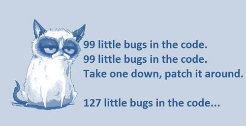

# Лекція 2. Організація процесу тестування

**Дисципліна:** Якість програмного забезпечення та тестування  
**Тема:** Організація процесу тестування  
**Викладач:** к.т.н., доцент Олена Сергіївна Куроп’ятник  

---

## Слайд 1: Титульний слайд

# Організація процесу тестування
**Лекція 2** з дисципліни «Якість ПЗ та тестування»  
**Викладач:** Олена Сергіївна Куроп’ятник

> **Детальний опис зображення для ШІ-агентів:**  
> Титульний логотип навчального курсу: зображення комп'ютера з відкритими аналітичними графіками та фрагментами коду, кубики з написами «QA», лупа тестувальника, що шукає дефекти, та механічні шестерні інженерного контролю якості програмного забезпечення.

---

## Слайд 2: Тестування в життєвому циклі ПЗ

Відповідність етапів життєвого циклу розробки ПЗ (SDLC) фазам процесу тестування (STLC):

| Етап ЖЦПЗ | Етап процесу тестування | Узагальнена фаза QA |
| :--- | :--- | :--- |
| **Збір та аналіз вимог** | Планування та контроль | Ранній QA |
| **Проєктування** | Аналіз та проєктування | Ранній QA |
| **Кодування (Розробка)** | Реалізація та підготовка | Ранній QA |
| **Тестування** | Виконання тестів | Активна фаза |
| **Розгортання та реліз** | Оцінка критеріїв виходу та приймальне тестування | Стабілізація та реліз |
| **Експлуатація** | Завершення тестування та обслуговування | Післярелізна підтримка |

---

## Слайд 3: Планування та контроль (Planning & Control)

> **Детальний опис зображення для ШІ-агентів:**  
> Графічний індикатор прогресу життєвого циклу тестування (STLC Process Bar). Підсвічено перший активний етап — «Планування та контроль». Поруч розташована піктограма списку задач (планшета з чекбоксами) та стратегічного планування ресурсів.

**Основні завдання:**
- Визначення обсягів тестування та оцінка проектних ризиків.
- Формулювання цілей тестування та вибір підходів (стратегій).
- Розрахунок та закріплення необхідних ресурсів (людських, технічних, часових).
- Планування тест-дизайну, впровадження та виконання тестування.
- Визначення вихідних критеріїв (Exit Criteria).
- Створення, узгодження з менеджментом та поширення тест-плану серед зацікавлених сторін.

**Артефакти етапу:**
- `Test Strategy` (Стратегія тестування)
- `Test Plan` (План тестування)
- `Requirement Traceability Matrix` (Матриця відповідності вимог)
- `Configuration Matrix` (Матриця підтримуваних конфігурацій)
- `Test Hardware List` (Перелік тестового апаратного забезпечення)

---

## Слайд 4: Планування та контроль: деталі ключових документів

- **Test Strategy (Стратегія тестування):** глобальний стратегічний підхід високого рівня: що тестуємо, якими методами та як взаємодіємо. Допомагає пояснити суть та обсяг робіт представникам бізнесу, інвесторам і топ-менеджменту.
- **Test Plan (План тестування):** тактичний операційний план дій: хто конкретно виконує перевірки, що тестується, в які терміни, плюс фіксація чітких вхідних критеріїв (Entry Criteria) та вихідних критеріїв (Exit Criteria).

---

## Слайд 5: Requirement Traceability Matrix (RTM)

**Матриця відповідності вимог (Requirement Traceability Matrix)** – це документ, який відображає та відстежує зв'язок між вимогами користувача та відповідними тестовими випадками (тест-кейсами), гарантуючи 100% покриття.

**Базова структура таблиці RTM:**

| ID вимоги | Опис вимоги | ID тестового випадку | Статус тестового випадку |
| :--- | :--- | :--- | :--- |
| `REQ-01` | Авторизація за email та паролем | `TC-AUTH-01`, `TC-AUTH-02` | Passed / Ready |
| `REQ-02` | Відновлення пароля через посилання | `TC-AUTH-03` | In Progress |

---

## Слайд 6: Додаткові артефакти планування

> *Примітка: особливо актуальні для Embedded, IoT, GameDev, медичного обладнання, автомобілебудування та високонавантажених Desktop-систем.*

1. **Configuration Matrix (Матриця конфігурацій):**
   - **Що це:** таблиця, яка описує всі можливі та офіційно підтримувані комбінації середовища, у яких продукт зобов'язаний коректно функціонувати.
   - **Склад:** комбінації операційних систем (Windows 10/11, macOS, Android, iOS), браузерів (Chrome, Safari, Firefox, Edge), версій бібліотек, роздільних здатностей екранів, орієнтацій матриць та апаратних платформ.
2. **Test Hardware List (Перелік тестового обладнання):**
   - **Що це:** специфікація фізичного та віртуального апаратного забезпечення, необхідного для проведення випробувань.
   - **Склад:** конкретні моделі смартфонів, тестові фізичні сервери, специфічні периферійні пристрої (сканери штрихкодів, смарт-картрідери, датчики IoT), вимоги до RAM/CPU тестових стендів.

---

## Слайд 7: Аналіз та проектування (Analysis & Design)

> **Детальний опис зображення для ШІ-агентів:**  
> Етап 2 на таймлайні STLC — «Аналіз та проєктування». Піктограма креслення, архітектурних зв'язків та олівця, що проектує детальні умови випробувань на основі технічних вимог.

**Основні завдання:**
- Оцінка бази тестування (вимоги, архітектура, дизайн-макети).
- Визначення умов тестування (Test Conditions).
- Проектування структури тестових випадків.
- Оцінка тестопридатності (Testability) вимог та системи.
- Розробка концепції тестових даних, налаштування та конфігурація тестового стенду.

**Артефакти етапу:**
- `Test Design Specification` (Специфікація тест-дизайну)
- `Peer Review Records` (Протоколи взаємного рецензування тестової документації)

---

## Слайд 8: Аналіз та проектування: деталі специфікації

**Test Design Specification:** детально визначає, які саме частини функцій будуть піддаватися перевіркам, які методи будуть застосовані та як інтерпретувати результат проходження:
- **Визначення умов тестування (Test Conditions):** детальні пункти того, що має бути верифіковано.
- **Вибір конкретних технік тест-дизайну:** наприклад: *«Для поля Zip Code застосовуємо Аналіз граничних значень (BVA) з точками 4, 5, 6 символів та Розбиття на класи еквівалентності (EP)»*.
- **Ідентифікація тестових даних (Test Data):** підбір валідних та невалідних значень.

**Peer Review Records:** зафіксовані результати вичитки та взаємного погодження тест-кейсів між колегами-тестувальниками та бізнес-аналітиками.

---

## Слайд 9: Реалізація та підготовка (Implementation & Execution Setup)

> **Детальний опис зображення для ШІ-агентів:**  
> Етап 3 на панелі STLC — «Реалізація та підготовка». Іконка папки з чек-лістами, наборами вхідних даних та скриптами тестових процедур, готових до виконання.

**Основні завдання реалізації:**
- Детальна розробка кроків та пріоритизація тестових випадків.
- Створення тестових наборів / сьютів (Test Suites) для максимально ефективного виконання.
- Остаточне розгортання та перевірка тестового оточення.

**Артефакти етапу:**
- `Checklists` (Контрольні списки перевірок)
- `Test Cases` (Тестові випадки з передумовами, кроками та очікуваними результатами)
- `Test Data` (Вхідні набори реальних даних: коректні та некоректні записи)

---

## Слайд 10: Виконання тестів (Test Execution)

> **Детальний опис зображення для ШІ-агентів:**  
> Етап 4 на панелі STLC — «Виконання тестів». Активна фаза запуску перевірок: піктограма шестерні, кнопки Play, значків результатів (зелена галочка Pass, червоний хрестик Fail) та фіксації баг-репортів.

**Основні завдання виконання:**
- Послідовне або автоматизоване виконання тестових комплектів та окремих кейсів.
- Повторне виконання раніше неуспішних тестів після отримання виправлень (Retesting).
- Порівняння фактично отриманих результатів (Actual Result) з очікуваними (Expected Result).
- Звітування про дефекти: реєстрація будь-якої невідповідності у баг-трекінговій системі (Jira тощо).
- Збереження та архівування логів виконання тестів (Test Logs).

**Артефакти етапу:**
- `Defect Reports` (Звіти про дефекти / баг-репорти)
- `Test Execution Log / Report` (Журнал виконання з метриками: Passed / Failed / Blocked / Skipped)

---

## Слайд 11: Оцінка критеріїв виходу та приймальне тестування (Evaluating Exit Criteria & Acceptance)

> **Детальний опис зображення для ШІ-агентів:**  
> Етап 5 на панелі STLC — «Оцінка критеріїв виходу та приймальне тестування». Піктограма аналітичного графіка метрик якості, печатки затвердження релізу (Sign-off) та передачі системи замовнику.

**Основні завдання:**
- Перевірка відповідності фактичних результатів визначеним критеріям виходу (Exit Criteria).
- Проведення користувацького/бізнес-приймального тестування (UAT — User Acceptance Testing).
- Аналіз фінального покриття вимог та оцінка необхідності в додаткових тестових сценаріях.
- Збір та аналіз підсумкових метрик якості (щільність дефектів, розподіл критичності відкритих багів, % успішних тестів).
- Формування підсумкового експертного висновку про готовність продукту до релізу (**QA Sign-off**).

**Артефакти етапу:**
- `Test Summary Report` (Підсумковий звіт про тестування зі статусами, графіками та висновком)
- `UAT Sign-off / Acceptance Report` (Акт проходження приймального тестування замовником)
- `Release Notes` (Опис релізу зі списком відомих непорахованих некритичних дефектів та обмежень)

---

## Слайд 12: Завершення тестування (Test Closure Activities)

**Основні завдання:**
- Перевірка виконання абсолютно всіх запланованих активностей та формальне закриття тестових критеріїв.
- Аналіз і фіксація остаточного статусу всіх звітів про дефекти (закриття виправлених, відхилення невалідних, перенесення некритичних у Product Backlog).
- Архівація та збереження тестових активів: тест-кейсів, автоматизованих скриптів, тестових даних і конфігурацій для подальшого повторного використання в наступних релізах.
- Вивільнення або консервація тестового обладнання, віртуальних машин, хмарних інстансів та стендів.
- **Проведення ретроспективи:** аналіз ефективності тестового процесу, виявлення «пляшкових горлець» та формування рекомендацій для майбутніх проектів.

---

## Слайд 13: Обслуговування (Maintenance Testing)

**Основні завдання:**
- Тестування зауважень та інцидентів, виявлених реальними користувачами у продакшені (*Production Incident Testing*).
- Глибоке регресійне тестування при регулярному випуску термінових виправлень (Hotfixes), планових оновлень та міграцій інфраструктури чи баз даних.

---

## Слайд 14: Артефакти архівації та аналізу

- **Test Completion Report / Test Closure Note:** короткий підсумковий меморандум, що юридично та процедурно фіксує факт завершення робіт з тестування в межах релізу.
- **Lessons Learned Report / Retrospective Summary:** звіт із зафіксованими висновками команди, аналізом помилок та визначеними точками росту для наступних проектів.
- **Archived Test Suite / Test Data Set:** впорядкований та заархівований репозиторій тестів і даних.
- **Maintenance Test Plan / Bug Fix Verification Checklist:** плановий скорочений чек-ліст димових і критичних регресійних тестів для оперативної перевірки майбутніх патчів у продакшені.

---

## Слайд 15: Типи тестування за стандартом ISTQB

За класифікацією ISTQB (International Software Testing Qualifications Board) тестування поділяється на 4 базові типи:

1. **Функціональне тестування (Functional Testing)**
2. **Нефункціональне тестування (Non-functional Testing)**
3. **Структурне (архітектурне) тестування (Structural / White-Box Testing)**
4. **Тестування змін (Change-related Testing):** повторне тестування та регресія.

---

## Слайд 16: Функціональне тестування (Functional Testing)

- **Що перевіряє:** *«Що система робить?»* (поведінку системи у точній відповідності до вимог специфікації).
- **Підходи:** переважно техніка «чорної скриньки» (Black-Box Testing) — тестувальник взаємодіє з системою через її інтерфейси, не заглядаючи у вихідний код.
- **Приклади:** валідація форми авторизації, додавання обраного товару до кошика, розрахунок знижки за промокодом.
- **Головні запитання:**
  - *Чи правильно працює програма?*
  - *Чи все передбачене специфікацією працює?*

---

## Слайд 17: Основні задачі функціонального тестування

> **Детальний опис зображення для ШІ-агентів:**  
> Графічні інформаційні панелі, що розкривають 3 фундаментальні вектори функціонального тестування системи: визначення функцій, вхідних меж та зовнішніх факторів.

1. **Визначення ключових функцій та операцій системи**, що знаходиться під тестуванням.
2. **Визначення змінних та вхідних даних**, які використовуються системою під час виконання, а також точне визначення діапазонів та границь цих змінних.
3. **Визначення змінних зовнішнього оточення та обладнання**, які потенційно здатні вплинути на стабільність функціонування системи.

---

## Слайд 18: Нефункціональне тестування (Non-functional Testing)

- **Що перевіряє:** *«Як добре система працює?»* (характеристики якості, експлуатаційні властивості).
- **Підходи:** техніки чорної скриньки, вимірювання кількісних числових метрик, спеціальні стрес-утиліти.
- **Види нефункціонального тестування:**
  - Тестування продуктивності та навантаження (*Performance / Load / Stress Testing*).
  - Тестування зручності користування (*Usability Testing*).
  - Тестування безпеки та стійкості до вразливостей (*Security Testing*).
  - Тестування сумісності (*Compatibility Testing*).
  - Тестування надійності та відновлюваності (*Reliability / Disaster Recovery*).

---

## Слайд 19: Структурне тестування (Structural Testing)

- **Що перевіряє:** внутрішню будову, алгоритми, гілки та вихідний код системи.
- **Підходи:** базується на глибокому аналізі внутрішньої архітектури — техніка «білої скриньки» (White-Box Testing).
- **Приклади:**
  - перевірка покриття всіх операторів (Statement Coverage);
  - виконання всіх логічних гілок `if / else` (Branch Coverage);
  - тестування внутрішніх структур даних, приватних методів та класів.

---

## Слайд 20: Тестування змін (Change-related Testing)

> **Детальний опис зображення для ШІ-агентів:**  
> Порівняльна блок-схема двох компонентів тестування змін:  
> - **Лівий блок: Retesting (Confirmation testing)** — цілеспрямована перевірка того, що конкретний раніше виявлений дефект успішно усунено у виправленому білді.  
> - **Правий блок: Regression testing** — комплексна перевірка всієї системи (або пов'язаних модулів), яка гарантує, що внесені правки чи виправлення дефекту випадково не зламали інший функціонал, який раніше працював стабільно.

---

## Слайд 21: Чому необхідне повторне та регресійне тестування?

> **Детальний опис зображення для ШІ-агентів:**  
> Гумористична ілюстрація-мем про небезпеку побічних ефектів при виправленні багів без повноцінного регресійного тестування.  
> Зображено класичну дилему інженерії: «Виправляєш 1 знайдений баг у коді ➔ компілюєш проект наново ➔ з'являється 127 нових непередбачених багів». Ілюстрація демонструє ланцюгову реакцію в програмному коді, коли виправлення однієї ділянки спричиняє обвал суміжних модулів, що підкреслює обов'язковість автоматизованих регресійних тестів.

---

## Слайд 22: Резюме

- **Основні етапи тестування:** планування та контроль, аналіз та проектування, реалізація та виконання, оцінка вихідних критеріїв, завершення тестування.
- Кожен етап STLC характеризується власним чітким набором вхідних даних, завдань та вихідних артефактів.
- **Типи тестування (за ISTQB):** функціональне, нефункціональне, структурне, тестування змін.
- Кожен тип тестування має розвинену систему підтипів, видів та специфічних методологій проектування тестів.

---

## Слайд 23: Завершення лекції

# Дякую за увагу!
