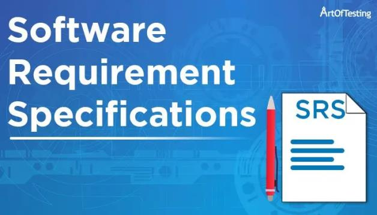
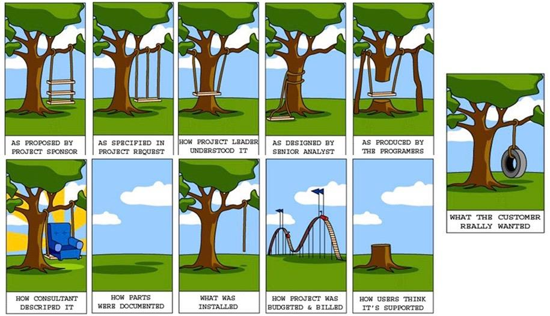

# Лекція 3. Аналіз вимог та тестування

**Дисципліна:** Якість програмного забезпечення та тестування  
**Тема:** Аналіз вимог та тестування  
**Викладач:** к.т.н., доцент Олена Сергіївна Куроп’ятник  

---

## Слайд 1: Титульний слайд

# Аналіз вимог та тестування
**Лекція 3** з дисципліни «Якість ПЗ та тестування»  
**Викладач:** Олена Сергіївна Куроп’ятник

> **Детальний опис зображення для ШІ-агентів:**  
> Логотип навчального курсу: монітор із зображенням програмного коду та метрик якості, кубики «QA» (Quality Assurance), лупа над цифровим жуком (дефектом) та інженерні шестерні взаємодії процесів тестування.

---

## Слайд 2: Джерела вимог

Основні формати фіксації та джерела вимог до програмного забезпечення:
1. **Специфікація вимог до ПЗ (SRS – Software Requirements Specification)**
2. **Діаграми прецедентів (Use Case Diagrams)**
3. **Історії користувача (User Stories)**

> **Детальний опис зображення для ШІ-агентів:**  
> Графічні піктограми трьох ключових джерел вимог:  
> 1. Документ зі специфікацією (SRS) — формальний текстовий контракт;  
> 2. UML Use Case діаграма — схематичні актори (стікмени) та овали системних прецедентів;  
> 3. Стікери User Story — картки користувацьких історій за форматом Agile.

---

## Слайд 3: Специфікація вимог до програмного забезпечення (SRS)

- **SRS (Software Requirements Specification)** — це формальний документ, що фіксує угоду між замовником та командою розробників/виконавців.
- Містить вичерпні функціональні та нефункціональні вимоги до проектованої системи.
- Використовується як єдина довідкова база та нормативна основа для всіх подальших етапів розробки, тестування та приймання продукту.

---

## Слайд 4: Структура SRS (за стандартом IEEE 830 / ISO/IEC/IEEE 29148)

Базова структура специфікації вимог складається з 3 основних розділів:
1. **Вступ (Introduction)**
2. **Загальний опис (Overall Description)**
3. **Детальні вимоги (Specific Requirements)**

> *Примітка: структура базується на посібнику IEEE щодо специфікацій вимог; точний перелік підрозділів може адаптуватися залежно від специфіки організації та проекту.*

---

## Слайд 5: SRS: Вступ

Підрозділи вступного розділу специфікації:
- **Призначення / мета:** навіщо створюється даний документ і для кого призначений.
- **Область застосування:** межі системи, що розробляється.
- **Визначення, акроніми та абревіатури:** глосарій термінів предметної області.
- **Список літератури / посилань:** стандарти, пов'язані документи, нормативні акти.
- **Огляд документа:** коротка навігація по структурі SRS.

---

## Слайд 6: SRS: Загальний опис

Підрозділи розділу загального опису системи:
- **Перспектива продукту:** контекст системи (автономний продукт чи частина більшого комплексу).
- **Функції продукту:** високорівневе резюме головних функціональних можливостей.
- **Характеристики користувача:** цільова аудиторія, кваліфікація, рівень технічних навичок.
- **Загальні обмеження:** нормативні, технологічні, апаратні чи корпоративні ліміти.
- **Припущення та залежності:** зовнішні сервіси, стабільність сторонніх API, операційні умови.

---

## Слайд 7: SRS: Детальні вимоги

Структура специфікації конкретних вимог:
1. **Вимоги до зовнішніх інтерфейсів:**
   - Інтерфейси користувача (UI / UX).
   - Апаратні інтерфейси (підтримка конкретного обладнання).
   - Програмні інтерфейси (API, протоколи взаємодії з ОС, БД, іншими системами).
   - Інтерфейси зв'язку (мережеві протоколи, безпека передачі даних).
2. **Функціональні вимоги:**
   - Модуль $N$ ➔ Функціональна вимога $N.1$ ➔ Функціональна вимога $N.2$ ...
3. **Вимоги до продуктивності / виконання (Performance):** час відгуку, пропускна здатність.
4. **Проектні обмеження:** мови програмування, архітектурні патерни, ліцензії бібліотек.
5. **Атрибути якості ПЗ:** безпека, надійність, супроводжуваність.
6. **Інші специфічні вимоги.**

---

## Слайд 8: Діаграма прецедентів (Use Case Diagram)

- Письмовий та графічний опис сценаріїв взаємодії користувача (актора) з програмним продуктом для досягнення певної бізнес-мети.
- Є наочним способом представлення різних варіантів дій, у яких може бути задіяна система (функціонал, який система надає своїм ролям).
- **Слугує первинною основою для написання тестових сценаріїв (Test Scenarios)** – тверджень високого рівня, що описують функціональні можливості тестованої програми.

---

## Слайд 9: Історія користувача (User Story)

- **User Story** – це неформальне, лаконічне пояснення функції програмного забезпечення, написане простою людською мовою з точки зору кінцевого користувача.
- **Мета:** чітко сформулювати, яку саме цінність (Value) для користувача чи бізнесу несе даний функціонал. Вона об'єднує бізнес-потребу, вимоги для розробки та основу для тестування.
- **Класичний шаблон:**
  $$	ext{«Як [персона / роль], я хочу [дію / функцію], щоб [отримати вигоду / цінність]»}$$
  *(As a [role], I want [action], so that [business value]).*

---

## Слайд 10: Критерії валідації вимог (Критерії якості вимог)

Вимоги повинні відповідати 5 обов'язковим інженерним критеріям:
1. **Повнота (Completeness):** містить усю необхідну інформацію для однозначної реалізації.
2. **Однозначність (Unambiguity):** допускає лише одне тлумачення всіма учасниками процесу.
3. **Відслідковуваність (Traceability):** кожна вимога має унікальний постійний ідентифікатор (ID).
4. **Консистентність / несуперечливість (Consistency):** жодна вимога не суперечить іншим вимогам чи стандартам.
5. **Тестованість (Testability):** існує можливість сформулювати чіткий тест-кейс із критерієм успішного проходження (Pass/Fail).

---

## Слайд 11: Проблема невизначеності вимог

> **Детальний опис зображення для ШІ-агентів:**  
> Класичний карикатурний комікс «Tree Swing Project» (Як насправді створюються програмні проекти при порушенні комунікації та невизначеності вимог):  
> 1. **Як пояснив замовник (How the customer explained it):** гойдалка з трьома дошками, прикріпленими двома мотузками до гілки, через що на ній неможливо розгойдуватися.  
> 2. **Як зрозумів керівник проекту (How the project leader understood it):** гойдалка, підвішена навколо стовбура дерева.  
> 3. **Як спроектував системний аналітик (How the analyst designed it):** дерево розпиляне посередині і підперте балками, щоб гойдалка могла проходити.  
> 4. **Як написав програміст (How the programmer wrote it):** мотузка прив'язана до стовбура, дошка лежить на землі.  
> 5. **Як описав бізнес-консультант (How the business consultant described it):** розкішне м'яке крісло замість дошки на тлі американських гірок.  
> 6. **Як проект був задокументований (How the project was documented):** чистий білий аркуш (документація взагалі відсутня).  
> 7. **Що було встановлено в експлуатацію (What operations installed):** просто мотузка, що звисає з дерева без дошки.  
> 8. **Який рахунок виставили замовнику (How the customer was billed):** рахунок на мільйони доларів, наче збудували суперсучасний атракціон.  
> 9. **Як здійснювалася підтримка (How it was supported):** спиляний пеньок дерева.  
> 10. **Що замовнику було насправді потрібно (What the customer really needed):** проста автомобільна шина, підвішена на одній міцній мотузці до гілки дерева.  
> **Висновок:** демонструє критичну важливість раннього тестування та валідації вимог інженерами з якості.

---

## Слайди 12–14: Структура тестового випадку (Test Case Structure)

Обов'язкові поля професійного тест-кейсу:
- **Test Case ID:** унікальний числовий або літерний ідентифікатор.
- **Назва (Title / Summary):** коротка суть перевірки.
- **Опис (Description):** контекст та бізнес-правило.
- **Передумови (Preconditions):** стан системи перед початком тесту.
- **Тестові дані (Test Data):** конкретні вхідні параметри.
- **Кроки виконання (Steps to reproduce):** послідовність дій.
- **Очікуваний результат (Expected Result):** поведінка системи згідно зі специфікацією.
- **Фактичний результат (Actual Result):** те, що відбулося на практиці (заповнюється при виконанні).
- **Статус (Status):** Pass / Fail / Blocked.

---

## Слайд 15: Тестовий випадок: деталізація кроків

> **Детальний опис зображення для ШІ-агентів:**  
> Зразок оформлення кроків у тестовому випадку для верифікації посилань мапи сайту:  
> `1. Go to Home page as logged in user.`  
> `2. Click "Sitemap" link.`  
> `3. Click Privacy Policy, Terms & Conditions and Cookie Policy hyperlinks one-by-one.`  
> `4. Repeat #1-3 steps for not logged user account.`

**Методологічні правила опису кроків:**
- Поле «Кроки» може бути незалежною нумерованою таблицею або частиною опису.
- Описуються конкретні дії перевірки.
- Кроки мають бути вичерпними та зрозумілими, щоб будь-який інший тестувальник міг легко відтворити їх без додаткових консультацій.
- **Застереження:** уникати надмірної тривіальної деталізації, на кшталт *«1. Підійдіть до комп’ютера. 2. Увімкніть монітор»*.

---

## Слайди 16–20: Класифікація тестової документації

- **Чек-ліст (Checklist):** список того, що має бути протестовано (без детальних кроків). Швидкий у створенні, потребує високої експертизи тестувальника.
- **Тест-кейс (Test Case):** деталізована інструкція з передумовами, кроками та точним очікуваним результатом.
- **Тестовий набір (Test Suite):** логічне об'єднання тест-кейсів (наприклад, сьют регресійного тестування модуля оплати).

---

## Слайд 21: Різновиди методів тестування

1. **Методи розробки статичних тестів (Static Testing Techniques):**
   - Тестування без виконання коду чи запуску програми.
   - Пов'язане із забезпеченням якості процесів: рецензування вимог (Review), інспекції, статичний аналіз коду лінтерами та сканерами безпеки.
2. **Методи розробки динамічних тестів (Dynamic Testing Techniques):**
   - Тестування шляхом фактичного запуску та виконання тестованої програми.
   - Тестувальник подає вхідні набори даних на вхід програми, виконує обчислення та перевіряє вихідні результати.

---

## Слайди 22–24: Методи розробки динамічних тестів

Динамічні техніки тест-дизайну поділяються на 3 групи:

1. **На основі специфікацій (чорна скринька / Black-Box):**
   - Розбиття на класи еквівалентності (Equivalence Partitioning).
   - Аналіз граничних значень (Boundary Value Analysis – BVA).
   - Таблиці рішень (Decision Tables).
   - Графіки причинно-наслідкових зв’язків (Cause-Effect Graphing).
   - Тестування переходів між станами (State Transition Testing).
   - Тестування варіантів використання (Use Case Testing).
2. **На основі структури (біла скринька / White-Box):**
   - Вимагає детального знання коду та архітектури.
   - Тестування операторів (Statement Coverage).
   - Тестування розгалужень / рішень (Branch / Decision Coverage).
   - Тестування умов (Condition Coverage).
   - Тестування шляхів (Path Coverage).
3. **На основі досвіду (Experience-Based):**
   - Не вимагає формальних систематичних математичних схем; базується на знаннях та інтуїції інженера.
   - Спеціальне дослідницьке тестування (Ad-hoc Testing).
   - Дослідницьке тестування за сесіями (Exploratory Testing).
   - Передбачення помилок (Error Guessing).

---

## Слайд 25: Резюме

- Тестування нерозривно пов’язане з вимогами, які фіксуються у вигляді SRS, Use Case діаграм та User Stories.
- На базі вимог проектуються сценарії та детальні тестові випадки (Test Cases).
- Застосовуються статичні методи (перевірка артефактів без запуску) та динамічні методи (виконання коду).
- Динамічні тести поділяються на методи на основі специфікації (чорна скринька), на основі структури (біла скринька) та на основі інтуїції й досвіду тестувальника.

---

## Слайд 26: Завершення лекції

# Дякую за увагу!
