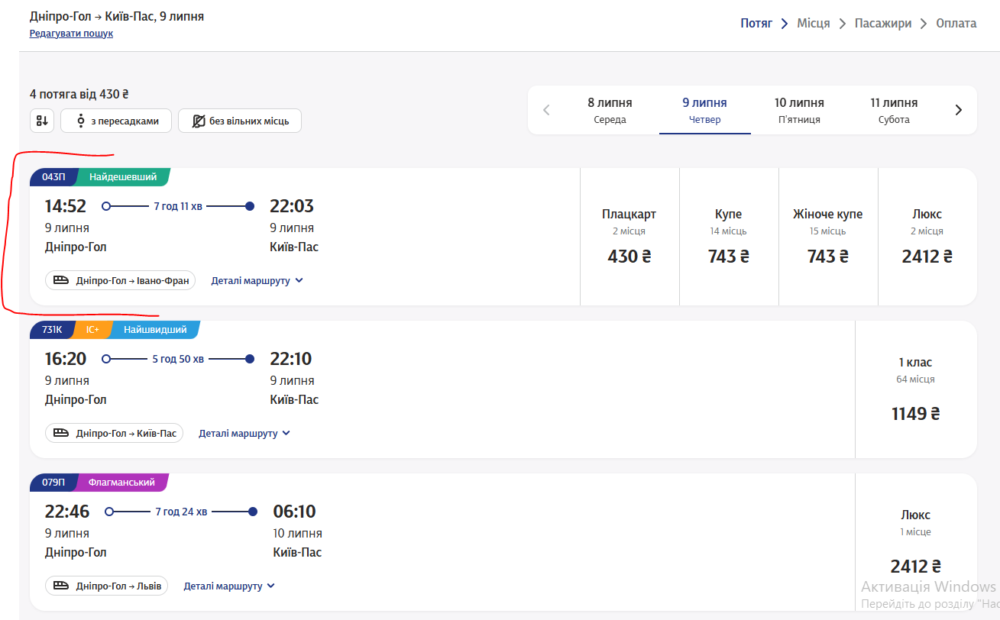
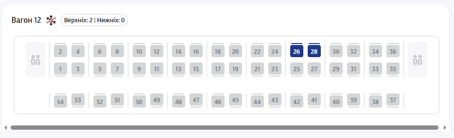

# Приклади розробки Test Case та CheckList (Матеріали до Лекції 3)

**Дисципліна:** Якість програмного забезпечення та тестування  
**Тема:** Приклади розробки тест-кейсів та чек-лістів на базі веб-застосунку «Укрзалізниця» (https://booking.uz.gov.ua/)  
**Викладач:** к.т.н., доцент Олена Сергіївна Куроп’ятник  

---

## Сторінка 1: Виділення функціональностей веб-застосунку

В ході виконання практичного завдання було виділено такі функціональності веб-застосунку **«Укрзалізниця»** (https://booking.uz.gov.ua/):
1. **Знайти квитки в один бік:** вибір станцій «Звідки» і «Куди», вибір дати відправлення та перегляд доступних потягів.
2. **Сортувати потяги за вартістю квитків від найдешевших:** фільтрація та впорядкування списку за ціновим критерієм.
3. **Переглянути табло станцій:** інформаційне табло розкладу прибуття та відправлення потягів.
4. **Вибрати місця у вагоні та порахувати їх вартість:** інтерактивна схема вагону, вибір типу вагону (Купе, Плацкарт, Люкс), динамічний розрахунок вартості замовлення.
5. **Оформити пасажирів:** внесення імені, прізвища, вибір пільг (дитячий, студентський) та додаткових послуг (постільна білизна, чай/напої).
6. **Оплатити квитки:** перехід до платіжного шлюзу, внесення реквізитів банківської картки та отримання електронного квитка.
7. **Переглянути «Мої квитки»:** особистий кабінет користувача з архівом та активними купленими квитками.

---

## Сторінка 2: Категоризація функціональностей для тестування

| № з/п | Функціональність | Категорія тестування | Обґрунтування обраної категорії |
| :---: | :--- | :--- | :--- |
| 1 | Знайти квитки в один бік | **Основна (Core)** | Критичний бізнес-функціонал: без можливості знайти потяг купівля квитка неможлива взагалі. |
| 2 | Сортувати потяги за вартістю | **Розширена (Extended)** | Допоміжна зручність для пасажира; впливає на UX, але користувач може знайти квиток і вручну. |
| 3 | Переглянути табло | **Спеціальна (Special)** | Довідковий сервіс для пасажирів на вокзалі, автономний від процесу продажу. |
| 4 | Вибрати місця у вагоні та розрахувати вартість | **Основна (Core)** | Ключовий етап бронювання місця в базі Укрзалізниці. Помилка веде до овербукінгу або фінансових збитків. |
| 5 | Оформити пасажирів | **Основна (Core)** | Необхідна для формування іменного проїзного документа згідно із законодавством України. |
| 6 | Оплатити квитки | **Критична (Critical)** | Фінансовий шлюз. Збій спричиняє списання грошей без видачі квитка або навпаки. |
| 7 | Перегляд «Мої квитки» | **Розширена (Extended)** | Особистий архів та доступ до збережених PDF/QR квитків після здійснення покупки. |

---

## Сторінки 3–4: Тестовий випадок (Test Case) — Вибір місць у вагоні

### Паспорт тест-кейсу:
- **ID:** `TC-BOOKING-004`
- **Назва:** Вибір вільних місць у вагоні купе та автоматичний розрахунок сумарної вартості
- **Пріоритет:** High / Critical
- **Передумови:**
  1. Користувач виконав пошук за маршрутом *«Дніпро-Головний – Харків-Пасажирський»* на дату *09 липня 2026*.
  2. Отримано список потягів із наявними вільними місцями.
  3. Користувач обрав потяг та натиснув на тип вагону «Купе».

> **Детальний опис зображення для ШІ-агентів:**  
> Скриншот інтерфейсу вибору квитків веб-застосунку Укрзалізниці (booking.uz.gov.ua):  
> - **Верхня панель:** маршрут «Дніпро-Головний ➔ Харків-Пасажирський», дата поїздки «09.07.2026», інформація про доступні потяги.  
> - **Слот потяга:** відображено номер потяга, час відправлення та прибуття, час у дорозі, доступні класи вагонів: Люкс, Купе (кількість вільних місць: 24), Плацкарт.  
> - **Вкладка «Потяг-Місця»:** інтерактивна графічна схема вагону №03 (Купе), де синім кольором виділено доступні для вибору вільні місця (парні/непарні полиці), а сірим — уже зайняті місця.

> **Детальний опис зображення для ШІ-агентів:**  
> Фрагмент інтерактивної схеми вагону після кліку користувача:  
> - Обрані пасажиром місця (№11, №12) змінили візуальний стан — зафарбовані яскравим оранжевим кольором з позначкою прапорця.  
> - Внизу з'явилася інформаційна панель обраних місць: «Вагон 03, Місця: 11, 12. Вартість за 1 квиток: 350.50 грн. До сплати: 701.00 грн». Кнопка переходу: «Оформити квитки».

---

## Сторінки 5–6: Кроки виконання тест-кейсу та очікувані результати

| Крок | Дія тестувальника | Очікуваний результат (Expected Result) |
| :---: | :--- | :--- |
| **1** | На інтерактивній схемі вагону клікнути лівою кнопкою миші на вільне місце (наприклад, №11). | Місце №11 змінює колір із синього на помаранчевий. Внизу з'являється плашка «Обрано місце 11», сума до сплати становить вартість 1 квитка. |
| **2** | Клікнути на друге вільне місце (№12). | Місце №12 зафарбовується помаранчевим. Сума подвоюється (коректне додавання вартості двох квитків). |
| **3** | Спробувати клікнути на зайняте (сіре) місце. | Курсор показує заборону, колір сірого місця не змінюється, нові місця не додаються, помилок у консолі браузера немає. |
| **4** | Повторно клікнути на раніше обране помаранчеве місце №11. | Місце №11 деактивується (повертає синій колір). Загальна сума зменшується на вартість одного квитка. |
| **5** | Натиснути кнопку «Оформити квитки». | Відбувається плавний перехід на сторінку «Оформлення пасажирів», де створено поля введення даних рівно для обраної кількості пасажирів. |

---

## Сторінки 7–8: Контрольний список (Checklist) — Сортування та «Мої квитки»

### 1. Чек-ліст для функції «Сортувати потяги за вартістю від найдешевших»:
- [ ] **CH-SORT-01:** Перевірити сортування списку, де всі потяги мають різні ціни (чи дійсно на першому місці найдешевший тариф).
- [ ] **CH-SORT-02:** Перевірити сортування, коли кілька потягів мають абсолютно однакову мінімальну ціну (коректність вторинного сортування за часом відправлення).
- [ ] **CH-SORT-03:** Перевірити сортування, коли в результатах присутні потяги різних категорій (Інтерсіті+, Нічний експрес, Регіональний).
- [ ] **CH-SORT-04:** Перевірити поведінку сортування при зміні дати поїздки (чи зберігається активний фільтр після оновлення списку).
- [ ] **CH-SORT-05:** Перевірити скидання фільтра сортування до значення за замовчуванням (сортування за часом відправлення).

### 2. Чек-ліст для розділу «Мої квитки»:
- [ ] **CH-MYTICKETS-01:** Перевірити відображення щойно придбаного квитка в особистому кабінеті (номер потяга, вагон, місце, дата, ім'я та прізвище пасажира, унікальний фіскальний QR-код).
- [ ] **CH-MYTICKETS-02:** Перевірити групування квитків, якщо в одному замовленні було оформлено декілька пасажирів (чи відображаються вони єдиним блоком замовлення).
- [ ] **CH-MYTICKETS-03:** Перевірити завантаження квитка у форматі PDF (читабельність шрифтів, валідність QR-коду сканером провідника).
- [ ] **CH-MYTICKETS-04:** Перевірити розділення квитків на вкладки: «Активні поїздки» та «Архів минулих поїздок».
- [ ] **CH-MYTICKETS-05:** Перевірити відображення статусу квитка при оформленні повернення (статус змінюється на «Повернено», фіксується дата та сума повернення).
