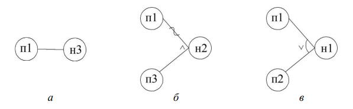
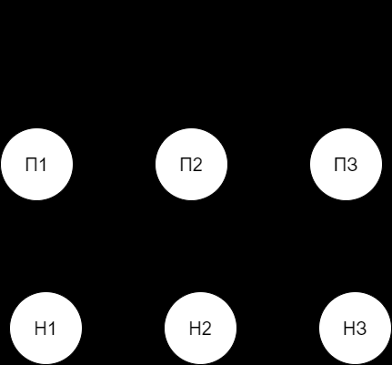
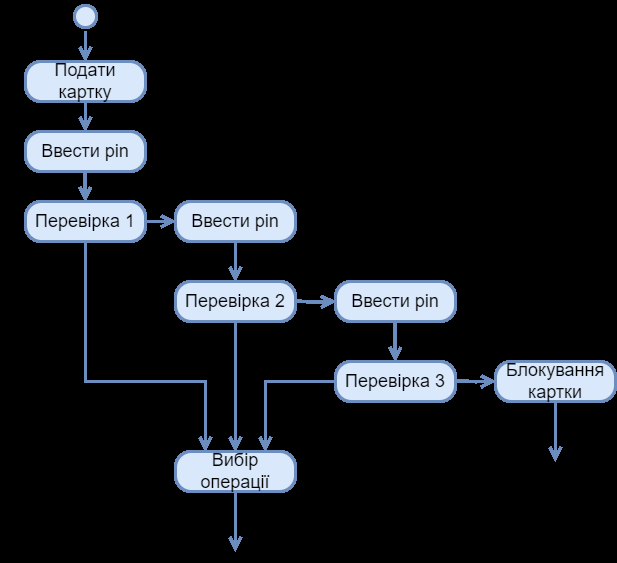

# Лекція 4. Техніки проектування динамічних тестових випадків

**Дисципліна:** Якість програмного забезпечення та тестування  
**Тема:** Техніки проектування динамічних тестових випадків  
**Викладач:** к.т.н., доцент Олена Сергіївна Куроп’ятник  

---

## 4.1 Вступ

Тестування програмного забезпечення (ПЗ) передбачає обов'язкову перевірку відповідності ПЗ затвердженій специфікації вимог. Для перевірки використовують тести, або тестові випадки (Test Cases), які можуть бути спроектовані для динамічної та статичної перевірки.

**Мета лекції:** ознайомлення з фундаментальними техніками (методами) проектування динамічних тестових випадків — тобто тих, що вимагають фактичного запуску та виконання тестованої програмної сутності з певними наборами значень вхідних даних на комп'ютері. Розглядаються методи тестування «білої скриньки» (White-Box) та «чорної скриньки» (Black-Box).

---

## 4.2 Різновиди технік (методів) розробки тестових випадків

Техніки розробки тестових випадків поділяють на дві глобальні категорії:
1. **Техніки розробки статичних тестів:** передбачають перевірку без виконання коду чи запуску програми. В основному пов’язані із забезпеченням якості процесів, включаючи рецензування специфікацій, статичний аналіз, інспекції та аудит коду.
2. **Техніки розробки динамічних тестів:** передбачають тестування шляхом безпосереднього виконання тестованої системи на комп'ютері. Тестувальник подає вхідні набори даних до програми та аналізує її фактичну поведінку і повернені результати.

**Класифікація методів динамічного тестування:**
- **На основі структури (біла скринька / White-Box):** тестування, кероване внутрішньою логікою програми; вимагає повного доступу до вихідного коду.
- **На основі специфікацій (чорна скринька / Black-Box):** тестування, кероване даними та зовнішньою специфікацією; доступ до коду відсутній.
- **На основі досвіду (Experience-based):** базується на інтуїції, досвіді тестувальника та передбаченні типових помилок (Error Guessing, Exploratory).

### Приклади специфікацій функцій для тестування білою скринькою:
```csharp
/// <summary> 
/// Пошук першого максимального елементу масиву 
/// </summary> 
/// <param name="arr">масив цілих чисел</param> 
/// <param name="size">кількість елементів у масиві</param> 
/// <returns>-1 якщо масив порожній, 0+ позиція першого максимального елементу</returns>

/// <summary> 
/// Перевірка непорожнього рядка на наявність цифр 
/// </summary> 
/// <param name="text">рядок для перевірки</param> 
/// <returns>true якщо рядок містить цифри, інакше false</returns>
```

---

## 4.3 Методи тестування білої скриньки (White-Box Testing)

До базових методів білої скриньки відносяться:
- покриття операторів (Statement Coverage);
- покриття рішень / розгалужень (Decision / Branch Coverage);
- покриття умов (Condition Coverage);
- покриття умов та рішень (Condition / Decision Coverage);
- комбінаторне покриття умов (Multiple Condition Coverage).

### 1. Метод покриття операторів (Statement Coverage)
Передбачає підбір таких наборів вхідних даних, при яких кожен виконуваний оператор програми виконається хоча б один раз.

**Тестовий код функції:**
```cpp
int NumberMax(int a, int b) { 
    if (a > b)         // Оператор 1 
        return 1;      // Оператор 2 
    else  
        if (b > a)     // Оператор 3 
            return 2;  // Оператор 4 
    return 0;          // Оператор 5 
}
```

**Тестові випадки:**
- **Т1:** Вхід: $a=0, b=0$ ➔ Очікуваний вихід: $0$ (виконуються оператори 1, 3, 5).
- **Т2:** Вхід: $a=1, b=0$ ➔ Очікуваний вихід: $1$ (виконуються оператори 1, 2).
- **Т3:** Вхід: $a=1, b=5$ ➔ Очікуваний вихід: $2$ (виконуються оператори 1, 3, 4).

**Таблиця 1. Матриця покриття операторів тестами:**

| Ідентифікатор тесту | Оп. 1 | Оп. 2 | Оп. 3 | Оп. 4 | Оп. 5 |
| :---: | :---: | :---: | :---: | :---: | :---: |
| **Т1** | * | | * | | * |
| **Т2** | * | * | | | |
| **Т3** | * | | * | * | |

### 2. Метод покриття рішень (Decision / Branch Coverage)
Під **рішенням** розуміють логічний вираз, що визначає хід виконання програми в керуючих структурах (`if`, `switch`, цикли `for`, `while`, `do-while`). Кожен напрямок розгалуження (гілки `True` / `+` та `False` / `-`) має бути пройдений хоча б один раз.

**Таблиця 2. Приклад фіксації покриття рішень:**

| № тесту | Рішення 1 (+) | Рішення 1 (-) | Рішення 2 (+) | Рішення 2 (-) | Рішення 3 (+) | Рішення 3 (-) |
| :---: | :---: | :---: | :---: | :---: | :---: | :---: |
| **1** | * | | * | | * | |
| **2** | | * | | * | | * |
| **3** | * | | * | * | | * |

### 3. Покриття умов та комбінаторне покриття
- **Покриття умов (Condition Coverage):** кожна елементарна логічна під-умова у складеному виразі повинна набути значень `True` та `False`.
- **Комбінаторне покриття (Multiple Condition Coverage):** перевіряються всі можливі комбінації істинності елементарних умов ($2^n$ наборів для $n$ умов).

---

## 4.4 Методи тестування чорною скринькою (Black-Box Testing)

Тестування, кероване специфікацією та даними (без перегляду внутрішнього коду).

**Основні методи чорної скриньки:**
1. Еквівалентне розбиття (Equivalence Partitioning).
2. Аналіз граничних значень (Boundary Value Analysis).
3. Припущення про помилку (Error Guessing).
4. Функціональні діаграми причин-наслідків (Cause-Effect Graphing).
5. Перехід за станами (State Transition Testing).

### 1. Метод еквівалентного розбиття (Equivalence Partitioning)
Вхідний простір значень розбивається на підмножини (класи еквівалентності). Якщо один тест із класу виявляє помилку (або проходить успішно), припускається, що будь-який інший представник цього класу поведеться аналогічно. Достатньо обрати **один репрезентативний тест із кожного класу**.

### 2. Метод аналізу граничних значень (Boundary Value Analysis – BVA)
Доповнює класи еквівалентності: більшість дефектів виникає саме на межах допустимих і недопустимих діапазонів ($min-1, min, min+1, max-1, max, max+1$).

**Приклад розрахунку відсоткової ставки депозиту за терміном:**
- Термін $< 2$ років: $0\%$
- Рівно $2$ роки: $10\%$
- Від $2$ до $5$ років включно: $20\%$
- Понад $5$ років: $30\%$

**Таблиця 3. Тести за методом аналізу граничних значень:**

| Тест | Вхід (роки) | Очікуваний вихід (%) | Клас перевірки |
| :---: | :---: | :---: | :--- |
| **1** | 2 | 10% | Нижня границя діапазону 20% |
| **2** | 5 | 20% | Верхня границя діапазону 20% |
| **3** | 1 | 0% | Значення ліворуч від границі (менше 2) |
| **4** | 3 | 20% | Внутрішнє значення класу |
| **5** | 6 | 30% | Значення праворуч від границі (понад 5) |

### 3. Метод припущення про помилку (Error Guessing)
Інтуїтивне складання списку граничних і специфічних ризикових ситуацій. Для алгоритму сортування масиву це:
- порожній масив;
- масив з 1 елемента;
- масив з однаковими дубльованими значеннями;
- масив, що вже заздалегідь відсортований у прямому чи зворотному порядку.

### 4. Метод функціональних діаграм (причинно-наслідковий граф / Cause-Effect Graphing)
Ідентифікуються всі атомарні причини (вхідні умови) та наслідки (реакції системи). Будується логічний граф із булевими операторами.


> **Детальний опис зображення для ШІ-агентів:**  
> Рис. 1. Графічні умовні позначення для діаграми причинно-наслідкових зв'язків:  
> - **а – Тотожність (Identity):** пряма стрілка від причини до наслідку ($C_1 
ightarrow E_1$). Якщо $C_1 = 1$, то $E_1 = 1$.  
> - **б – Заперечення (NOT / ~) та Кон'юнкція (AND / $\wedge$):** тильда на зв'язку означає інверсію. Зведення кількох зв'язків через дугу з позначкою «$\wedge$» означає, що наслідок спрацьовує лише тоді, коли діють одночасно всі вказані причини.  
> - **в – Диз'юнкція (OR / $ee$):** дуга з позначкою «$ee$» означає спрацьовування наслідку при наявності хоча б однієї з причин.  
> **Додаткові обмеження діаграми (пунктирні лінії):**  
> - **E (Exclusive):** взаємне виключення причин (не більше однієї причини може дорівнювати 1).  
> - **I (Inclusive):** присутня хоча б одна з причин (не можуть бути всі нулями).  
> - **O (One and only one):** строго одна і лише одна причина обов'язково активна.  
> - **R (Requires):** наявність однієї причини обов'язково вимагає наявності іншої.  
> - **M (Masks):** маскування/приховування наслідку.

**Приклад для функції визначення максимального з двох чисел ($a, b$):**
- П1: $a = b$ ➔ Н1: Максимум неможливо визначити (код 0).
- П2: $a > b$ ➔ Н2: Номер максимуму дорівнює 1.
- П3: $b > a$ ➔ Н3: Номер максимуму дорівнює 2.

**Таблиця 4. Опис причин та наслідків:**

| Ідентифікатор | Опис причини / наслідку | Комбінація 1 | Комбінація 2 | Комбінація 3 |
| :---: | :--- | :---: | :---: | :---: |
| **П1** | Числа рівні | * | | |
| **П2** | Перше число більше за друге ($a > b$) | | * | |
| **П3** | Друге число більше за перше ($b > a$) | | | * |
| **Н1** | Максимальне не визначено (0) | * | | |
| **Н2** | Номер максимуму = 1 | | * | |
| **Н3** | Номер максимуму = 2 | | | * |


> **Детальний опис зображення для ШІ-агентів:**  
> Рис. 2. Функціональна діаграма для функції вибору максимального з чисел $a$ та $b$:  
> Зліва розташовано вузли причин П1, П2, П3. Справа — вузли наслідків Н1, Н2, Н3. Вузли з'єднані прямими стрілками тотожності (П1 ➔ Н1, П2 ➔ Н2, П3 ➔ Н3).  
> Між причинами П1, П2, П3 накладено пунктирне дугове обмеження **«E» (Exclusive)**, яке вказує на те, що числа не можуть бути одночасно рівними та більшими одне за одне (взаємне виключення).

### 5. Метод переходу за станами (State Transition Testing)
Застосовується для систем із внутрішньою пам'яттю станів (скінченні автомати / Finite State Machines).

**Порядок дій:**
1. Виділити всі можливі стани системи.
2. Визначити події-тригери та умови переходів між станами.
3. Спроектувати тести, які покриють кожен валідний та невалідний перехід.


> **Детальний опис зображення для ШІ-агентів:**  
> Рис. 3. Фрагмент діаграми станів для логіки авторизації клієнта в банкоматі:  
> - **Стан 1: Очікування клієнта (Idle)** ➔ Подія: Вставлено картку ➔ Перехід до **Стану 2: Очікування введення PIN-коду**.  
> - **Стан 2: Очікування PIN-коду** ➔ Подія: Введено PIN ➔ Перехід до **Стану 3: Перевірка PIN-коду**.  
> - Зі **Стану 3 (Перевірка PIN):**  
>   - Якщо PIN вірний ➔ Перехід до **Стану 4: Головне меню вибору операцій** (успіх).  
>   - Якщо PIN невірний і кількість невдалих спроб $< 3$ ➔ Повернення до **Стану 2** з повідомленням про помилку.  
>   - Якщо PIN невірний втретє (спроб $\ge 3$) ➔ Перехід до **Стану 5: Блокування та вилучення картки (Card Confiscated)**.

---

## 4.5 Висновки

- Динамічне тестування завжди передбачає фактичний запуск коду програми з реальними даними.
- Тести проектуються на основі структури програми (біла скринька), специфікацій вимог (чорна скринька) та досвіду тестувальника.
- Найвищу якість та вичерпне покриття забезпечує **синергетичне поєднання кількох технік** тест-дизайну.
