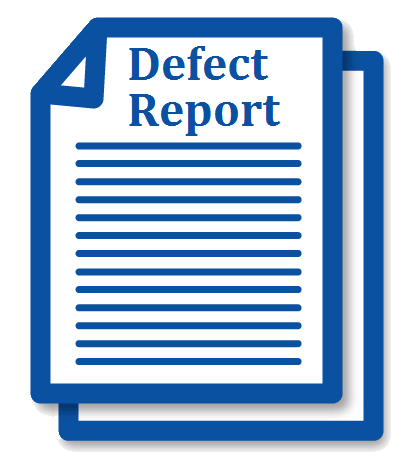

# Лекція 5. Пошук та відстеження дефектів

**Дисципліна:** Якість програмного забезпечення та тестування  
**Тема:** Пошук та відстеження дефектів  
**Викладач:** к.т.н., доцент Олена Сергіївна Куроп’ятник  

---

## Слайд 1: Титульний слайд

# Пошук та відстеження дефектів
**Лекція 6 (в нумерації курсу)** з дисципліни «Якість ПЗ та тестування»  
**Викладач:** Олена Сергіївна Куроп’ятник

> **Детальний опис зображення для ШІ-агентів:**  
> Логотип навчального курсу: комп'ютерний монітор із відкритими інтерфейсами налагодження коду та звітності, кубики «QA», збільшувальне скло для виявлення прихованих програмних несправностей та механічні шестерні загального управління якістю.

---

## Слайд 2: Несправності у ПЗ: співвідношення понять

У професійній інженерії якості розрізняють такі категорії несправностей:
- **Human Error / Mistake (Помилка людини):** дія людини (програміста, аналітика, архітектора), яка призводить до невірного результату (наприклад, неуважність, неправильне розуміння вимоги, синтаксична помилка).
- **Defect / Fault / Bug (Дефект / Вада):** вада або недолік у програмному компоненті, документації чи коді, що може викликати збій системи.
- **Failure (Збій / Відмова):** відхилення фактично виконуваної системи від її очікуваної роботи, що безпосередньо спостерігається користувачем під час роботи програми.

> **Детальний опис зображення для ШІ-агентів:**  
> Графічні інформаційні блоки, що розмежовують ключові міжнародні терміни:  
> `[Error (помилка мислення людини)] ➔ породжує ➔ [Defect / Bug / Fault (дефект у коді чи вимогах)] ➔ під час виконання спричиняє ➔ [Failure (відмову / збій у роботі системи)]`.

---

## Слайд 3: Порівняння термінів у тестуванні ПЗ (ISTQB Glossary)

| Термін | Рівень виникнення | Визначення | Приклад |
| :--- | :--- | :--- | :--- |
| **Error (Помилка)** | Людський фактор | Неправильне ментальне рішення чи дія людини. | Програміст переплутав знаки `<` та `<=`. |
| **Defect / Bug (Дефект)** | Артефакт / Код | Внутрішній недолік у коді чи специфікації. | У файлі вихідного коду записано `a < b` замість `a <= b`. |
| **Failure (Відмова)** | Виконання (Runtime) | Подія, коли система не може виконати потрібну дію. | Програма падає з помилкою `IndexOutOfRangeException` при граничному значенні. |

---

## Слайд 4: Категорії дефектів

Дефекти класифікують за трьома основними категоріями розбіжностей зі специфікацією:
1. **Wrong (Неправильно):**
   - Вимоги реалізовано з помилкою або не у відповідності до специфікації. Це дефект безпосереднього відхилення від описаної логіки.
2. **Missing (Відсутній):**
   - Існувала затверджена вимога замовника, але її взагалі забули реалізувати в системі. Вказівка на неповну реалізацію або пропуск функціоналу.
3. **Extra (Додатково / Зайве):**
   - До продукту включено функцію чи властивість, якої не було у вимогах і яку не замовляв клієнт. Навіть якщо вона здається корисною, це вважається дефектом, оскільки є несанкціонованим відхиленням від затвердженої специфікації, збільшує кодову базу та підвищує ризики вразливостей.

---

## Слайд 5: Найпоширеніші типи помилок у програмуванні

- Логічні помилки (порушення булевої логіки, некоректні умови розгалужень).
- Помилки обробки дати та часу (часові пояси, високосні роки, літній/зимовий час).
- Арифметичні помилки (ділення на нуль, переповнення цілих чисел, похибки округлення `float/double`).
- Помилки управління пам'яттю (витоки пам'яті, звернення за нульовим вказівником `NullReferenceException`).
- Інтерфейсні та інтеграційні помилки (несумісність типів при передачі параметрів, відсутність обробки помилок сервера).

---

## Слайд 6: Мета відстеження дефектів

> **Детальний опис зображення для ШІ-агентів:**  
> Три взаємопов'язані блоки, що розкривають головні цілі управління дефектами в команді інженерії якості: моніторинг, комунікація та системний аналіз процесів.

1. **Відстеження стану тестування та усунення дефектів:** повний контроль життєвого циклу кожної знайденої проблеми від відкриття до верифікації виправлення.
2. **Організація взаємодії між співробітниками:** прозоре вирішення спірних питань щодо класифікації, серйозності та черговості (пріоритетів) усунення багів.
3. **Визначення першопричин (Root Cause Analysis):** виявлення «пляшкових горлець» у процесах розробки та тестування для оптимізації командної роботи.

---

## Слайд 7: Звіт про дефекти: різні погляди учасників процесу

- **Погляд тестувальника (QA):**
  - Як швидко та стабільно відтворити дефект (Steps to reproduce);
  - Чому саме ця поведінка вважається дефектом (посилання на вимогу);
  - Який очікуваний результат (Expected Result).
- **Погляд розробника (Developer):**
  - Точне місце прояву помилки (стектрейс, модуль, екран);
  - Які специфічні вхідні дані призводять до збою;
  - Що очікувалося і чому поточна логіка спрацювала не так.
- **Погляд замовника / користувача (Business Stakeholder):**
  - Наскільки критично ця помилка шкодить бізнесу чи блокує роботу реального користувача.

---

## Слайд 8: Життєвий цикл дефекту (Defect Life Cycle)

> **Детальний опис зображення для ШІ-агентів:**  
> Чотириетапна лінійна блок-схема життєвого циклу обробки окремого дефекту:  
> `[1. Відкриття проблеми (Open / Submit)] ➔ [2. Вивчення (Analyze / Assign)] ➔ [3. Дія (Fix / Resolve)] ➔ [4. Закриття (Verify / Close)]`.  
> Кожен етап закріплений за певною роллю (тестувальник, розробник, лід проекту).

---

## Слайд 9: Зміст етапів відстеження дефекту

1. **Відкриття проблеми (Submit / Open):**
   - Тестувальник документує повний звіт про дефект (Bug Report) у системі відстеження та призначає його відповідальній команді.
2. **Вивчення (Investigation / Triage):**
   - Розробник або лід команди аналізує звіт і приймає рішення: чи дійсно це дефект (згоден чи відхиляє / Rejected / Not a Bug / Duplicate).
   - Якщо це дефект — розробник призначає термін та черговість усунення. У спірних випадках рішення про пріоритет приймає керівник проекту (Project Manager).
3. **Дія (Action / Fix):**
   - Розробник виправляє код, проводить власне автономне юніт-тестування та переводить статус звіту на «Виправлено» (Resolved / Fixed), призначаючи назад на тестувальника.
4. **Закриття (Closure / Verify):**
   - Тестувальник проводить повторне тестування (Retesting) на свіжій зборці:
     - якщо виправлено ➔ переводить у статус **«Закрито» (Closed)**;
     - якщо дефект досі відтворюється ➔ повертає у статус **«Перевідкрито» (Reopened)**.
   - **Важливе правило:** *Закрити або видалити звіт про дефект має право виключно тестувальник!*

---

## Слайд 10: Рапортування про помилку

Хто має право реєструвати дефекти в проекті:
- Тестувальники та інженери з якості (QA персонал) — основне джерело.
- Розробники (виявлення проблем у суміжних модулях чи API).
- Бізнес-аналітики та продукт-овнери (невідповідність бізнес-логіці).
- Спеціалісти технічної підтримки та кінцеві користувачі (інциденти з продакшену).

---

## Слайд 11: Аспекти класифікації дефектів

1. **Симптом:** зовнішнє візуальне або функціональне проявлення, яке безпосередньо фіксує тестувальник.
2. **Серйозність (Severity):** ступінь технічного впливу дефекту на працездатність системи.
3. **Пріоритет (Priority):** черговість виправлення дефекту з точки зору бізнес-потреб.
4. **Стадія розробки та джерело:** документація, архітектура, бізнес-вимоги, код, тестове середовище.
5. **Тип дефекту:** логічний, обчислювальний, інтерфейсний (GUI), обробки даних, введення/виведення, безпеки, конфігурації.

---

## Слайд 12: Рівні серйозності дефекту (Severity Levels)

| Рівень | Назва | Характеристика | Приклад |
| :--- | :--- | :--- | :--- |
| **S1** | **Критичний (Blocker / Critical)** | Повне падіння системи, блокування основної бізнес-функціональності, втрата або пошкодження даних. Обхідного шляху (workaround) немає. | Додаток аварійно завершується при запуску; база даних скидає замовлення. |
| **S2** | **Серйозний (Major)** | Не працює важлива функціональність, проте система залишається працездатною; або існує складний обхідний шлях. | Не працює оплата картками Visa (але працює через Google Pay). |
| **S3** | **Значний (Moderate / Normal)** | Порушено роботу другорядної функції; система стабільна. | Не спрацьовує сортування за відгуками в каталозі товарів. |
| **S4** | **Незначний (Minor / Trivial)** | Косметичні дефекти інтерфейсу, друкарські помилки, зміщення пікселів, що не впливають на логіку. | Помилка в тексті ліцензійної угоди, зміщення іконки на 2 пікселі. |

---

## Слайд 13: Рівні пріоритету усунення дефекту (Priority Levels)

| Рівень | Назва | Черговість реакції |
| :--- | :--- | :--- |
| **P1** | **High / Immediate** | У першу чергу. Негайно зупиняються інші задачі для випуску Hotfix. |
| **P2** | **Medium** | Виправляється в межах поточного спринту чи найближчого релізу. |
| **P3** | **Low** | Виправляється за наявності вільного часу або переноситься у беклог. |

---

## Слайд 14: Структура звіту про дефект (Defect Report Structure)

> **Детальний опис зображення для ШІ-агентів:**  
> Піктограма планшета з бланком звітності, значком жука (бага) та чек-боксами обов'язкових інформаційних блоків дефект-репорту.

**Обов'язкові атрибути професійного баг-репорту:**
1. **ID дефекту:** унікальний номер (наприклад, `BUG-1042`).
2. **Резюме / Заголовок (Summary):** короткий зміст за формулою *«Що? Де? Коли / За яких умов?»*.
3. **Опис (Description):** розширене пояснення проблеми.
4. **Кроки для відтворення (Steps to Reproduce):** чітка нумерована послідовність дій від стартової точки.
5. **Фактичний результат (Actual Result):** що саме відбулося (включаючи тексти системних помилок).
6. **Очікуваний результат (Expected Result):** як система мала б коректно відпрацювати згідно з ТЗ.
7. **Серйозність (Severity) та Пріоритет (Priority).**
8. **Середовище (Environment):** ОС, версія браузера, білд програми, роздільна здатність екрану.
9. **Вкладення (Attachments):** скриншоти з виділеними помилками, відеозаписи, системні логи.
10. **Автор, дата створення, виконавець.**

---

## Слайд 15–17: Приклад реального баг-репорту на прикладі веб-застосунку

Наведено приклад тестування функцій сервісу **«Укрзалізниця»** (https://booking.uz.gov.ua/):
- Дефект блокування інтерфейсу при спробі оплати та некоректної валідації пільги пасажира.
- Докладні скриншоти, статус та журнал відтворення наведені у супровідному документі `DefectReport.md`.

---

## Слайди 18–20: Метрики дефектів та надійності

1. **Кількість дефектів ($D_{\text{факт}}$):** сума всіх знайдених дефектів за період/реліз.
2. **Профіль відкритих дефектів:** відношення незакритих дефектів до загальної кількості.
3. **Інтенсивність відмов (Failure Rate):** кількість збоїв системи в одиницю часу:
   $$\lambda = \frac{\text{Кількість відмов}}{\text{Час спостереження}}$$

---

## Слайд 21: Метрики покриття

- **Метрики структурного покриття:** відношення кількості виконаних рядків або гілок коду до загальної їх кількості в модулі:
  $$C_{\text{struct}} = \frac{N_{\text{виконаних}}}{N_{\text{загальна}}} \times 100\%$$
- **Метрики функціонального покриття:** відношення кількості успішно виконаних функціональних тестів до загальної кількості необхідних тестів за специфікацією.

---

## Слайд 22: Метрики динаміки процесу тестування

1. **Динаміка виконання тестів:**
   $$K_{\text{exec}} = \frac{\text{Виконано тестів}}{\text{Заплановано тестів}}$$
2. **Динаміка виявлення дефектів:**
   $$K_{\text{def}} = \frac{\text{Кількість тестів, що виявили баги}}{\text{Загальна кількість виконаних тестів}}$$
3. **Загальний стан успішності тестування (Pass Rate):**
   $$\text{Pass Rate} = \frac{\text{Успішно пройдено тестів (Passed)}}{\text{Всього заплановано}}$$

---

## Слайд 23: Резюме

- У ПЗ виникають людські помилки (Errors), які призводять до дефектів у коді (Bugs), а ті спричиняють видимі відмови системи (Failures).
- Класифікація багів враховує симптоми, категорії (Wrong, Missing, Extra), рівень серйозності (Severity) та пріоритетність (Priority).
- Звіт про дефект (Defect Report) повинен бути вичерпним, однозначним і містити кроки відтворення, очікуваний та фактичний результати.
- Управління якістю спирається на об'єктивні числові метрики покриття, динаміки та надійності.

---

## Слайд 24: Завершення лекції

# Дякую за увагу!
