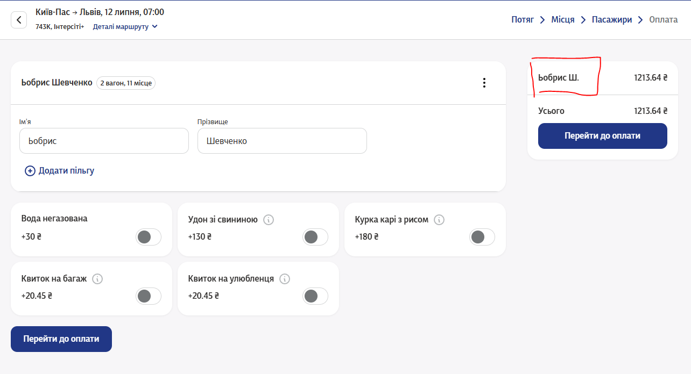
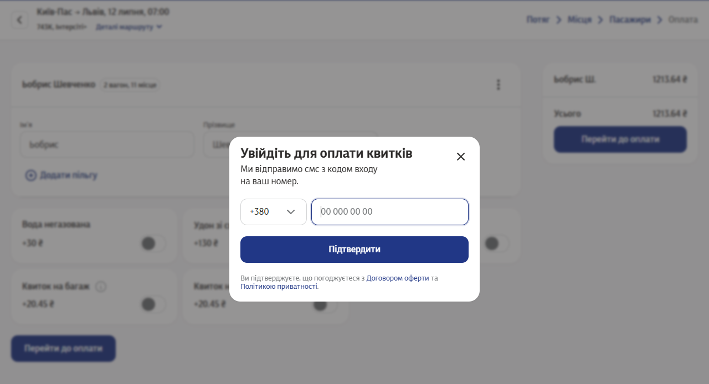
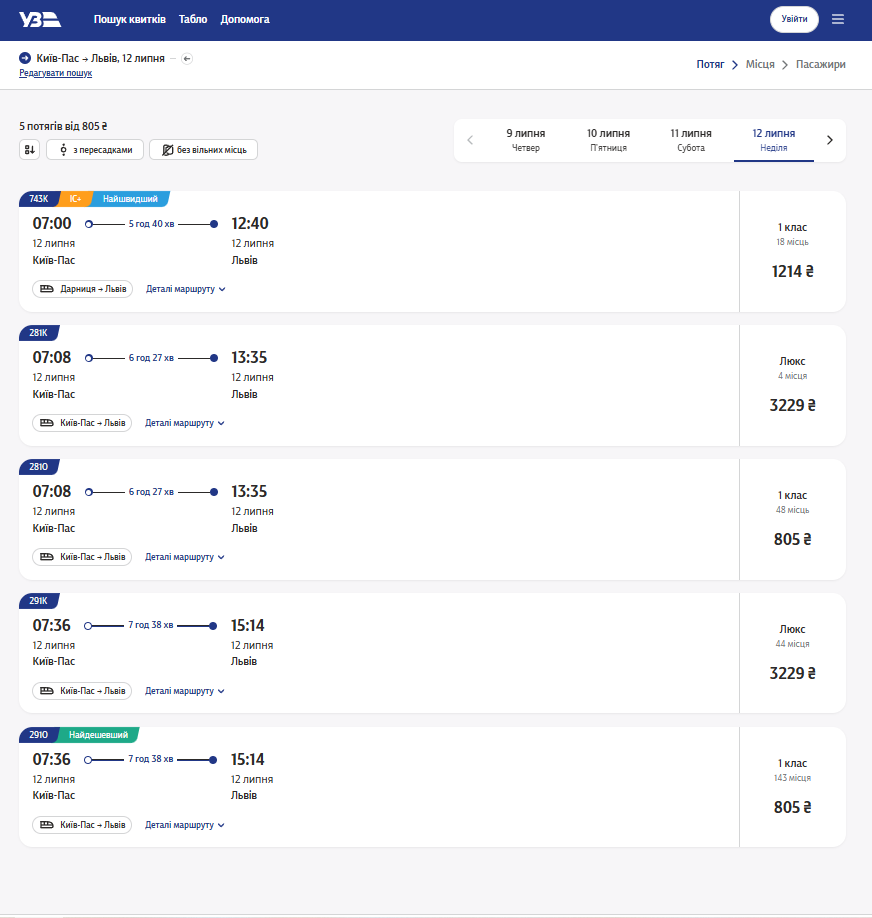
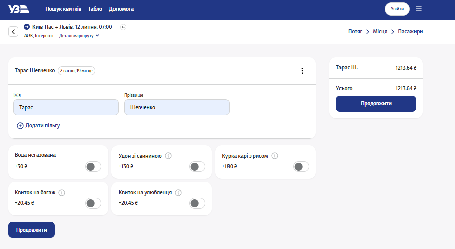
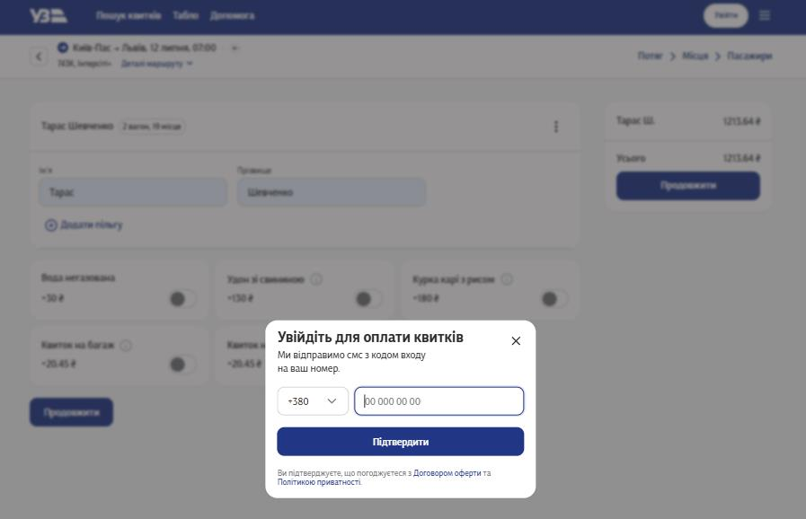
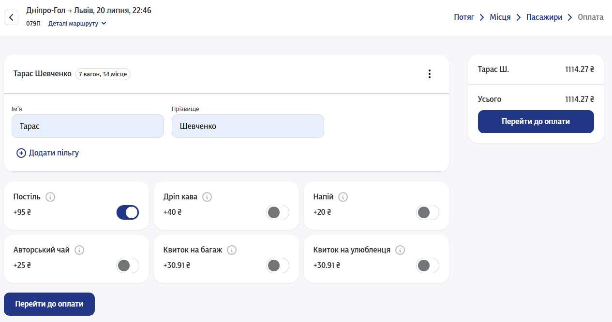
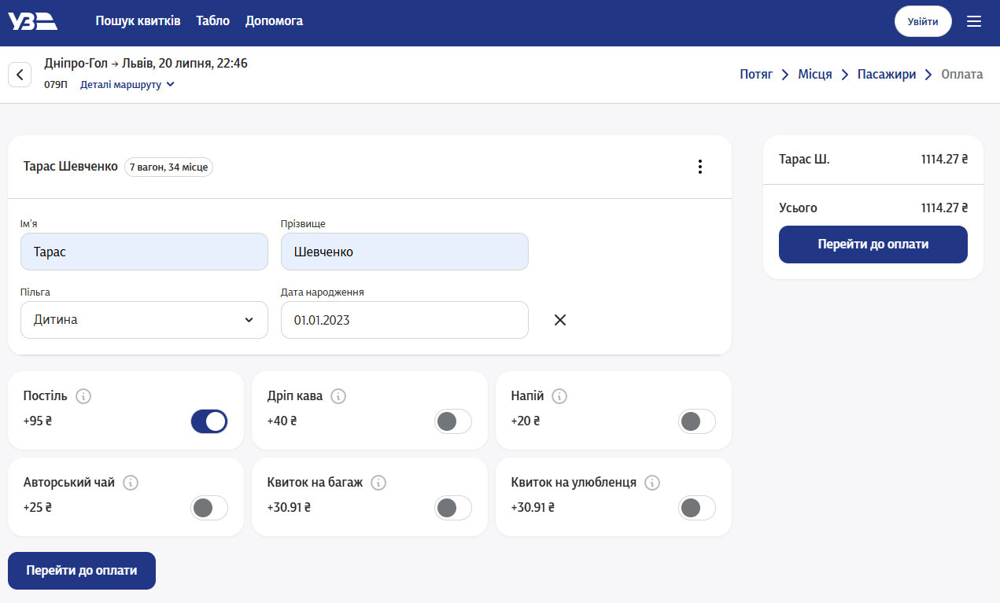
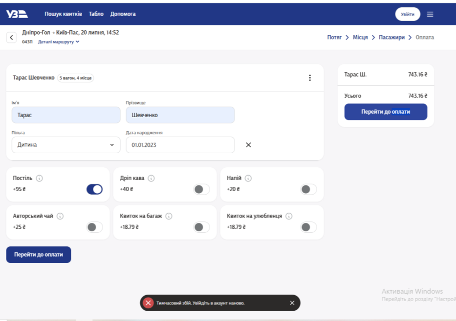

# Звіти про дефекти (Defect Reports) — Приклади до Лекції 5

**Дисципліна:** Якість програмного забезпечення та тестування  
**Об'єкт тестування:** Веб-застосунок бронювання квитків «Укрзалізниця» (https://booking.uz.gov.ua/)  
**Автор матеріалу:** к.т.н., доцент Олена Сергіївна Куроп’ятник  

---

## 1. Вступ

Було проведено тестування функцій веб-застосунку **Укрзалізниці** (https://booking.uz.gov.ua/), а саме:
- оформлення пасажира;
- пошук квитків «туди і назад»;
- додавання пільги.

В ході тестування було виявлено низку дефектів різного рівня критичності. Звіти про знайдені дефекти з докладними кроками відтворення та скриншотами наведено нижче (Таблиці 1–3).

---

## 2. Звіт про дефект №1 (Таблиця 1)

### Паспорт дефекту:
- **ID:** `BUG-UZ-001`
- **Короткий опис (Summary):** Неможливість відредагувати некоректно введені дані пасажира після спроби продовжити оформлення.
- **Опис проблеми:** Після натискання кнопки «Продовжити» (перехід до оплати) з некоректно заповненими полями користувач опиняється у глухому куті: відкривається модальне вікно входу для оплати, а початкова форма блокується для редагування.
- **Серйозність (Severity):** Major (Серйозний)
- **Пріоритет (Priority):** High (Високий)
- **Середовище (Environment):** Windows 11, Google Chrome v.126.0, роздільна здатність 1920x1080.

### Кроки для відтворення:
1. Перейти на сторінку вибору місць та обрати будь-яке вільне місце у вагоні.
2. Натиснути кнопку «Оформити квитки».
3. У полі введення прізвища ввести некоректні дані (наприклад, спеціальні символи або залишити порожнім) та спробувати натиснути «Перейти до оплати».
4. Спостерігати появу модального вікна авторизації/оплати.

### Фактичний результат (Actual Result):
Вікно авторизації перекриває форму; при спробі повернутися поля вводу пасажира стають неактивними (disabled). Користувач не може скоригувати ім'я/прізвище без повного скидання сесії та перезавантаження сторінки з втратою обраного місця.

### Очікуваний результат (Expected Result):
Система повинна провести валідацію полів ДО виклику платіжного вікна, підсвітити помилкові поля червоним кольором із поясненням та залишити поля активними для негайного виправлення.

> **Детальний опис зображення для ШІ-агентів:**  
> Скриншот веб-інтерфейсу бронювання квитків Укрзалізниці: відображено форму введення даних пасажира (Ім'я, Прізвище, вибір постелі/напоїв). Поля вводу відображаються у сірому заблокованому стані (недоступні для кліку чи редагування тексту), при цьому кнопка переходу до наступного кроку не реагує.

> **Детальний опис зображення для ШІ-агентів:**  
> Скриншот інтерфейсу із поверхневим спливаючим модальним вікном авторизації/входу («Вхід до особистого кабінету для оплати»). Вікно входу є активним, але заднє фонове вікно оформлення пасажира затемнене та заблоковане для будь-якої взаємодії, що позбавляє користувача можливості виправити допущену помилку введення.

---

## 3. Звіт про дефект №2 (Таблиця 2)

### Паспорт дефекту:
- **ID:** `BUG-UZ-002`
- **Тестовий випадок:** «Пошук квитків у дві сторони з валідними назвами станцій та валідними датами, які ще не настали».
- **Короткий опис (Summary):** Некоректне збереження параметрів зворотного рейсу при комбінованому пошуку квитків «туди і назад».
- **Серйозність (Severity):** Major
- **Пріоритет (Priority):** Medium

### Кроки для відтворення:
1. Відкрити головну сторінку сервісу `https://booking.uz.gov.ua/`.
2. У поле «Звідки» ввести *«Київ-Пасажирський»* (обрати з випадаючого списку автодоповнення).
3. У поле «Куди» ввести *«Львів»* (обрати з автодоповнення).
4. Встановити дату відправлення «Туди» (наприклад, 15.08.2026) та дату «Назад» (20.08.2026).
5. Натиснути кнопку «Пошук поїздів».

### Фактичний результат (Actual Result):
Відображається список поїздів лише в одну сторону («Туди»); вкладка вибору зворотного квитка або не активується, або скидає попередньо обрану дату зворотного відправлення на дату за замовчуванням.

### Очікуваний результат (Expected Result):
Система повинна коректно відобразити результати для обох рейсів у вигляді двох зв'язаних вкладок («Київ ➔ Львів» та «Львів ➔ Київ») із збереженням обраних дат.

> **Детальний опис зображення для ШІ-агентів:**  
> Скриншот інтерфейсу пошуку квитків Укрзалізниці: відображено форму пошуку зі станціями відправлення та прибуття, де після виконання пошукового запиту у дві сторони інтерфейс некоректно показує лише прямий рейс без можливості паралельного бронювання зворотного квитка.

> **Детальний опис зображення для ШІ-агентів:**  
> Скриншот переходу на сторінку авторизації та оплати, де у складі замовлення фігурує лише один квиток замість пари квитків «туди і назад».

---

## 4. Звіт про дефект №3 (Таблиця 3)

### Паспорт дефекту:
- **ID:** `BUG-UZ-003`
- **Тестовий випадок:** «Додати пільгу «Дитина» з валідними даними».
- **Короткий опис (Summary):** Неможливо візуально переконатися, чи діє пільга та який її розмір — відсутній динамічний перерахунок суми.
- **Опис:** При виборі з випадаючого списку пільги «Дитина (до 14 років)» та введенні валідної дати народження дитини загальна вартість проїзду у чеку праворуч не змінюється (залишається повною вартістю дорослого квитка).
- **Серйозність (Severity):** Major
- **Пріоритет (Priority):** High

> **Детальний опис зображення для ШІ-агентів:**  
> Скриншот форми введення даних пасажира: увімкнено випадаючий список «Оберіть пільгу», вибрано значення «Дитина». З'явилися додаткові поля введення дати народження дитини та свідоцтва про народження. У правій колонці вартість замовлення відображає 420.00 грн (повна вартість дорослого квитка) без застосування дитячої знижки.

> **Детальний опис зображення для ШІ-агентів:**  
> Скриншот стану інтерфейсу після повного заповнення всіх полів дитячого квитка: кнопка «До сплати» показує повну суму. Немає жодного підтверджуючого напису про застосування пільги або відображення відсотка знижки.

> **Детальний опис зображення для ШІ-агентів:**  
> Скриншот модального діалогового вікна помилки: «Тимчасовий збій сервера / Помилка зв'язку з базою даних пільг». Повідомлення перекриває форму, заважаючи визначити, чи була пільга врахована платіжним шлюзом під час спроби ініціалізації транзакції.

### Коментарі тестувальника:
- **Припущення:** можливо, перевірка правомірності пільги та перерахунок ціни відбуваються пізніше — безпосередньо при переході на сторінку банківського еквайрингу.
- Однак перевірити це не вдалося через тимчасовий збій сервера під час тестування (09.07.2026, див. скриншот).
- З точки зору користувацького досвіду (UX), відсутність миттєвого перерахунку суми вводить покупця в оману, створюючи враження, що пільга не застосувалася.

> **Детальний опис зображення для ШІ-агентів:**  
> Скриншот фінального екрану оформлення: системне сповіщення про помилку оформлення квитка («Операцію перервано, спробуйте пізніше»). Форма скинута, замовлення не сформовано.
