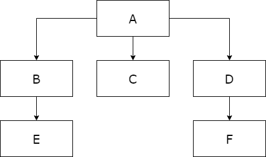
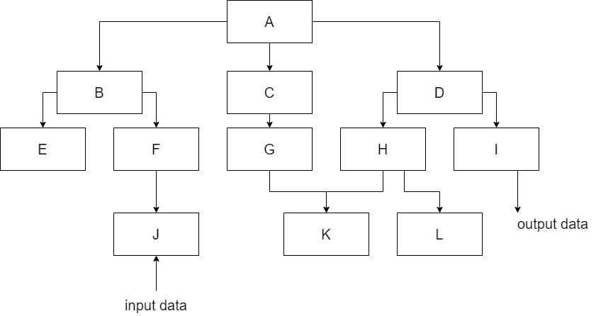

# Лекція: Тестування багатомодульних програм

**Дисципліна:** Якість програмного забезпечення та тестування  
**Тема:** Тестування багатомодульних програм  
**Викладач:** к.т.н., доцент Олена Сергіївна Куроп’ятник  

---

## Слайд 1: Титульний слайд

# Тестування багатомодульних програм
**Лекція 5** з дисципліни «Якість ПЗ та тестування»  
**Викладач:** Олена Сергіївна Куроп’ятник

> **Детальний опис зображення для ШІ-агентів:**  
> Титульна ілюстрація навчального курсу: зображено розгорнутий екран комп'ютера з відкритими структурними схемами та кодом, кубики з літерами «QA» (Quality Assurance), стилізовану лупу для виявлення дефектів, зображення програмної помилки («жука» / bug) та шестерні взаємодії системних компонентів.

---

## Слайд 2: Модулі та їх властивості

**Модуль** – програмна одиниця. В якості модулів можуть виступати окремі класи, пакети, підпрограми, функції або мікросервіси.

**Фундаментальні властивості модуля:**
1. **Блочність:** можливість використання модуля як автономної «цеглинки» (незалежність від конкретного місця його використання у великій системі).
2. **Синтаксична відокремленість:** наявність чітко визначеного початку, кінця та оголошеного інтерфейсу (сигнатури).
3. **Семантична незалежність:** логічна завершеність виконуваної задачі без прихованих побічних ефектів.
4. **Спільність даних (інкапсуляція / утворення капсули):** внутрішні структури даних приховані всередині модуля і захищені від прямого зовнішнього втручання.
5. **Повнота понять:** модуль реалізує цілісну, концептуально закінчену предметну функціональність.

---

## Слайд 3: Модульне тестування (Unit Testing)

**Модульне тестування** – процес тестування окремих блоків, підпрограм, класів або процедур, що утворюють велику програмну систему.

- **Мета:** порівняння функцій, які фактично реалізуються модулем, зі специфікаціями, що описують його функціональні або інтерфейсні характеристики.
- **Модульне тестування сприяє:**
  - підвищенню ефективності тестування, оскільки увага інженера зосереджена на меншій ізольованій частині системи;
  - суттєвому полегшенню налагодження програм (локалізація дефекту в межах одного модуля);
  - паралельності процесів тестування різними розробниками та тестувальниками.

---

## Слайд 4: Етапи тестування багатомодульних програм

Повний процес тестування багатомодульних програм складається з 4 послідовних етапів:

1. **Тестування окремих модулів** *(засобами структурного тестування «білої скриньки»)*.
2. **Спільне тестування модулів (інтеграційне тестування)** *(засобами структурного тестування)*.
3. **Тестування специфікації програми (функціональне тестування «чорної скриньки»)**.
4. **Тестування всього комплексу загалом (системне тестування):** пошук невідповідності створеного програмного продукту цілям проектування, сформульованим у Технічному Завданні (ТЗ).

---

## Слайд 5: Тестування модулів: монолітний vs інкрементний підхід

Тестування та об'єднання модулів здійснюється за двома принципово різними стратегіями:

- **Неінкрементне (монолітне) тестування:** незалежне автономне тестування абсолютно всіх модулів окремо один від одного, після чого всі модулі одночасно збираються в єдиний комплекс і тестуються разом (підхід «великого вибуху» / Big Bang).
- **Інкрементне (покрокове) тестування:** приєднання чергового модуля до ядра вже попередньо протестованих модулів і подальше тестування отриманої проміжної зборки.

---

## Слайд 6: Приклад об’єднання модулів при тестуванні

> **Детальний опис зображення для ШІ-агентів:**  
> Графічна діаграма ієрархічної структури викликів 6 модулів системи (від A до F):  
> - **Модуль A** — кореневий керуючий модуль верхнього рівня (Root). З нього виходять стрілки викликів до трьох підлеглих модулів другого рівня: B, C, D.  
> - **Модуль B** — викликає підлеглий модуль E.  
> - **Модуль C** — є термінальним (листковим) модулем на рівні 2 (нікого не викликає).  
> - **Модуль D** — викликає підлеглий модуль F.  
> - **Модулі E та F** — термінальні модулі нижнього (3-го) рівня.

### Порівняння тестового оточення:
1. **Неінкрементне тестування:**
   - Потрібні **драйвери (Drivers)** для модулів: E, F, B, C, D (5 драйверів).
   - Потрібні **заглушки (Stubs)** для модулів: A, B, D (імітація викликів підлеглих модулів).
   - Фінальна зборка: `A + B + C + D + E + F` одночасно.
2. **Інкрементне тестування (знизу вгору / Bottom-Up):**
   - Крок 1: тестуються термінальні модулі E, C, F (для них створюються драйвери).
   - Крок 2: збираються та тестуються блоки BE та DF (драйвери для блоків).
   - Крок 3: повне підключення вершини: `A + BE + C + DF`.

**Визначення допоміжних компонентів:**
- **Driver module (драйвер)** – допоміжний програмний модуль верхнього рівня, що імітує виклик тестованого модуля та подає тестові дані на його вхід.
- **Stub module (заглушка)** – допоміжний програмний модуль нижнього рівня, що імітує логіку роботи підлеглого модуля (повертає фіксовані відповіді) для забезпечення функціонування тестованого модуля вищого рівня.

---

## Слайд 7: Інкрементне vs неінкрементне тестування

### Переваги інкрементного тестування:
- Суттєво менше загальних витрат на розробку драйверів та заглушок.
- Раннє виявлення помилок міжмодульної взаємодії та інтерфейсних несумісностей.
- Спрощення локалізації та налагодження: помилка, що виникла при приєднанні нового модуля, майже гарантовано знаходиться або в ньому самому, або в його інтерфейсі стикування.

### Переваги неінкрементного тестування:
- Зменшення витрат машинного часу на ранніх кроках (виконується ізольовано один модуль із заглушкою, а не весь довгий ланцюжок залежностей).
- Більше можливостей для паралельного автономного тестування модулів різними інженерами на ранніх етапах.
- Можливість глибшого тестування внутрішньої логіки конкретного модуля без впливу інших частин коду.

---

## Слайд 8: Стратегія низхідного тестування (Top-Down Testing)

> **Детальний опис зображення для ШІ-агентів:**  
> Деревоподібна ієрархія викликів модулів комплексу із 12 модулів (A, B, C, D, E, F, G, H, I, J, K, L):  
> - **Рівень 1 (Вершина):** Модуль A (головний керуючий модуль).  
> - **Рівень 2:** Модулі B, C, D, які викликаються безпосередньо модулем A.  
> - **Рівень 3:** Модуль B викликає модулі E та F. Модуль C викликає модуль G. Модуль D викликає модулі H та I.  
> - **Рівень 4 (Термінальні модулі):** Модуль E викликає модуль J. Модуль G викликає модуль K. Модуль H викликає модуль L. Модулі F та I є термінальними на рівні 3.  
> На схемі показано процес тестування згори донизу: спочатку береться модуль A, а замість B, C, D підставляються тимчасові заглушки (Stubs).

**Можлива послідовність тестування:**
- $A + 	ext{заглушки } B, C, D$
- $AB + 	ext{заглушки } E, F, C, D$
- $ABE + 	ext{заглушки } J, F, C, D$ і так далі.

**Можливі шляхи приєднання модулів:**
1. **Обхід у ширину (Breadth-First):** $A 
ightarrow B, C, D 
ightarrow E, F, G, H, I 
ightarrow J, K, L$.
2. **Обхід у глибину (Depth-First):** $A 
ightarrow B 
ightarrow E 
ightarrow J 
ightarrow F 
ightarrow C 
ightarrow G 
ightarrow K 
ightarrow D 
ightarrow H 
ightarrow L 
ightarrow I$.
3. У довільному порядку пріоритетів зверху вниз.

---

## Слайд 9: Розробка заглушок (Stubs)

Вимоги до створення заглушок:
- Заглушка повинна адекватно імітувати функціональність відповідного підлеглого модуля.
- Заглушка повинна повертати правдоподібні коректні дані для модулів верхнього рівня.
- Дані, що повертаються заглушкою, мають бути варіативними (різні сценарії поведінки) — це досягається розробкою кількох варіантів заглушок або завантаженням тестових відповідей із зовнішнього конфігураційного файлу.

---

## Слайд 10: Першочергове додавання модулів

При виборі черговості додавання модулів пріоритет надається:
1. **Критично важливим модулям:** що реалізують новий або нестандартний алгоритм, мають найвищу цикломатичну складність чи є ключовими архітектурними вузлами.
2. **Модулям введення та/або виведення даних:** підключення I/O дозволяє створити працюючий каркас програми.

**Побудова ранньої каркасної версії системи дає можливість:**
- вчасно виявити помилки та концептуальні прорахунки, зумовлені людським фактором;
- продемонструвати діючий прототип кінцевому користувачеві чи замовнику.

---

## Слайд 11: Переваги низхідного тестування

- Надає максимальні переваги, якщо найбільша кількість архітектурних помилок зосереджена в модулях верхніх рівнів керування.
- Подача тестів значно спрощується після раннього підключення модулів введення-виведення.
- Створення раннього працюючого каркаса дає змогу ранньої демонстрації замовнику та позитивно мотивує команду розробників.

---

## Слайд 12: Недоліки низхідного тестування

- Висока потреба у розробці численних складних заглушок (Stubs).
- Потреба у використанні тестових наборів з інших модулів, які забезпечують введення даних.
- Необхідність додаткових інтелектуальних зусиль для визначення того, які саме тести слід подати на вхід верхнього рівня, щоб протестувати конкретну гілку нижнього модуля.
- Складність аналізу результатів для модулів, які не виводять дані назовні самостійно.
- Зміни у модулях нижнього рівня можуть викликати необхідність рефакторингу та перетестування вже перевірених модулів верхнього рівня.
- Якщо верхній модуль постачає дані для нижнього, коректність його роботи можна остаточно перевірити лише після підключення реального нижнього модуля (відтермінування повного тестування).

---

## Слайд 13: Стратегія висхідного тестування (Bottom-Up Testing)

> **Детальний опис зображення для ШІ-агентів:**  
> Та ж сама деревоподібна структура 12 модулів (A..L), але проілюстрована для стратегії знизу вгору (Bottom-Up):  
> - Стрілки тестування спрямовані знизу вгору: спочатку виділено термінальні модулі нижнього рівня $I, J, K, L$ та $F$.  
> - Кожен термінальний модуль підключається до власного тестового драйвера (Driver).  
> - Після успішної перевірки модулі об'єднуються у кластери ($E+J$, $G+K$, $H+L$, $D+I+H+L$, $B+E+F+J$) і керуються драйверами проміжного рівня, доки не буде підключено вершину $A$.

- Тестування починається з **термінальних модулів** – тих, які самі не викликають інших модулів.
- Наступними тестуються модулі, для яких підлеглі модулі вже повністю перевірені.

**Послідовність тестування:**
1. Модулі $I, J, K, L$ та інші термінальні модулі за допомогою тестових драйверів (Drivers).
2. Критичні проміжні модулі.
3. Інші модулі в порядку знизу вгору до вершини $A$.

---

## Слайд 14: Переваги висхідного тестування

- Має суттєві переваги, якщо найбільша кількість дефектів зосереджена в модулях нижніх рівнів (обчислювальні бібліотеки, утиліти, робота з пам'яттю).
- Значно легше створювати тестові умови: достатньо одного вхідного драйвера для модуля замість розробки складної мережі заглушок для підлеглих функцій.
- Набагато простіше спостерігати безпосередній вихідний результат роботи модуля (вихідні змінні повертаються безпосередньо в драйвер).

---

## Слайд 15: Недоліки висхідного тестування

- Потреба в обов'язковій розробці численних тестових драйверів (Drivers).
- **Програма як єдине ціле не існує** доти, доки не буде підключено найостанніший керуючий модуль верхівки $A$, через що неможливо продемонструвати ранній працюючий каркас програми замовнику.

---

## Слайд 16: Резюме

- **Модульне тестування** – ізольоване тестування окремих функціональних блоків/класів; вимагає аналізу специфікацій та тексту коду програми.
- **Підходи до об'єднання модулів:**
  - *Неінкрементне (монолітне):* автономне тестування всіх модулів із подальшою одночасною зборкою.
  - *Інкрементне (покрокове):* почергове приєднання модулів до протестованої зборки.
- **Стратегії інкрементного тестування:**
  - *Низхідна (Top-Down):* тестування зверху вниз, використання заглушок (Stubs), можливість раннього каркаса.
  - *Висхідна (Bottom-Up):* тестування знизу вгору від термінальних модулів, використання драйверів (Drivers), прозоре спостереження результатів.

---

## Слайд 17: Завершення лекції

# Дякую за увагу!
