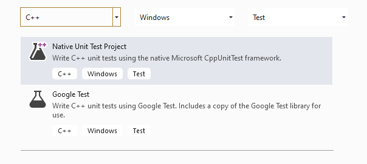
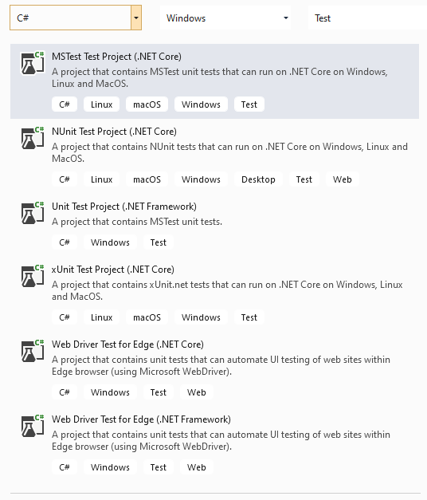
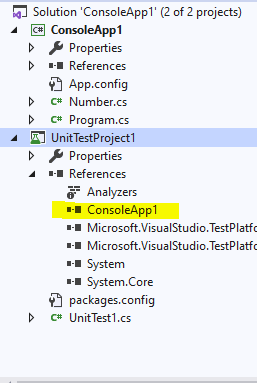
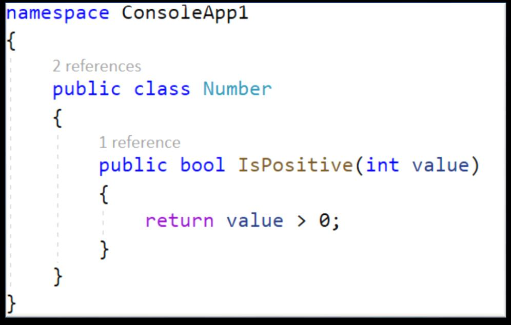
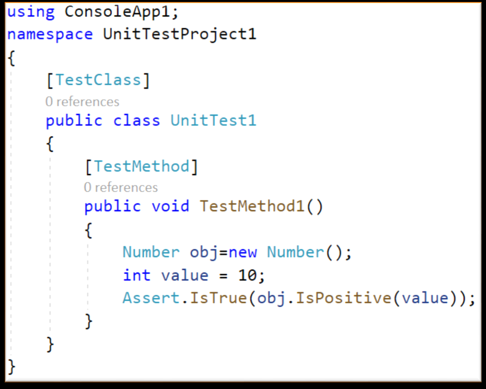

# Лекція 7. Автоматизоване тестування

**Дисципліна:** Якість програмного забезпечення та тестування  
**Тема:** Автоматизоване тестування  
**Викладач:** к.т.н., доцент Олена Сергіївна Куроп’ятник  

---

## Слайд 1: Титульний слайд

# Автоматизоване тестування
**Лекція 7** з дисципліни «Якість ПЗ та тестування»  
**Викладач:** Олена Сергіївна Куроп’ятник


> **Детальний опис зображення для ШІ-агентів:**  
> Логотип навчального курсу: комп'ютер із запущеними інструментами автоматизації, кубики «QA», збільшувальне скло інженера з якості та системні шестерні безперервної інтеграції (CI/CD) і автоматизованого прогону тестів.

---

## Слайд 2: Поняття автоматизованого тестування

**Автоматизоване тестування** передбачає використання спеціального інструменту автоматизації (Automation Tool / Framework) для виконання набору тестів без участі людини.

**Що автоматизується:**
- ✓ Введення тестових даних у систему, яку тестують;
- ✓ Порівняння фактичних результатів виконання з очікуваними (Assertion);
- ✓ Автоматична генерація детального звіту про проходження тестів (Test Execution Report).

> **Головна мета автоматизації:** скорочення кількості тестів, які потрібно щоразу запускати вручну, а **НЕ повне усунення ручного тестування** в цілому (ручне тестування залишається для Exploratory, Usability та оцінки первинного дизайну).

---

## Слайд 3: Доцільність автоматизації тестування

- Ручне тестування великих систем вимагає занадто багато часу, людських зусиль та фінансових витрат.
- Доволі складно і ресурсомістко протестувати мультимовні та багатоплатформні системи вручну.
- Можливість запускати автоматичні тести у фоновому режимі без нагляду (наприклад, нічні білди в CI/CD).
- Автоматизація в десятки разів збільшує швидкість виконання тесту.
- Автоматизація допомагає суттєво збільшити тестове покриття (*Test Coverage*).
- Ручне монотонне виконання одних і тих самих перевірок є нудним для людини, що неминуче веде до випадкових людських помилок (Human Factor).

---

## Слайд 4: Мотиви використання автоматизації

Автоматизація процесів тестування є найбільш доцільною та окупною, якщо продукт відповідає таким критеріям:
- ✓ **Сценарії регулярно повторюються** (регресійне тестування перед кожним релізом);
- ✓ **Сценарії трудомісткі, математично складні** й не підходять для ручної перевірки;
- ✓ Перевірка тестових випадків вручну займає занадто багато часу;
- ✓ Сценарії розроблені для **високонавантажених додатків** (імітація одночасних запитів від тисяч користувачів).

---

## Слайд 5: Ручне vs Автоматизоване тестування


> **Детальний опис зображення для ШІ-агентів:**  
> Порівняльна схема характеристик Manual vs Automated Testing:  
> - **Ручне тестування:** піктограма тестувальника за комп'ютером; гнучкість, можливість оцінки юзабіліті, перевірка нестандартних кейсів «на льоту», проте вимагає людського часу та монотонності.  
> - **Автоматизоване тестування:** піктограма шестерень автотесту та блискавки швидкодії; висока швидкість, стабільність, робота 24/7 для регресії, проте вимагає початкових витрат на написання та підтримку коду автотестів.

| Критерій | Ручне тестування (Manual) | Автоматизоване тестування (Automated) |
| :--- | :--- | :--- |
| **Сфера застосування** | Можна протестувати практично будь-який додаток; зручно для нових фіч та UX. | Для стабільного, зрілого функціоналу. |
| **Ефективність** | Може бути нудним, монотонним, схильне до людської втоми. | Зберігає час, ресурси та кошти на тривалій дистанції. |
| **Основна роль** | Дослідницьке (Exploratory), юзабіліті, Ad-hoc тестування. | Регресійне тестування, стрес-тести, навантаження, CI/CD. |

---

## Слайд 6: Типи тестування, які рекомендується автоматизувати

1. **Тестування продуктивності (навантажувальне, стресове):**
   - Перевірка поведінки системи в умовах реальних пікових навантажень (тисячі паралельних запитів за секунду, витік пам'яті, деградація БД). Вручну виконати неможливо.
2. **Регресійне тестування функціональності:**
   - Перевірка того, що нові зміни чи багфікси не порушили раніше працюючий функціонал сервісу (проганяється на кожному комміті/білді).
3. **Конфігураційне та кросбраузерне тестування:**
   - Перевірка коректності роботи на різних ОС (Windows, macOS, Linux, Android, iOS), браузерах та розмірах екранів.
4. **Тестування локалізації (L10n / i18n):**
   - Контроль перекладу, валютних знаків, форматів дат, числових роздільників для багатомовних систем.
5. **Інтеграційне тестування:**
   - Автоматична перевірка коректності взаємодії API та модулів, розроблених різними підрозділами або командами.

---

## Слайд 7: Види автоматизованого тестування

- **Автоматизація тестування коду (Code-driven testing):** тестування на рівні програмних модулів, класів та бібліотек (Unit-тести).
- **Автоматизація тестування графічного інтерфейсу (GUI testing):** використання фреймворків (Selenium, Playwright, Cypress), які імітують рухи миші, введення з клавіатури та кліки користувача у веб-браузері чи вікні додатка.
- **Автоматизація тестування API (Application Programming Interface):** пряма відправка HTTP/REST/gRPC/SOAP запитів на бекенд і перевірка статус-кодів, заголовків та тіла JSON-відповідей (Postman, REST-assured).

---

## Слайд 8: Поняття модульного тестування (Unit Testing)

**Модульне тестування (Unit Testing)** – процес тестування найменших ізольованих блоків коду: підпрограм, функцій, методів або окремих класів.

- **Мета:** порівняння реальних функцій модуля зі специфікаціями його інтерфейсу.
- **Переваги модульного тестування:**
  - підвищення ефективності розробки через фокус на малих фрагментах;
  - надзвичайно просте та швидке налагодження (баг локалізується в межах 1 методу);
  - можливість незалежного паралельного написання коду та тестів різними програмістами.

---

## Слайд 9: Проектування модульних тестів

- Використання специфікації вимог та вихідного тексту коду програми.
- Застосування структурних методів **білої скриньки** (покриття операторів, рішень та умов).
- Доповнення тестами на базі методів **чорної скриньки** (класи еквівалентності та граничні значення для вхідних аргументів).

---

## Слайд 10: Автоматизація модульного тестування в MS Visual Studio


> **Детальний опис зображення для ШІ-агентів:**  
> Вікно Visual Studio Test Explorer (Провідник тестів). Показано ієрархічне дерево тестових методів, кнопки запуску тестів («Run All», «Run Selected»), панель фільтрації за результатами (зелена галочка для успішних тестів Passed, червоний хрестик для завалених Failed), час виконання у мілісекундах.


> **Детальний опис зображення для ШІ-агентів:**  
> Вікно Solution Explorer у Visual Studio: показано два пов'язані проекти: основний проект застосунку (ConsoleApp / ClassLibrary) та окремий тестовий проект (UnitTestProject), який має Project Reference на тестований модуль.

---

## Слайд 11: Порядок виконання unit-тестування мовою C#

1. Написати робочі модулі/класи, які підлягають перевірці, та оголосити їх модифікатором доступу `public`.
2. Додати до рішення (Solution) новий окремий проект Unit-тестів.
3. У тестовому проекті додати посилання на тестований проект (**Dependencies ➔ Add Project Reference**).
4. Підключити простір імен тестованого проекту в коді тесту (наприклад: `using MyProject;`).
5. Написати тестовий метод, позначивши клас атрибутом `[TestClass]`, а метод — атрибутом `[TestMethod]`.
6. Скомпілювати рішення та запустити тести у вікні **Test Explorer**.


> **Детальний опис зображення для ШІ-агентів:**  
> Схема використання стандартних атрибутів фреймворку тестування MSTest:  
> - `[TestClass]` — розміщується перед класом, вказуючи збирачу тестів, що клас містить юніт-тести;  
> - `[TestMethod]` — розміщується перед кожним тестовим методом для його ідентифікації та запуску ранером.

---

## Слайди 12–14: Вибір шаблону тесту в .NET / Visual Studio

| Назва шаблону | Вид тестування | Для чого потрібен і коли обирати |
| :--- | :--- | :--- |
| **xUnit Test Project** | Unit, Integration | **Сучасний індустріальний стандарт.** Обирайте для більшості нових .NET-проєктів. Забезпечує найвищу ізоляцію тестів (новий екземпляр класу на кожен тест) та лаконічний синтаксис без застарілих атрибутів. |
| **NUnit 3 Test Project** | Unit, Integration | **Гнучке тестування.** Чудово підходить для складних параметризованих тестів (`[TestCase]`, `[Values]`) завдяки багатому та зручному синтаксису fluent-тверджень (`Assert.That(...)`). |
| **MSTest Test Project** | Unit, Integration | **Екосистема Microsoft.** Ідеально для нативної інтеграції з Azure DevOps, TFS та внутрішнім tooling-ом Microsoft без додаткових сторонніх бібліотек. |
| **NUnit Playwright Test Project** | E2E / Web UI | Автоматизація браузерного UI (Chromium, Firefox, WebKit) на сучасному рушії Playwright із використанням ранера та структури NUnit. |
| **MSTest Playwright Test Project** | E2E / Web UI | Автоматизація UI у браузері з використанням Playwright та синтаксису/атрибутів MSTest. |
| **Unit Test Project (.NET Framework)** | Unit (Legacy) | Призначений виключно для підтримки та тестування застарілих legacy-проектів, прив'язаних до класичного .NET Framework 4.x та Windows. |

---

## Слайд 15: Допоміжний клас `Assert`

Клас `Assert` використовується для порівняння очікуваних результатів з фактичними. Якщо твердження не справджується, генерується виняток `AssertFailedException`, і тест маркується як Failed.

**Основні методи класу `Assert`:**
- `Assert.AreEqual(expected, actual)` — перевірка рівності значень.
- `Assert.AreNotEqual(notExpected, actual)` — перевірка нерівності значень.
- `Assert.IsTrue(condition)` — перевірка того, що логічна умова є істинною (`true`).
- `Assert.IsFalse(condition)` — перевірка того, що умова є хибною (`false`).
- `Assert.IsNull(value)` / `Assert.IsNotNull(value)` — перевірка на `null`.
- `Assert.AreSame(expected, actual)` — перевірка того, що змінні посилаються на один і той самий об'єкт у пам'яті (за посиланням).
- `Assert.IsInstanceOfType(value, expectedType)` — перевірка типу об'єкта.

---

## Слайд 16: Допоміжний клас `CollectionAssert`

Спеціалізований клас для роботи з колекціями, масивами та списками:
- `CollectionAssert.AreEqual(expected, actual)` — колекції мають однакові елементи в однаковому порядку.
- `CollectionAssert.AreEquivalent(expected, actual)` — колекції містять однакові елементи незалежно від їх порядку.
- `CollectionAssert.AllItemsAreNotNull(collection)` — жоден елемент колекції не дорівнює `null`.
- `CollectionAssert.AllItemsAreUnique(collection)` — у колекції відсутні дублікати.
- `CollectionAssert.Contains(collection, element)` — перевірка наявності елемента в колекції.
- `CollectionAssert.IsSubsetOf(subset, superset)` — перевірка, чи є одна колекція підмножиною іншої.

---

## Слайд 17: Приклад реалізації модульного тесту мовою C#


> **Детальний опис зображення для ШІ-агентів:**  
> Скриншот редактора коду MS Visual Studio з модульним тестом:  
> ```csharp
> [TestClass]
> public class CalculatorTests {
>     [TestMethod]
>     public void TestAddNumbers() {
>         // Arrange (Підготовка даних)
>         int a = 5;
>         int b = 10;
>         int expected = 15;
>         
>         // Act (Виконання дії)
>         int actual = Calculator.Add(a, b);
>         
>         // Assert (Перевірка результату)
>         Assert.AreEqual(expected, actual);
>     }
> }
> ```


> **Детальний опис зображення для ШІ-агентів:**  
> Вікно Visual Studio Test Explorer, де метод `TestAddNumbers` успішно пройшов виконання: зелений значок Passed, тривалість 2 мс.

---

## Слайд 18: Резюме

- Автоматизоване тестування базується на використанні зовнішніх інструментів, бібліотек та фреймворків.
- Автоматизація не замінює ручне тестування, а гармонійно доповнює його, звільняючи час інженерів від рутинних регресійних дій.
- Unit-тестування – базовий рівень автоматизації, який перевіряє окремі модулі/функції коду.
- Сучасні IDE (MS Visual Studio, VS Code, JetBrains Rider) надають потужні вбудовані ранери, генератори та провідники тестів.

---

## Слайд 19: Завершення лекції

# Дякую за увагу!
