# База тестових питань з дисципліни «Якість ПЗ та тестування»

<!-- ===================================================================== -->
<!-- РОЗДІЛ: ЛАБОРАТОРНА РОБОТА № 1 (Тестування білою скринькою)          -->
<!-- ===================================================================== -->

## 🚀 Початок тестів: Лабораторна робота № 1

### Питання 1
**Текст питання:**  
Тест включає в себе

**Варіанти відповідей:**
* опис вхідних і вихідних даних
* значення вихідних даних
* вихідний код функції

**Правильна відповідь за системою:**  
* **значення вихідних даних**  
*(Примітка: варіант «опис вхідних і вихідних даних» система позначає як невірний, оскільки «опис» є характеристикою специфікації, а тест безпосередньо містить значення/очікувані результати).*

---

### Питання 2
**Текст питання:**  
Для тестування наведеного коду методом покриття умов необхідно і достатньо розробити тести у кількості:
```cpp
if(a>b && c>d)
{ //do_somethings }
```

**Варіанти відповідей:**
* 2
* 3
* 4
* 1

**Правильна відповідь:**  
* **2**  
*(Обґрунтування: метод покриття умов Condition Coverage вимагає, щоб кожна елементарна під-умова набула True та False хоча б один раз. Достатньо двох тестів: T1(True, True) та T2(False, False)).*

---

### Питання 3
**Текст питання:**  
При покритті рішень даного коду:
```cpp
while (a>b && c!=0)
{
    if(a%2==0)
    { //do something }
    else
    { //do something }
}
```
кількість розглянутих рішень складатиме

**Варіанти відповідей:**
* 3
* 2
* 5
* 4

**Правильна відповідь:**  
* **2**  
*(Обґрунтування: код містить дві керуючі структури — цикл while та розгалуження if, отже рівно 2 рішення).*

---

### Питання 4
**Текст питання:**  
Вхідними даними для розробки стратегії є  
*(Виберіть одну або декілька відповідей)*

**Варіанти відповідей:**
* наявні засоби тестування
* план керування ризиками
* інформація про замовника
* вимоги до надійності

**Правильні відповіді за системою (2 варіанти):**  
* **наявні засоби тестування**
* **вимоги до надійності**  
*(Примітка: варіант «план керування ризиками» система не зараховує як правильний).*

---

### Питання 5
**Текст питання:**  
Особливістю тестування білою скринькою є

**Варіанти відповідей:**
* повнота специфікації вхідних даних
* доступ до вихідного коду
* відсутність необхідності розуміння мови програмування

**Правильна відповідь:**  
* **доступ до вихідного коду**  
*(Обґрунтування: методологія білої скриньки базується на аналізі внутрішньої структури та відкритого вихідного коду програми).*

---

### Питання 6
**Текст питання:**  
Виконання та невиконання кожної умови окремо розглядається при тестуванні покриттям

**Варіанти відповідей:**
* комбінації умов
* рішень
* умов

**Правильна відповідь:**  
* **умов**  
*(Обґрунтування: метод покриття умов Condition Coverage вимагає, щоб кожна елементарна під-умова окремо набула значень True та False).*

---

### Питання 7
**Текст питання:**  
Зазначені рівні тестування передбачають перевірку:  
*(Встановіть відповідність)*

**Питання та правильні відповіді:**
* **системне** ➔ **взаємодії ПЗ з іншими, в тому числі не програмними, компонентами системи**
* **тестування ПЗ** ➔ **ПЗ у середовищі, що моделюється**
* **модульне** ➔ **функціональних об'єктів окремо один від одного**
* **інтеграційне** ➔ **правильності взаємодії між програмними об'єктами, які були протестовані раніше автономно**

---

### Питання 8
**Текст питання:**  
У коді
```cpp
if(a>b && b<c)
{ }
else
{ }
```
присутні  
*(Виберіть одну або декілька відповідей)*

**Варіанти відповідей:**
* 1 рішення
* 2 рішення
* 3 умови
* 2 умови

**Правильні відповіді (2 варіанти):**  
* **1 рішення**
* **2 умови**  
*(Обґрунтування: конструкція if містить 1 повне рішення та 2 елементарні умови `a > b` і `b < c`).*

---

### Питання 9
**Текст питання:**  
Рішення в коді
```cpp
while (a>3 && b>0)
{
    a++;
    b--;
    cout<<a<<” ”<<b<<endl;
}
```
де a, b - вхідні параметри  
достатньо покрити тестами у кількості

**Варіанти відповідей:**
* 3
* 1
* 4
* 2

**Правильна відповідь:**  
* **1**  
*(Пояснення: відповідь 2 невірна. Це класичне питання з каверзою. Тіло циклу містить реальну логіку `b--`. При запуску одного тесту з вхідними даними, наприклад, a=4, b=1: на вході в цикл умова набуває значення True (рішення виконується), а після зменшення `b--` умова стає False і цикл завершується. Таким чином, обидві гілки рішення True і False покриваються в межах одного єдиного прогону (1 тест)).*

---

### Питання 10
**Текст питання:**  
Перевагою монолітного тестування полягає у

**Варіанти відповідей:**
* розпаралеленні роботи
* тестуванні на ранніх етапах розробки
* спрощенні локалізації помилки

**Правильна відповідь:**  
* **розпаралеленні роботи**  
*(Обґрунтування: Лекція 6. При неінкрементному (монолітному) тестуванні модулі роздаються різним інженерам і розробляються/тестуються паралельно й незалежно).*

---

### Питання 11
**Текст питання:**  
Для тестування функції чорною скринькою надають її

**Варіанти відповідей:**
* вимоги до часових характеристик
* специфікацію
* вихідний код

**Правильна відповідь:**  
* **специфікацію**  
*(Обґрунтування: при тестуванні чорною скринькою доступ до коду відсутній, тестування базується на специфікації вимог та контрактів даних).*

---

### Питання 12
**Текст питання:**  
При тестуванні білою скринькою використовують методи покриття  
*(Виберіть одну або декілька відповідей)*

**Варіанти відповідей:**
* граничних умов
* умов
* умов і рішень
* класів еквівалентності

**Правильні відповіді (2 варіанти):**  
* **умов**
* **умов і рішень**  
*(Обґрунтування: «граничні умови» та «класи еквівалентності» — це методи чорної скриньки).*

---

### Питання 13
**Текст питання:**  
У коді
```cpp
while(a>0 || b!=2)
{ }
```
присутні  
*(Виберіть одну або декілька відповідей)*

**Варіанти відповідей:**
* 3 умови
* 1 рішення
* 2 рішення
* 2 умови

**Правильні відповіді (2 варіанти):**  
* **1 рішення**
* **2 умови**  
*(Обґрунтування: логічний вираз циклу while у цілому є 1 рішенням, а всередині нього є 2 елементарні умови `a > 0` та `b != 2`).*

---

### Питання 14
**Текст питання:**  
Дано клас для роботи зі списком:
```cpp
class List
{
private:
     Item *first; //вказівник на перший елемент
public:
     List(void);
     ~List(void);
      void add(int n); //додавання нового ел-ту зі значенням n
      void show(); //виведення на екран
};
```
Вихідні дані методу show -

**Варіанти відповідей:**
* значення елементів списку на екрані
* відсутні
* вказівник на початок списку first
* список

**Правильна відповідь:**  
* **значення елементів списку на екрані**  
*(Обґрунтування: незважаючи на тип повернення `void`, вихідними даними методу є його результат — виведення інформації/значень на екран).*

---

### Питання 15
**Текст питання:**  
Невідповідність стану програми специфікації називається

**Варіанти відповідей:**
* похибкою
* помилкою
* несправністю

**Правильна відповідь:**  
* **помилкою**  
*(Обґрунтування: у тестуванні ПЗ розбіжність між фактичним станом програми та вимогами специфікації визначається як помилка / дефект).*

---

### Питання 16
**Текст питання:**  
В залежності від порядку тестування розробляють такі програмні сутності:  
*(Встановіть відповідність)*

**Питання та правильні відповіді:**
* **монолітно** ➔ **сумісники модулів**
* **згори донизу** ➔ **заглушки**
* **знизу вгору** ➔ **драйвери**

*(Обґрунтування: Лекція 6. Top-Down тестує верхні модулі й замінює нижні заглушками; Bottom-Up тестує нижні модулі й викликає їх через драйвери; монолітний підхід потребує зв'язуючого середовища / сумісників модулів).*

---

### Питання 17
**Текст питання:**  
При тестуванні згори вниз виникає необхідність розробки

**Варіанти відповідей:**
* програми для суміщення модулів
* драйверу
* заглушки

**Правильна відповідь:**  
* **заглушки**  
*(Обґрунтування: Лекція 6, слайд 8. При підході Top-Down тестування починається з верхніх модулів, а відсутні модулі нижнього рівня замінюються заглушками).*

---

### Питання 18
**Текст питання:**  
Процес виконання програми з метою перевірки її відповідності встановленим вимогам і виявлення дефектів називається

**Варіанти відповідей:**
* верифікацією
* валідацією
* тестуванням

**Правильна відповідь:**  
* **тестуванням**  
*(Обґрунтування: Лекція 1, слайд 2. Класичне академічне визначення тестування за Майєрсом та ISTQB).*

---

### Питання 19
**Текст питання:**  
Тест включає в себе

**Варіанти відповідей:**
* значення вхідних даних
* специфікацію функцій
* вихідний код функції

**Правильна відповідь:**  
* **значення вхідних даних**  
*(Обґрунтування: Лекція 4. Тест складається зі значень вхідних даних та очікуваних результатів. Специфікація та код до складу самого тесту не входять).*

---

### Питання 20
**Текст питання:**  
Дано клас для роботи зі списком:
```cpp
class List {
private:
    Item *first; //вказівник на перший елемент
public:
    List(void);
    ~List(void);
    void add(int n); //додавання нового ел-ту зі значенням n
    void show(); //виведення на екран
};
```
Вхідними параметрами методу void add(int n) є  
*(Виберіть одну або декілька відповідей)*

**Варіанти відповідей:**
* this
* list
* n
* Item

**Правильні відповіді (2 варіанти):**  
* **this**
* **n**  
*(Обґрунтування: `n` — явний вхідний параметр; `this` — неявний вхідний параметр-вказівник на екземпляр класу `List*`, обов'язковий для будь-якого нестатичного методу в С++).*

---

### Питання 21
**Текст питання:**  
При тестуванні білою скринькою використовують методи покриття  
*(Виберіть одну або декілька відповідей)*

**Варіанти відповідей:**
* комбінацій умов
* умов
* циклів
* комбінацій операторів

**Правильні відповіді (2 варіанти):**  
* **комбінацій умов**
* **умов**  
*(Обґрунтування: Лекція 4. Базовими структурними критеріями білої скриньки є покриття операторів, рішень, умов та комбінацій умов (комбінаторне покриття). Варіанти «циклів» та «комбінацій операторів» не належать до цієї системи методів).*

---

### Питання 22
**Текст питання:**  
Необхідність розробки заглушок виникає при тестуванні

**Варіанти відповідей:**
* знизу вгору
* монолітному
* згори вниз

**Правильна відповідь:**  
* **згори вниз**  
*(Обґрунтування: Лекція 6, слайд 8. При підході Top-Down тестування починається з верхніх керуючих модулів, а відсутні підлеглі модулі нижніх рівнів імітуються заглушками (stubs)).*

---

### Питання 23
**Текст питання:**  
У коді
```cpp
while(a>b && b<c) { }
```
кількість рішень складає

**Варіанти відповідей:**
* 3
* 2
* 1

**Правильна відповідь:**  
* **1**  
*(Обґрунтування: Лекція 4. Керуюча конструкція циклу while містить єдиний логічний вираз, що утворює рівно 1 рішення, незважаючи на наявність у ньому двох елементарних умов).*

---

### Питання 24
**Текст питання:**  
При покритті умов даного коду:
```cpp
while (a>b && c!=0)
{
    if(a%2==0)
    { //do something }
    else
    { //do something }
}
```
кількість розглянутих умов складатиме

**Варіанти відповідей:**
* 3
* 4
* 5
* 2

**Правильна відповідь:**  
* **3**  
*(Обґрунтування: Лекція 4. У коді присутні 3 елементарні логічні під-умови: 1) a > b, 2) c != 0, 3) a % 2 == 0. Відповідно, при покритті умов розглядаються всі 3 окремо).*

---

### Питання 25
**Текст питання:**  
При тестуванні методом покриття умов слід розглянути дві умови у випадках  
*(Виберіть одну або декілька відповідей)*

**Варіанти відповідей:**
* do{}while(a>b && c<2);
* while(x>0)
{
if(x%2==0) {}
}
* if(a>b) {} else {}
* if(a>=0){}else{}

**Правильні відповіді (2 варіанти):**  
* **`do{}while(a>b && c<2);`**
* **`while(x>0) { if(x%2==0) {} }`**  
*(Обґрунтування: Лекція 4. У першому варіанті присутні 2 умови `a > b` та `c < 2`; у другому варіанті також 2 умови: `x > 0` у циклі та `x % 2 == 0` в операторі if. В інших варіантах — лише по 1 елементарній умові).*

---

### Питання 26
**Текст питання:**  
При монолітному тестуванні виникає необхідність розробки

**Варіанти відповідей:**
* заглушки
* сутностей для суміщення модулів
* драйверу

**Правильна відповідь:**  
* **сутностей для суміщення модулів**  
*(Обґрунтування: Лекція 6. При монолітному (неінкрементному) тестуванні модулі об'єднуються одразу разом, що потребує створення спеціальних програмних засобів / сутностей для суміщення модулів).*

---

### Питання 27
**Текст питання:**  
Стратегія тестування визначає  
*(Виберіть одну або декілька відповідей)*

**Варіанти відповідей:**
* послідовність тестування частин програми
* методи тестування
* виконавця тестування
* форму оплату робіт

**Правильні відповіді (2 варіанти):**  
* **послідовність тестування частин програми**
* **методи тестування**  
*(Обґрунтування: Лекція 3. Стратегія тестування описує загальний підхід до тестування, визначає методи тестування, послідовність перевірки частин/модулів програми та критерії готовності).*

---

### Питання 28
**Текст питання:**  
Перевагами тестування знизу вгору є  
*(Виберіть одну або декілька відповідей)*

**Варіанти відповідей:**
* розпаралелення роботи
* постійна наявність працюючої програми
* початок тестування на ранніх етапах розробки
* спрощення локалізації помилки

**Правильні відповіді (2 варіанти):**  
* **початок тестування на ранніх етапах розробки**
* **спрощення локалізації помилки**  
*(Обґрунтування: Лекція 6, слайди 7, 14, 15. Тестування знизу вгору починається з базових термінальних модулів, що дозволяє розпочати перевірку на ранніх етапах розробки. Оскільки це інкрементний підхід, локалізація помилок значно спрощується. Варіант «розпаралелення роботи» характерний для монолітного підходу, а «постійна наявність працюючої програми» — для тестування згори вниз).*

---

### Питання 29
**Текст питання:**  
Вхідними даними для розробки стратегії є  
*(Виберіть одну або декілька відповідей)*

**Варіанти відповідей:**
* перелік зацікавлених в розробці сторін
* виробничі ресурси
* термін виконання тестування
* інформація про кінцевого користувача

**Правильні відповіді (2 варіанти):**  
* **виробничі ресурси**
* **термін виконання тестування**  
*(Обґрунтування: Лекція 1, 00:33:01, розділ обов'язків QA Lead: виробничі ресурси та терміни виконання є прямими вхідними обмеженнями розробки стратегії тестування. Варіанти «інформація про кінцевого користувача» та «перелік зацікавлених сторін» належать до бізнес-менеджменту).*

---

## 🏁 Кінець тестів: Лабораторна робота № 1

<!-- ===================================================================== -->
<!-- РОЗДІЛ: ЛАБОРАТОРНА РОБОТА № 2 (Тестування чорною скринькою)          -->
<!-- ===================================================================== -->

## 🚀 Початок тестів: Лабораторна робота № 2

### Питання 1
**Текст питання:**  
Функція робить відбір кандидатів. Частина логіки описується так. Якщо є стаж (причина 1) та знання англійської (причина 2) - співбесіда (наслідок 1). Немає знання англійської - відмова (наслідок 2). Діаграма для тестування має вигляд

**Варіанти відповідей:**  
Графічні варіанти діаграм функціональних зв'язків.

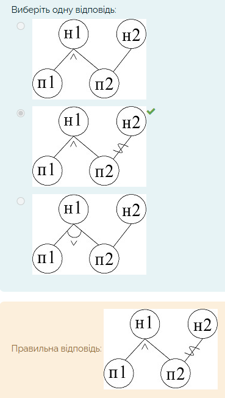  
> **Опис зображення:** Наведено 3 варіанти діаграм причинно-наслідкових зв'язків:  
> - **Варіант 1:** п1 і п2 з'єднані через кон'юнкцію `^` до н1; ребро від п2 до н2 пряме (без інверсії).  
> - **Варіант 2 (Правильний):** п1 і п2 з'єднані через кон'юнкцію `^` до н1; на ребрі від п2 до н2 присутня тильда `~` (символ заперечення / NOT).  
> - **Варіант 3:** п1 і п2 з'єднані через диз'юнкцію `v` до н1; ребро від п2 до н2 пряме.

**Правильна відповідь:**  
* **Варіант 2: діаграма з кон'юнкцією `^` до н1 та тильдою `~` (заперечення) на зв'язку від п2 до н2**  
*(Обґрунтування: Лекція 4, Розділ 4: «Метод функціональних діаграм причин-наслідків / Cause-Effect Graphing». Умова «стаж ТА англійська -> співбесіда» реалізується кон'юнкцією `^` між п1 і п2 до н1. Умова «НЕМАЄ знання англійської -> відмова» вимагає інверсії причини п2, що на графі позначається тильдою `~` на лінії зв'язку до н2).*

---

### Питання 2
**Текст питання:**  
Тестові набори у методі функціональних діаграм визначаються для

**Варіанти відповідей:**
* кожного наслідку
* кожножної причини
* усіх можливих комбінацій причин

**Правильна відповідь:**  
* **кожного наслідку**  
*(Обґрунтування: Лекція 4, Розділ 4: у методі Cause-Effect Graphing граф конвертується в таблицю рішень шляхом послідовного трасування від кожного наслідку (встановлюючи наслідок у 1) до комбінацій причин, що його спричиняють. Це дозволяє уникнути повного комбінаторного перебору всіх можливих $2^N$ станів).*

---

### Питання 3
**Текст питання:**  
На функціональній діаграмі пряма лінія між вершинами графу позначає

**Варіанти відповідей:**
* кон’юнкцію (причина 1 і причина 2 породжують...)
* тотожність (причина породжує наслідок)
* заперечення

**Правильна відповідь:**  
* **тотожність (причина породжує наслідок)**  
*(Обґрунтування: Лекція 4, Розділ 4: пряма стрілка або лінія між причиною та наслідком без додаткових позначок означає відношення тотожності (Identity: якщо умова активна, то наслідок настає)).*

---

### Питання 4
**Текст питання:**  
У функціональній діаграмі вершинами є

**Варіанти відповідей:**
* комбінації причин,які впливають на результат
* значення вхідних даних
* причини, які впливають на результат

**Правильна відповідь:**  
* **причини, які впливають на результат**  
*(Обґрунтування: Лекція 4, Розділ 4: вершинами булевого графа причинно-наслідкових зв'язків є виділені атомарні причини (вхідні ситуації/умови) та наслідки. Самі комбінації задаються ребрами та дугами з логічними зв'язками).*

---

### Питання 5
**Текст питання:**  
Приведену діаграму можна описати як  

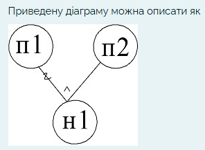  
> **Опис зображення:** На графі показано дві причини (п1, п2) та один наслідок (н1). До н1 веде дуга кон'юнкції з позначкою `^` («ТА»). На гілці від причини п1 до н1 нанесено тильду `~` (символ заперечення). Гілка від причини п2 до н1 є прямою без інверсії.

**Варіанти відповідей:**
* причина 1 та причина 2 призводять до наслідку 1
* відсутність причина 1 та причина 2 призводять до наслідку 1
* причина 1 або відсутність причини 2 призводять до наслідку 1

**Правильна відповідь:**  
* **відсутність причина 1 та причина 2 призводять до наслідку 1**  
*(Обґрунтування: Лекція 4, Розділ 4: дуга `^` задає кон'юнкцію («ТА»), а хвиляста лінія / тильда `~` на лінії від п1 позначає інверсію (відсутність або заперечення причини 1). Формула: `н1 = (¬п1) ∧ п2`).*

---

### Питання 6
**Текст питання:**  
При тестуванні за допомогою класів еквівалентності необхідно і достатньо з кожного класу виконати тести у кількості

**Варіанти відповідей:**
* рівній кількості класам еквівалентості
* 1
* 2
* визначеній стратегією тестування

**Правильна відповідь:**  
* **1**  
*(Обґрунтування: Лекція 4, Розділ 1: «Еквівалентне розбиття». За фундаментальним принципом методу, усі значення всередині одного еквівалентного класу обробляються програмою однаково, тому необхідно і достатньо обрати рівно одне представницьке значення — 1 тест з кожного класу).*

---

### Питання 7
**Текст питання:**  
Функція приймає параметр цілого типу кількість студентів. Його значення - від 16 (не включаючи). Для тестування методом аналізу граничних умов на вхід слід подати значення

**Варіанти відповідей:**
* 15, 16, 17
* 15, 17
* 16

**Правильна відповідь:**  
* **15, 16, 17**  
*(Обґрунтування: Лекція 4, Розділ 2: «Метод аналізу граничних значень (BVA)». Для цілочисельної межі (в даному випадку 16) перевіряються 3 критичні точки: сама границя, на одиницю менше та на одиницю більше ($min-1, min, min+1$), тобто 15, 16 та 17).*

---

### Питання 8
**Текст питання:**  
Приведену діаграму можна описати як  

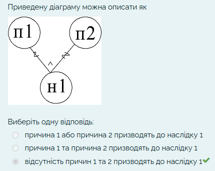  
> **Опис зображення:** На графі дві причини (п1, п2) сходяться до одного наслідку (н1) через дугу кон'юнкції `^` («ТА»). При цьому на обох вхідних гілках (як від п1, так і від п2) нанесено позначки інверсії (тильди `~`).

**Варіанти відповідей:**
* причина 1 або причина 2 призводять до наслідку 1
* причина 1 та причина 2 призводять до наслідку 1
* відсутність причин 1 та 2 призводять до наслідку 1

**Правильна відповідь:**  
* **відсутність причин 1 та 2 призводять до наслідку 1**  
*(Обґрунтування: Лекція 4, Розділ 4: дуга `^` позначає логічне «ТА», а тильди `~` на гілках від п1 та п2 вказують на інверсію/заперечення обох умов. Формула: `н1 = (¬п1) ∧ (¬п2)`).*

---

### Питання 9
**Текст питання:**  
На функціональній діаграмі для позначення умов та їх комбінацій використовують такі позначки:  
*(Виберіть одну або декілька відповідей)*

**Варіанти відповідей:**
* рівність
* тотожність
* дискретність
* диз’юнкція

**Правильні відповіді (2 варіанти):**  
* **тотожність**
* **диз’юнкція**  
*(Обґрунтування: Лекція 4, Розділ 4: базовими зв'язками функціональних діаграм є тотожність (пряма лінія), диз'юнкція (`v`), кон'юнкція (`^`) та заперечення (`~`). Терміни «рівність» та «дискретність» у нотації Cause-Effect Graphing відсутні).*

---

### Питання 10
**Текст питання:**  
Метод тестування, що передбачає формування списку можливих помилок, називається

**Варіанти відповідей:**
* еквівалентних розбиттів
* функціональних діаграм
* припущення про помилку

**Правильна відповідь:**  
* **припущення про помилку**  
*(Обґрунтування: Лекція 4, Розділ 3: «Метод припущення про помилку / Error Guessing». Суть методики полягає у складанні на основі інтуїції, досвіду тестувальника та специфікації переліку потенційних дефектів, ризикових ситуацій або помилкових даних для їх цілеспрямованої перевірки).*

---

### Питання 11
**Текст питання:**  
“Заперечення” присутнє на діаграмах  
*(Виберіть одну або декілька відповідей)*

**Варіанти відповідей:**  
Чотири графічні варіанти діаграм функціональних зв'язків.

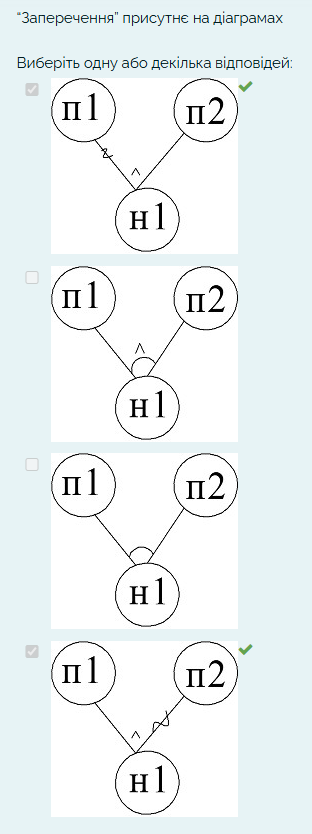  
> **Опис зображення:** Наведено 4 варіанти діаграм:  
> - **Варіант 1 (Правильний):** дві причини (п1, п2) сходяться до н1 через кон'юнкцію `^`. На ребрі від причини **п1** нанесено позначку інверсії (тильду `~`).  
> - **Варіант 2:** причини п1 і п2 сходяться до н1 через кон'юнкцію `^` з дугою, тильди відсутні.  
> - **Варіант 3:** причини п1 і п2 сходяться до н1 через дугу, тильди відсутні.  
> - **Варіант 4 (Правильний):** дві причини (п1, п2) сходяться до н1 через кон'юнкцію `^`. На ребрі від причини **п2** нанесено позначку інверсії (тильду `~`).

**Правильні відповіді (2 варіанти):**  
* **Варіант 1 (перша діаграма з тильдою «~» на зв'язку від п1)**
* **Варіант 4 (четверта діаграма з тильдою «~» на зв'язку від п2)**  
*(Обґрунтування: Лекція 4, Розділ 4: у функціональних діаграмах причин-наслідків операція заперечення (NOT) графічно позначається хвилястою лінією / тильдою `~`, нанесеною безпосередньо на лінію причинно-наслідкового зв'язку).*

---

### Питання 12
**Текст питання:**  
До методів тестування чорною скринькою належать  
*(Виберіть одну або декілька відповідей)*

**Варіанти відповідей:**
* припущення про помилку
* еквівалентні розбиття
* діаграми виконання
* комбінаторне покриття умов

**Правильні відповіді (2 варіанти):**  
* **припущення про помилку**
* **еквівалентні розбиття**  
*(Обґрунтування: Лекція 4, Розділ 4.1: класичними техніками проектування тестів за методом чорної скриньки є еквівалентне розбиття, аналіз граничних значень, припущення про помилку та функціональні діаграми. «Комбінаторне покриття умов» належить до білої скриньки, а варіант «діаграми виконання» не є методом тест-дизайну).*

---

### Питання 13
**Текст питання:**  
У функціональній діаграмі вершинами є

**Варіанти відповідей:**
* значення вихідних і вихідних даних
* реакції (наслідки)
* комбінації причин, які впливають на результат

**Правильна відповідь:**  
* **реакції (наслідки)**  
*(Обґрунтування: Лекція 4, Розділ 4: вершинами булевого графа причинно-наслідкових зв'язків є виділені атомарні причини (вхідні умови/події) та наслідки (вихідні реакції системи). Значення даних та логічні комбінації вершинами не є).*

---

### Питання 14
**Текст питання:**  
Процес перевірки коректності окремого модуля називається

**Варіанти відповідей:**
* section-тестування
* стрес-тестування
* unit-тестування

**Правильна відповідь:**  
* **unit-тестування**  
*(Обґрунтування: Лекція 2 та Лекція 7: тестування окремого функціонального об'єкта, класу або модуля ізольовано від решти компонентів системи називається модульним або unit-тестуванням).*

---

### Питання 15
**Текст питання:**  
Сполучення “і” присутнє на діаграмах  
*(Виберіть одну або декілька відповідей)*

**Варіанти відповідей:**  
Чотири графічні варіанти діаграм функціональних зв'язків.

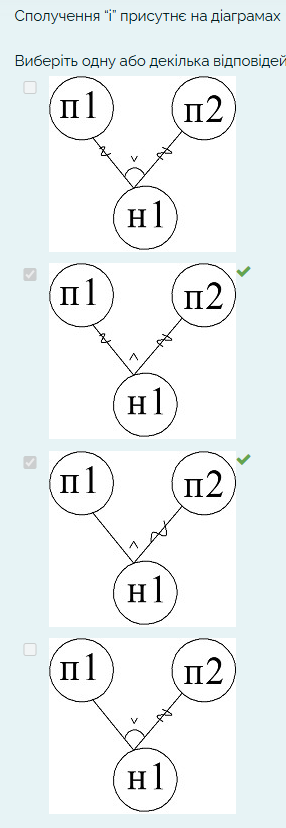  
> **Опис зображення:** Наведено 4 варіанти діаграм:  
> - **Варіант 1:** між гілками присутня дуга з символом `v` (позначає логічне «АБО» / диз'юнкцію).  
> - **Варіант 2 (Правильний):** між гілками присутній символ `^` (позначає логічне «І» / кон'юнкцію), на гілках є тильди заперечення.  
> - **Варіант 3 (Правильний):** між гілками присутній символ `^` (позначає логічне «І» / кон'юнкцію), на одній гілці є тильда заперечення.  
> - **Варіант 4:** між гілками присутня дуга з символом `v` (позначає логічне «АБО» / диз'юнкцію).

**Правильні відповіді (2 варіанти):**  
* **Варіант 2 (друга діаграма з символом «^»)**
* **Варіант 3 (третя діаграма з символом «^»)**  
*(Обґрунтування: Лекція 4, Розділ 4: умовні позначення функціональних діаграм — логічне сполучення «і» (кон'юнкція / AND) позначається символом `^`, тоді як символ `v` або проста дуга відповідають сполученню «або» (диз'юнкція / OR)).*

---

### Питання 16
**Текст питання:**  
Приведену діаграму можна описати як  

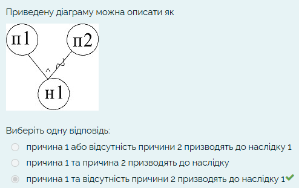  
> **Опис зображення:** На графі показано причини п1, п2 та наслідок н1. До н1 веде дуга кон'юнкції `^` («ТА»). Гілка від причини п1 є прямою (без інверсії). На гілці від причини п2 стоїть позначка інверсії (тильда `~`).

**Варіанти відповідей:**
* причина 1 або відсутність причини 2 призводять до наслідку 1
* причина 1 та причина 2 призводять до наслідку
* причина 1 та відсутність причини 2 призводять до наслідку 1

**Правильна відповідь:**  
* **причина 1 та відсутність причини 2 призводять до наслідку 1**  
*(Обґрунтування: Лекція 4, Розділ 4: пряме ребро від п1 означає наявність причини 1, символ `^` означає кон'юнкцію («ТА»), а хвиляста лінія / тильда `~` на лінії від п2 означає інверсію / відсутність причини 2. Формула: `н1 = п1 ∧ (¬п2)`).*

---

### Питання 17
**Текст питання:**  
До методів тестування чорною скринькою належать  
*(Виберіть одну або декілька відповідей)*

**Варіанти відповідей:**
* покриття умов
* аналіз граничних значень
* комбінаторне покриття умов
* функціональні діаграми

**Правильні відповіді (2 варіанти):**  
* **аналіз граничних значень**
* **функціональні діаграми**  
*(Обґрунтування: Лекція 4, Розділ 4: аналіз граничних значень (BVA) та функціональні діаграми (Cause-Effect Graphing) є базовими техніками тестування чорною скринькою. Варіанти «покриття умов» та «комбінаторне покриття умов» належать до структурного тестування білою скринькою).*

---

### Питання 18
**Текст питання:**  
Приведену діаграму можна описати як  

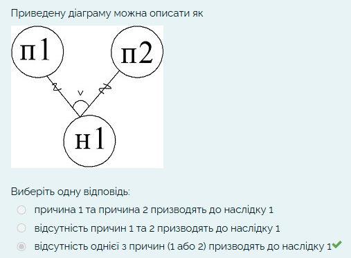  
> **Опис зображення:** На графі показано дві причини (п1, п2), що сходяться до н1 через дугу диз'юнкції з символом `v` («АБО»). На обох гілках (від п1 та від п2) присутні позначки інверсії (тильди `~`).

**Варіанти відповідей:**
* причина 1 та причина 2 призводять до наслідку 1
* відсутність причин 1 та 2 призводять до наслідку 1
* відсутність однієї з причин (1 або 2) призводять до наслідку 1

**Правильна відповідь:**  
* **відсутність однієї з причин (1 або 2) призводять до наслідку 1**  
*(Обґрунтування: Лекція 4, Розділ 4: дуга з символом `v` позначає логічне «АБО» (диз'юнкцію), а тильди `~` на обох гілках задають заперечення/відсутність кожної з причин. Формула: `н1 = (¬п1) ∨ (¬п2)`).*

---

### Питання 19
**Текст питання:**  
На функціональній діаграмі для позначення умов та їх комбінацій використовують такі позначки:  
*(Виберіть одну або декілька відповідей)*

**Варіанти відповідей:**
* рівність
* кон’юнкція
* бієктивність
* тотожність

**Правильні відповіді (2 варіанти):**  
* **кон’юнкція**
* **тотожність**  
*(Обґрунтування: Лекція 4, Розділ 4: нотація функціональних діаграм причин-наслідків включає кон'юнкцію (`^`), тотожність (пряма лінія), диз'юнкцію (`v`) та заперечення (`~`). Терміни «рівність» та «бієктивність» у цій нотації не існують).*

---

### Питання 20
**Текст питання:**  
Класи еквівалентності виділяються на основі значень множини

**Варіанти відповідей:**
* вихідних даних
* вхідних даних
* вхідних і вихідних даних

**Правильна відповідь за системою:**  
* **вхідних даних**  
*(Примітка та обґрунтування: Лекція 4, слайд 112: «Вхідний простір значень розбивається на підмножини (класи еквівалентності)». У тестовій системі правильним зараховується саме варіант «вхідних даних», попри те, що в академічній літературі класи еквівалентності іноді також виділяють і для вихідних результатів).*

---

### Питання 21
**Текст питання:**  
Діаграма, що відповідає опису “причина 1 та відсутність причини 2 призводять до наслідку 1”, має вигляд

**Варіанти відповідей:**  
Три графічні варіанти функціональних діаграм.

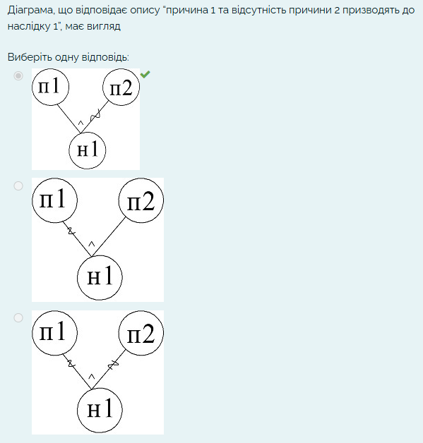  
> **Опис зображення:** Наведено 3 варіанти діаграм причинно-наслідкових зв'язків:  
> - **Варіант 1 (Правильний):** ребро від п1 пряме (наявність причини 1), на зв'язку від причини п2 нанесено тильду `~` (інверсія / відсутність причини 2), до н1 веде кон'юнкція `^` («ТА»).  
> - **Варіант 2:** ребро від п1 має тильду `~`, ребро від п2 пряме.  
> - **Варіант 3:** на обох ребрах (від п1 та від п2) нанесені тильди `~`.

**Правильна відповідь:**  
* **Варіант 1: перша діаграма (прямий зв'язок від п1, позначка «^» та тильда «~» на гілці п2)**  
*(Обґрунтування: Лекція 4, Розділ 4: пряме ребро від п1 позначає виконання причини 1, символ `^` задає логічне «ТА», а хвиляста лінія / тильда `~` на лінії від п2 позначає заперечення / відсутність причини 2. Формула: `н1 = п1 ∧ (¬п2)`).*

---

### Питання 22
**Текст питання:**  
Функція приймає параметр цілого типу кількість студентів. Його значення - від 16 (не включаючи). Для тестування слід виділити класи еквівалентності  
*(Виберіть одну або декілька відповідей)*

**Варіанти відповідей:**
* 16
* <=16
* >16
* >=16

**Правильні відповіді (2 варіанти):**  
* **<=16**
* **>16**  
*(Обґрунтування: Лекція 4, Розділ 1: «Еквівалентне розбиття». Область значень параметра ділиться на дві неперетинні підмножини: валідний клас `> 16` (значення від 16 не включаючи) та невалідний клас `<= 16` (усі значення, що не задовольняють умову специфікації)).*

---

### Питання 23
**Текст питання:**  
Модульний тест – це

**Варіанти відповідей:**
* опис очікуваних результатів роботи компонента проекту
* метод, який тестує компонент проекту
* набір вхідних і вихідних даних

**Правильна відповідь:**  
* **метод, який тестує компонент проекту**  
*(Обґрунтування: Лекція 7: «Поняття модульного тестування (Unit Testing)». У парадигмі модульного тестування (xUnit, MSTest, NUnit) модульний тест фізично реалізується як окремий тестовий метод у тестовому класі, призначений для виклику та перевірки коректності поведінки конкретного методу чи компонента проєкту).*

---

### Питання 24
**Текст питання:**  
Функція приймає рішення щодо відрахування студента. Причини: 1 - наявність більше 2 боргів, 2 - більше 200 годин пропусків. Наслідки: 1 - відрахування, 2 - навчання. Студент відрахований, якщо виконується хоча б одна з причин, інакше - навчання. Функціональна діаграма матиме вигляд

**Варіанти відповідей:**  
Три графічні варіанти діаграм функціональних зв'язків.

> [!IMPORTANT]
> **Файли для перегляду в папці `img/`:**
> - 📄 [answer_lab2_q24_options.png](file:///c:/Users/User/Desktop/якість%20пз/Тесты/img/answer_lab2_q24_options.png) — скріншот усіх 3 варіантів у тесті з червоною позначкою помилки.
> - 📄 [answer_lab2_q24_correct.png](file:///c:/Users/User/Desktop/якість%20пз/Тесты/img/answer_lab2_q24_correct.png) — точний скріншот системи з правильною відповіддю.

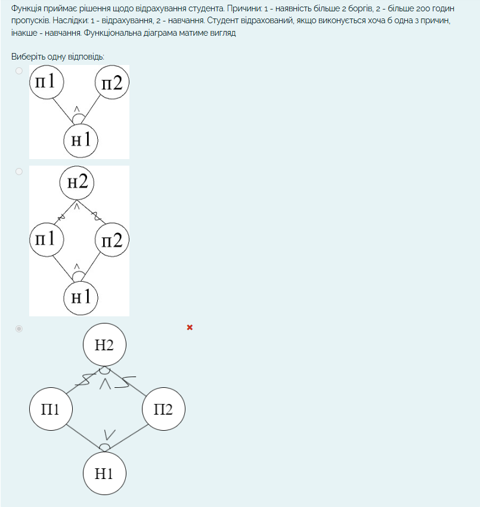  
> **Опис варіантів у тесті:**  
> - **Варіант 1 (зверху):** лише вузол н1 з кон'юнкцією `^`, наслідок н2 відсутній.  
> - **Варіант 2 (посередині, ПРАВИЛЬНИЙ ЗА СИСТЕМОЮ):** ромбоподібна діаграма зі шрифтом із засічками (Serif): внизу н1 з дугою та `^`, вгорі н2 з тильдами `~` на обох гілках та позначкою `^`.  
> - **Варіант 3 (знизу):** ромбоподібна діаграма з гротескним шрифтом (Sans-serif) та позначкою `v` біля Н1. **Система позначає цей варіант як невірний!**

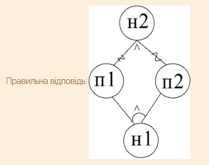  
> **Підтверджена правильна відповідь за системою:**  
> На скріншоті системи показано саме **Варіант 2** (діаграма зі шрифтом із засічками, де внизу біля н1 стоїть дуга з `^`, а вгорі біля н2 — дві тильди `~` та `^`).

**Правильна відповідь за системою:**  
* **Варіант 2 (середня діаграма, шрифт із засічками: внизу н1 з дугою та `^`, вгорі н2 з двома тильдами `~` та `^`)**  
*(Примітка: обов'язково обирайте саме Варіант 2 (середній рисунок). Незважаючи на математично-словесну логіку «хоча б одна», тестова система зараховує як правильний лише Варіант 2, а варіант 3 маркує червоним хрестиком як помилку).*

---

### Питання 25
**Текст питання:**  
Вхідний параметр деякого методу приймає значення від 3 до 5 включно. Доречним є розгляд класів еквівалентності у кількості

**Варіанти відповідей:**
* 3
* 2
* 1

**Правильна відповідь:**  
* **3**  
*(Обґрунтування: Лекція 4, Розділ 1: «Еквівалентне розбиття». Для діапазону значень $[3; 5]$ виділяється рівно 3 класи еквівалентності: 1 допустимий валідний клас $[3..5]$ та 2 недопустимих невалідних класи: менше 3 ($x < 3$) і більше 5 ($x > 5$)).*

---

### Питання 26
**Текст питання:**  
На функціональній діаграмі пряма лінія між вершинами графу позначає

**Варіанти відповідей:**
* заперечення
* тотожність (причина породжує наслідок)
* кон’юнкцію (причина 1 і причина 2 породжують...)

**Правильна відповідь:**  
* **тотожність (причина породжує наслідок)**  
*(Обґрунтування: Лекція 4, Розділ 4: «Метод функціональних діаграм». Пряма стрілка/лінія між причиною та наслідком позначає відношення тотожності (Identity): $C_1 \rightarrow E_1$ (якщо причина активна, наслідок настає безпосередньо)).*

---

### Питання 27
**Текст питання:**  
Тестові набори у методі функціональних діаграм визначаються для

**Варіанти відповідей:**
* кожного наслідку
* кожножної причини
* усіх можливих комбінацій причин

**Правильна відповідь:**  
* **кожного наслідку**  
*(Обґрунтування: Лекція 4, Розділ 4: метод Cause-Effect Graphing фокусується на наслідках (реакціях системи). Тести проектуються зворотним трасуванням від кожного наслідку до комбінацій причин, що забезпечує мінімальний і достатній набір тестів без комбінаторного вибуху $2^N$).*

---

### Питання 28
**Текст питання:**  
Вхідний параметр функції для переказу грошей - сума - приймає значення від 100 грн. За методом граничних умов слід розробити тести для суми

**Варіанти відповідей:**
* менше 100, 100, більше 100
* більше 100, 100
* більше 100
* 100

**Правильна відповідь:**  
* **менше 100, 100, більше 100**  
*(Обґрунтування: Лекція 4, Розділ 2: «Аналіз граничних значень (BVA)». Для граничної точки $100$ грн перевіряються 3 критичні значення: на самій границі ($100$), безпосередньо ліворуч/нижче границі ($< 100$) та безпосередньо праворуч/вище границі ($> 100$)).*

---

### Питання 29
**Текст питання:**  
Є функція обчислення вартості проїзду, яка приймає на вхід параметр “тип транспорту”. Параметр може набувати значення авто, автобус, поїзд. Кожне значення трактується окремо. Для тестування функції доцільно розглядати класи еквівалентності у кількост

**Варіанти відповідей:**
* 4
* 3
* 1
* 6

**Правильна відповідь:**  
* **4**  
*(Обґрунтування: Лекція 4, Розділ 1: «Еквівалентне розбиття». Для множини дискретних значень, які обробляються окремо, виділяється по 1 валідному класу для кожного значення ($3$ класи: авто, автобус, поїзд) + $1$ спільний невалідний клас для будь-якого іншого некоректного входу. Разом: $3 + 1 = 4$).*

---

### Питання 30
**Текст питання:**  
“Заперечення” присутнє на діаграмах  
*(Виберіть одну або декілька відповідей)*

**Варіанти відповідей:**  
Чотири графічні варіанти діаграм функціональних зв'язків.

> [!IMPORTANT]
> **Файл для перегляду в папці `img/`:**
> - 📄 [answer_lab2_q31.png](file:///c:/Users/User/Desktop/якість%20пз/Тесты/img/answer_lab2_q31.png) — підтверджений системою скріншот із зеленими галочками біля правильних діаграм.

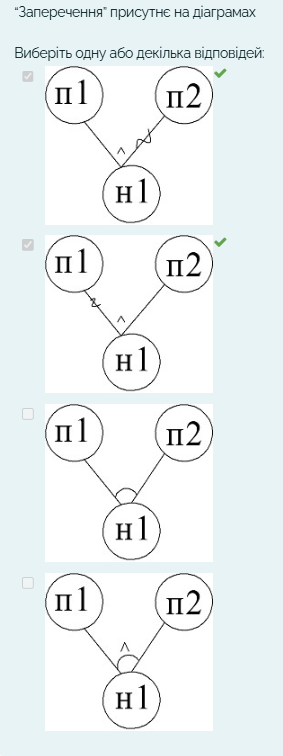  
> **Опис варіантів у тесті:**  
> - **Варіант 1 (перша зверху діаграма, ПРАВИЛЬНА):** на зв'язку від причини `п2` до наслідку `н1` нанесено тильду `~` (інверсія / заперечення).  
> - **Варіант 2 (друга зверху діаграма, ПРАВИЛЬНА):** на зв'язку від причини `п1` до наслідку `н1` нанесено тильду `~` (інверсія / заперечення).  
> - **Варіант 3 (третя діаграма):** лише дуга біля `н1` без знака заперечення.  
> - **Варіант 4 (четверта діаграма):** дуга з позначкою кон'юнкції `^` біля `н1` без тильд.

**Правильні відповіді (2 варіанти):**  
* **Варіант 1 (перша зверху діаграма: тильда «~» на лінії від п2)**
* **Варіант 2 (друга зверху діаграма: тильда «~» на лінії від п1)**  
*(Обґрунтування: Лекція 4, Розділ 4: у нотації Cause-Effect Graphing логічна операція «Заперечення» (NOT) позначається тильдою `~` (хвилястою рискою) на відповідному ребрі).*

---

### Питання 31
**Текст питання:**  
У функціональній діаграмі вершинами є  
*(Варіант питання з наслідками)*

**Варіанти відповідей:**
* реакції (наслідки)
* У функціональній діаграмі вершинами є реакції (наслідки) значення вихідних і вихідних даних комбінації причин,які впливають на результат
* значення вихідних і вихідних даних

**Правильна відповідь:**  
* **реакції (наслідки)**  
*(Обґрунтування: Лекція 4, Розділ 4: «Метод функціональних діаграм». Граф будується з двох типів вершин: атомарні вхідні умови (причини) та вихідні стани/дії системи — «реакції (наслідки)»).*

---

### Питання 32
**Текст питання:**  
Сполучення “або” присутнє на діаграмі

**Варіанти відповідей:**  
Три графічні варіанти діаграм функціональних зв'язків.

> [!IMPORTANT]
> **Файл для перегляду в папці `img/`:**
> - 📄 [answer_lab2_q33.png](file:///c:/Users/User/Desktop/якість%20пз/Тесты/img/answer_lab2_q33.png) — підтверджений системою скріншот із зеленою галочкою біля правильної діаграми.

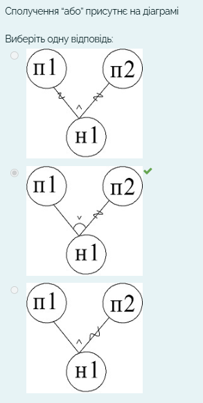  
> **Опис варіантів у тесті:**  
> - **Варіант 1 (зверху):** позначка кон'юнкції `^` біля `н1` та тильди на обох гілках.  
> - **Варіант 2 (посередині, ПРАВИЛЬНИЙ):** біля вершини `н1` зображено дугу з літерою `v` («диз'юнкція / АБО»).  
> - **Варіант 3 (знизу):** позначка кон'юнкції `^` біля `н1` та тильда на гілці `п2`.

**Правильна відповідь:**  
* **Варіант 2 (середня діаграма: біля вершини н1 дуга з позначкою «v»)**  
*(Обґрунтування: Лекція 4, Розділ 4: позначка `v` з дугою позначає диз'юнкцію — логічне сполучення «АБО»).*

---

### Питання 33
**Текст питання:**  
У функціональній діаграмі вершинами є  
*(Варіант питання з причинами)*

**Варіанти відповідей:**
* причини, які впливають на результат
* значення вхідних даних
* комбінації причин,які впливають на результат

**Правильна відповідь:**  
* **причини, які впливають на результат**  
*(Обґрунтування: Лекція 4, Розділ 4: у парадигмі Cause-Effect Graphing вершинами вхідного шару є саме «причини, які впливають на результат», а вихідного шару — «реакції (наслідки)»).*

---

### Питання 34
**Текст питання:**  
Приведену діаграму можна описати як  
*(Дзеркальний варіант до питання 21)*

> [!IMPORTANT]
> **Файл для перегляду в папці `img/`:**
> - 📄 [answer_lab2_q34.png](file:///c:/Users/User/Desktop/якість%20пз/Тесты/img/answer_lab2_q34.png) — підтверджений системою скріншот із зеленою галочкою біля правильної відповіді.

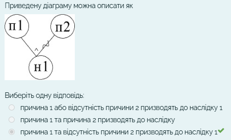  
> **Опис зображення:** На діаграмі зображено дві причини (`п1` та `п2`), що сходяться до наслідку `н1`. Біля вершини `н1` нанесено позначку кон'юнкції `^` («ТА»), на зв'язку від причини `п2` присутня позначка інверсії / заперечення (тильда `~`), а лінія від `п1` пряма без позначок (тотожність).

**Варіанти відповідей:**
* причина 1 або відсутність причини 2 призводять до наслідку 1
* причина 1 та причина 2 призводять до наслідку
* причина 1 та відсутність причини 2 призводять до наслідку 1

**Правильна відповідь:**  
* **причина 1 та відсутність причини 2 призводять до наслідку 1**  
*(Обґрунтування: Лекція 4, Розділ 4: пряма лінія від `п1` відповідає наявності причини 1; символ `^` задає кон'юнкцію «ТА»; хвиляста лінія / тильда `~` на лінії від `п2` позначає заперечення / відсутність причини 2. Формула: `н1 = п1 ∧ ¬п2`).*

---

### Питання 35
**Текст питання:**  
Процес перевірки коректності окремого модуля називається

**Варіанти відповідей:**
* unit-тестування
* стрес-тестування
* section-тестування

**Правильна відповідь:**  
* **unit-тестування**  
*(Обґрунтування: Лекція 7: «Поняття модульного тестування (Unit Testing)». Модульне тестування (Unit Testing) є процесом ізольованої перевірки коректності функціонування окремих складових частин — модулів, класів, методів програми).*

---

## 🏁 Кінець тестів: Лабораторна робота № 2


